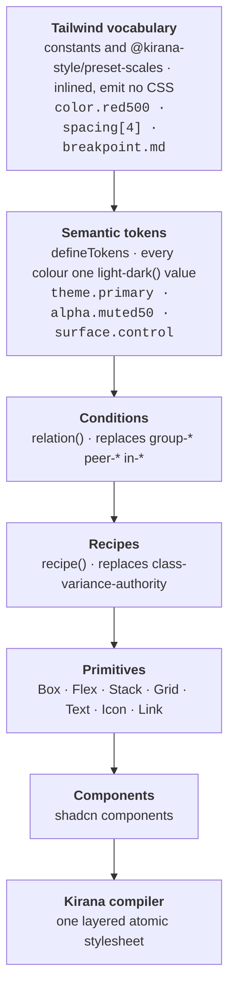

# shadcn/ui on Kirana

A TanStack Start monorepo with the shadcn/ui component set rebuilt on **Kirana**,
this repository's own compile-time styling system, and a design system layered on
top of it that keeps Tailwind's vocabulary and Panda's ideas about tokens and
recipes.

> **Kirana is the compiler, Panda is the inspiration for the API, and Tailwind is
> the vocabulary.**

There is no Tailwind, no StyleX, no `cn`, no `class-variance-authority`, and no
`dark:` variant anywhere in the codebase. Every style is compiled to layered
atomic CSS at build time by a Rust engine.



## Documentation

Start at [`docs/README.md`](docs/README.md). The four documents there cover the
design system:

| Document                                                  | What it answers                                                |
| --------------------------------------------------------- | -------------------------------------------------------------- |
| [architecture.md](docs/architecture.md)                   | How it is layered, and why each decision went that way         |
| [porting-from-tailwind.md](docs/porting-from-tailwind.md) | The mental shift, the utility-by-utility mapping, the pitfalls |
| [catalogue.md](docs/catalogue.md)                         | What already exists, so you do not rebuild it                  |
| [workflows.md](docs/workflows.md)                         | Adding a component, removing one, verifying a port             |

The compiler, its packages and its specification are in
[kirana-style/kirana](https://github.com/kirana-style/kirana).

## Layout

```
apps/web                  the demo page (:3000)
apps/blocks               shadcn blocks: dashboard, sidebars, login, signup, preview cards (:3001)
apps/examples             one page per component (:3002)
packages/shell            the app shell blocks and examples share
packages/vite-config      the Vite + Kirana config every app uses
packages/ui/src
├── tokens/               Layer 1 — Tailwind scales as constants
├── theme/                Layer 2–3 — semantic tokens, relations, context tokens, keyframes
├── recipes/              Layer 4 — variant tables, shared component chrome
├── primitives/           Layer 5 — Box, Flex, Stack, Grid, Text, Icon, Link
├── components/           Layer 6 — the shadcn components
└── styles/globals.css    the only hand-written CSS: a structural reset
```

Dependency versions used by more than one workspace are pinned once, in the Bun
catalog in the root `package.json`, and referenced as `"catalog:"`. Anything a
single workspace uses is versioned in that workspace alone.

## Using components

```tsx
import { Button } from "@workspace/ui/components/button"
import { Stack, Text } from "@workspace/ui/primitives"
```

Components take an `sx` prop instead of `className`, applied last so a caller can
always override:

```tsx
const styles = { pushEnd: css({ marginInlineStart: "auto" }) }

<Button variant="outline" size="sm" sx={styles.pushEnd}>
  Save
</Button>
```

Plain elements take `sx` too; the compiler turns it into `className`, merged with
the element's own. An array composes several styles, and later entries win:

```tsx
<div sx={[styles.row, isActive && styles.active, sx]} />
```

## Theming

Every colour token is one `light-dark(<light>, <dark>)` value. `ThemeProvider`
sets `color-scheme` on `<html>` for the three modes through Kirana's `mode`
handles: `light dark` for system, which follows the OS with no JavaScript, so the
first paint is already correct, and `light` or `dark` to pin one. It needs
Chrome 123, Safari 17.5 or Firefox 120.

```tsx
import { ThemeProvider, useTheme } from "@workspace/ui/theme/theme-provider"
```

## Getting started

### 1. Install the prerequisites (once)

| Tool          | Why                                                       | Install                                                           |
| ------------- | --------------------------------------------------------- | ----------------------------------------------------------------- |
| Bun 1.4.2     | package manager and script runner                         | https://bun.com/docs/installation                                 |
| Rust (rustup) | the Kirana engine is Rust, built before any app           | `curl --proto '=https' --tlsv1.2 -sSf https://sh.rustup.rs \| sh` |
| A C linker    | Rust links the native engine with it                      | Linux/WSL: `build-essential` · macOS: `xcode-select --install`    |
| Cargo tools   | only for `kirana:check`, `kirana:test`, `kirana:coverage` | `cargo install --locked cargo-nextest cargo-deny cargo-llvm-cov`  |
| Chromium      | only for `kirana:conformance`                             | `cd packages/kirana && bunx playwright install chromium`          |

The Rust version is pinned in `packages/kirana/rust-toolchain.toml`; rustup
downloads it the first time a command needs it. The scripts find cargo in
`~/.cargo/bin` even when your terminal has not loaded `~/.cargo/env`.

### 2. Install dependencies

```bash
bun install
```

Run it again whenever `bun.lock` changes (after a pull or a branch switch).

### 3. Run the apps

```bash
bun dev          # demo :3000, blocks :3001, examples :3002
```

`bun dev` runs Turbo, which first builds the native engine
(`packages/kirana/npm/compiler/kirana.<platform>.node`, the `@kirana-style/compiler`
build) and then starts the app. The first run compiles the Rust workspace and
takes a few minutes; later runs reuse Turbo's cache until a file in
`packages/kirana/crates` changes.

### 4. Build for production

```bash
bun run build                      # native engine, then every app → apps/*/dist
cd apps/web && bunx vite preview   # serve one build on http://localhost:4173
```

The build prints every compiler diagnostic as `file:line:column`; it must report
0 errors.

## Scripts

Every command runs from the repository root. **Needs** is what must have run
first.

| Command                      | What it does                                                                | Needs                                                  |
| ---------------------------- | --------------------------------------------------------------------------- | ------------------------------------------------------ |
| `bun install`                | installs every workspace                                                    | Bun                                                    |
| `bun dev`                    | builds the native engine, then serves the three apps with hot reload        | `bun install`, Rust                                    |
| `bun run build`              | builds the native engine, then every app into `dist/`                       | `bun install`, Rust                                    |
| `bun run check`              | oxlint, oxfmt check, TypeScript typecheck                                   | `bun install`                                          |
| `bun run format`             | rewrites files with oxfmt                                                   | `bun install`                                          |
| `bun run kirana:build`       | builds only the native engine (release)                                     | `bun install`, Rust                                    |
| `bun run kirana:check`       | `cargo fmt`, Clippy, `cargo deny`, Rust tests, typecheck, Vitest            | `bun run kirana:build`, cargo-nextest, cargo-deny      |
| `bun run kirana:test`        | Rust tests and Vitest; `KIRANA_UPDATE_FIXTURES=1` rewrites golden fixtures  | `bun run kirana:build`, cargo-nextest                  |
| `bun run kirana:coverage`    | the same tests with coverage; fails below 100 % (Rust regions too)          | `bun install`, cargo-nextest, cargo-llvm-cov           |

When a Rust tool is missing, the command stops and prints the line that installs
it.

### Troubleshooting

| Symptom                                                         | Fix                                                               |
| --------------------------------------------------------------- | ----------------------------------------------------------------- |
| `Kirana needs Rust, and cargo was not found`                    | install rustup (above), then open a new terminal                  |
| `Internal Error: cargo metadata failed to run`                  | cargo is not reachable: install rustup, or `. "$HOME/.cargo/env"` |
| `Cannot find module '…/kirana.<platform>.node'`                 | `bun run kirana:build`                                            |
| `This command needs cargo-nextest …`                            | run the `cargo install` line it prints                            |
| `bun dev` starts on :3001 or later                              | another server holds :3000; stop it (`lsof -i :3000` shows which) |
| `lockfile had changes, but lockfile is frozen` / missing module | `bun install`                                                     |
| Turbo keeps a stale engine                                      | `bun run clean`, then rebuild                                     |
| A `default_*.profraw` file appears                              | coverage output from an instrumented binary; ignored, delete it   |
| `Kirana has no engine` from `bun run lint`                      | `bun run kirana:build`                                            |

## Editor, lint and brand-logo tooling

### Lint

`bun run lint` (part of `bun run check`) runs oxlint with Kirana's own rules,
`@kirana-style/eslint-plugin`, loaded from source through `jsPlugins` in
`.oxlintrc.json`. The rules read the compiler, so **build the native engine
first** (`bun run kirana:build`, or any `bun run build`); without it every file
reports `Kirana has no engine`. The examples and the editor extensions are
excluded. How another project sets the plugin up under Oxlint or ESLint is on the
docs page `/docs/tooling/lint`.

### The language server in VS Code, Cursor, Windsurf or Antigravity

The extension lives in `packages/kirana/editors/vscode` and starts the project's
own `kirana lsp`. It is not on a marketplace yet, so build and install it by hand:

```bash
bun run kirana:build                                   # the engine the server runs
(cd packages/kirana/editors/vscode && bun run package) # writes kirana.vsix
```

Then, in the editor: **Extensions: Install from VSIX…** and pick
`packages/kirana/editors/vscode/kirana.vsix` — or from a terminal:

```bash
code --install-extension packages/kirana/editors/vscode/kirana.vsix --force
antigravity --install-extension packages/kirana/editors/vscode/kirana.vsix --force   # if its CLI is on PATH
```

This repository has no `node_modules/.bin/kirana`, so `.vscode/settings.json`
points the extension at the compiler entry instead:

```json
{
  "kirana.server.path": "packages/kirana/npm/compiler/bin/kirana.ts",
  "kirana.trace.server": "verbose"
}
```

- **After changing the extension:** package again, install with `--force` (or
  uninstall the old one first), then **Developer: Reload Window**.
- **After changing the compiler:** `bun run kirana:build`, then **Kirana: Restart
  Language Server**.
- **WSL, SSH or a container:** install the `.vsix` on the remote side (the
  Extensions view offers "Install in WSL"), where the project and Node.js live.
- **Without installing:** `bun run build` in the extension's folder, then
  `code --extensionDevelopmentPath="$PWD/packages/kirana/editors/vscode" .`
- **What it says:** the **Kirana** output channel, with `kirana.trace.server` set
  to `verbose`.

The extension's end-to-end test downloads VS Code and runs it headless against a
fixture project: `(cd packages/kirana/editors/vscode && bun run test:e2e)`.

### Zed, Neovim and Helix

Zed: **zed: install dev extension** and pick `packages/kirana/editors/zed`
(it builds the WebAssembly itself; `rustup target add wasm32-wasip2` once).
Neovim and Helix need only configuration, on the docs page `/docs/tooling/editor`.

### Brand logos (svgl.app)

The docs show product logos from [SVGL](https://svgl.app), kept in the repository
so nothing is fetched at runtime, in dev, in builds or in CI:

- `packages/docs-ui/src/brands/*.svg` — the files, and `manifest.json`, what was
  fetched;
- `apps/docs/src/generated/svgl-icons.gen.ts` — the `SVGL` map, each logo a Vite
  asset import (`?url`).

To add a logo, add its slug and SVGL title to `NEEDED` in
`apps/docs/scripts/generate-svgl.ts` (search the title at
`https://api.svgl.app?search=<name>`), then:

```bash
(cd apps/docs && bun run generate:svgl)   # downloads the files and rewrites the map
```

Use it as `<BrandIcon icon={SVGL.name} />` (`@workspace/docs-ui/brand-icon.tsx`).
A logo with light and dark files follows the site's theme switch, not the
operating system's. `bun run verify:generated` (in `apps/docs`) checks the map
against the manifest offline. webpack, Helix and StyleX are not on SVGL.

## Adding a component

`bunx shadcn add` no longer applies, because its output is Tailwind. Take the
upstream component as a reference for structure and behaviour, then write the
styles against this design system. The process is in
[docs/workflows.md](docs/workflows.md) and the mapping table in
[docs/porting-from-tailwind.md](docs/porting-from-tailwind.md) is most of the
work.
