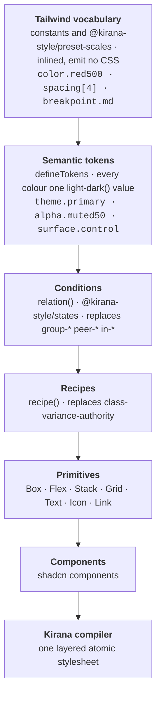

# shadcn/ui on Kirana

The shadcn/ui component set, its blocks and its examples, rebuilt on
[Kirana](https://github.com/kirana-style/kirana), a compile-time styling system,
with a design system layered on top that keeps Tailwind's vocabulary and Panda's
ideas about tokens and recipes. It is becoming the site and registry at
`ui.kirana.style`; today it is three apps and the components they share.

> **Kirana is the compiler, Panda is the inspiration for the API, and Tailwind is
> the vocabulary.**

There is no Tailwind, no StyleX, no `cn`, no `class-variance-authority`, and no
`dark:` variant anywhere in the codebase. Every style is compiled to layered
atomic CSS at build time by Kirana's Rust engine, installed from npm.



## Documentation

Start at [`docs/README.md`](docs/README.md). The four documents there cover the
design system:

| Document                                                  | What it answers                                                |
| --------------------------------------------------------- | -------------------------------------------------------------- |
| [architecture.md](docs/architecture.md)                   | How it is layered, and why each decision went that way         |
| [porting-from-tailwind.md](docs/porting-from-tailwind.md) | The mental shift, the utility-by-utility mapping, the pitfalls |
| [catalogue.md](docs/catalogue.md)                         | What already exists, so you do not rebuild it                  |
| [workflows.md](docs/workflows.md)                         | Adding a component, removing one, verifying a port             |

The compiler, its packages and its specification are in
[kirana-style/kirana](https://github.com/kirana-style/kirana).

## Layout

```
apps/web                  the demo page (:3000), deployed as the Cloudflare Worker `ui`
apps/blocks               shadcn blocks: dashboard, sidebars, login, signup, preview cards (:3001)
apps/examples             one page per component (:3002)
packages/shell            the app shell blocks and examples share
packages/vite-config      the Vite + Kirana (+ Cloudflare) config every app uses
packages/ui/src
├── tokens/               Layer 1 — Tailwind scales as constants
├── theme/                Layer 2–3 — semantic tokens, relations, context tokens, keyframes
├── recipes/              Layer 4 — variant tables, shared component chrome
├── primitives/           Layer 5 — Box, Flex, Stack, Grid, Text, Icon, Link
├── components/           Layer 6 — the shadcn components
└── styles/globals.css    the only hand-written CSS: a structural reset
scripts/                  use-kirana.ts (moves the Kirana version), check-licenses.ts
```

Every `@kirana-style/*` package and the `kirana-style` CLI are pinned to one
exact version in the Bun catalog in the root `package.json`, and move together
with `bun scripts/use-kirana.ts <version | latest>`. Other versions used by more
than one workspace are pinned once in the same catalog and referenced as
`"catalog:"`; anything a single workspace uses is versioned in that workspace
alone.

## Using components

```tsx
import { Button } from "@workspace/ui/components/button"
import { Stack, Text } from "@workspace/ui/primitives"
```

Components take an `sx` prop instead of `className`, applied last so a caller can
always override:

```tsx
const styles = { pushEnd: css({ marginInlineStart: "auto" }) }

<Button variant="outline" size="sm" sx={styles.pushEnd}>
  Save
</Button>
```

Plain elements take `sx` too; the compiler turns it into `className`, merged with
the element's own. An array composes several styles, and later entries win:

```tsx
<div sx={[styles.row, isActive && styles.active, sx]} />
```

## Theming

Every colour token is one `light-dark(<light>, <dark>)` value. `ThemeProvider`
sets `color-scheme` on `<html>` for the three modes through Kirana's `mode`
handles: `light dark` for system, which follows the OS with no JavaScript, so the
first paint is already correct, and `light` or `dark` to pin one. Given a
`cookie` name, it keeps the choice across reloads and tabs. It needs Chrome 123,
Safari 17.5 or Firefox 120.

```tsx
import { ThemeProvider, useTheme } from "@workspace/ui/theme/theme-provider"
```

## Getting started

### 1. Install the prerequisites (once)

[Vite+](https://viteplus.dev) (`vp`) runs everything: it installs the Node.js
version in `.node-version` and the Bun version in `package.json`'s
`packageManager`, so nothing else is needed.

```bash
curl -fsSL https://vite.plus | bash
```

Then open a new terminal. Without the global CLI, `bunx vp …` runs the
workspace's copy. Kirana's engine is a prebuilt package for your platform; there
is no Rust to install.

### 2. Install dependencies

```bash
vp install
```

Run it again whenever `bun.lock` changes (after a pull or a branch switch). It
also installs the git hooks: formatting and lint on commit, `vp run prepush` on
push.

### 3. Run the apps

```bash
vp run dev       # demo :3000, blocks :3001, examples :3002
```

The demo runs inside workerd, the runtime Cloudflare uses, so a Node-only API
fails here rather than after deploying.

### 4. Build for production

```bash
vp run build                         # every app → apps/*/dist
cd apps/web && bun run preview       # the built demo as its Worker, on http://localhost:8787
```

The build prints every compiler diagnostic as `file:line:column`; it must report
0 errors.

## Commands

Every command runs from the repository root.

| Command                                            | What it does                                                                                                |
| -------------------------------------------------- | ----------------------------------------------------------------------------------------------------------- |
| `vp install`                                       | installs every workspace and the git hooks                                                                  |
| `vp run dev`                                       | the three apps with hot reload                                                                              |
| `vp run build`                                     | every app into `dist/`; prints Kirana's diagnostics                                                         |
| `vp run check`                                     | Oxfmt, Oxlint with the Kirana rules, TypeScript (tsgolint)                                                  |
| `vp check --fix`                                   | the same, fixing what can be fixed                                                                          |
| `vp run licenses`                                  | every installed package's licence against `scripts/check-licenses.ts`                                       |
| `vp run prepush`                                   | what the pre-push hook and CI run: check, licences, build                                                   |
| `bun scripts/use-kirana.ts 0.3.1`                  | pins every Kirana package to one release (`latest` for npm's latest), then `vp install`                     |
| `bunx kirana-style check <paths>`                  | every Kirana diagnostic with its source line, from an app's folder (it reads that app's `kirana.config.ts`) |
| `bunx kirana-style trace <file>:<line> <property>` | which entry wins for a property, and why                                                                    |
| `vp cache clean`                                   | forgets the task cache                                                                                      |

Skip the hooks once with `VP_GIT_HOOKS=0 git commit …` (CI still runs
everything).

### Troubleshooting

| Symptom                                                         | Fix                                                               |
| --------------------------------------------------------------- | ----------------------------------------------------------------- |
| `vp: command not found`                                         | install Vite+ (above) and open a new terminal, or use `bunx vp`   |
| `lockfile had changes, but lockfile is frozen` / missing module | `vp install`                                                      |
| `vp run dev` starts the demo on :3001 or later                  | another server holds :3000; stop it (`lsof -i :3000` shows which) |
| A task replays a stale result                                   | `vp cache clean`, and add the missing path to the task's `input`  |
| `defineTokens() ran without being compiled` in the demo         | a Kirana library was pre-bundled; see `packages/vite-config`      |

## Editor

The Kirana extension (`kirana-style.kirana` on the VS Code Marketplace and Open
VSX) shows what a style compiles to on hover, a summary after each `sx`, the
compiler's diagnostics as you type, and which entry wins. It runs this project's
own `node_modules/.bin/kirana-style lsp`, so the editor and the build use the
same engine. Zed, Neovim and Helix are covered in Kirana's editor docs. Oxfmt and
Oxlint run through the Oxc extension, which reads the root `vite.config.ts`.

## Deployment

`apps/web` is the Cloudflare Worker `ui`, served at
`ui.kirana-style.workers.dev` until `ui.kirana.style` is attached.
`.github/workflows/site.yml` deploys every push to `main` and uploads a preview
version, `pr-<number>-ui.<subdomain>.workers.dev`, for every pull request from a
branch of this repository.

## Adding a component

`bunx shadcn add` does not apply yet, because its output is Tailwind. Take the
upstream component as a reference for structure and behaviour, then write the
styles against this design system; `bunx kirana-style migrate tailwind` drafts
the style objects from class strings. The process is in
[docs/workflows.md](docs/workflows.md) and the mapping table in
[docs/porting-from-tailwind.md](docs/porting-from-tailwind.md) is most of the
work.

## Licence

MIT, for the Kirana authors' work. The components, blocks and examples are
ported from [shadcn/ui](https://github.com/shadcn-ui/ui), MIT, Copyright (c)
2023 shadcn; its notice is in [`LICENSE`](LICENSE). This project is not
affiliated with or endorsed by shadcn/ui.
