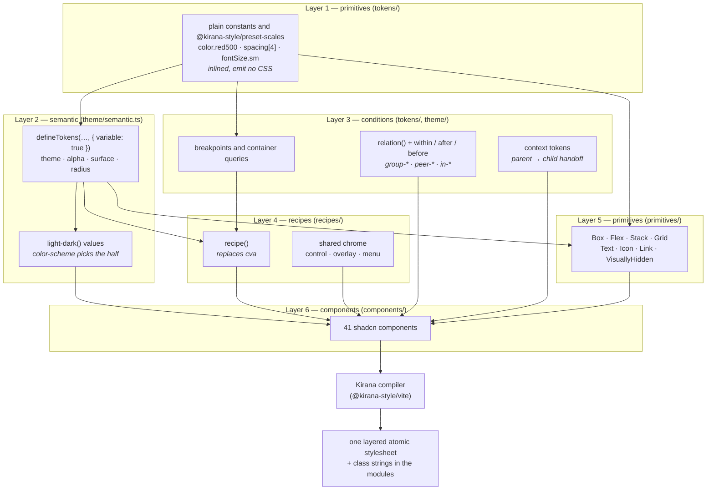
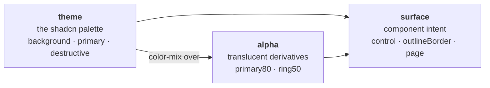
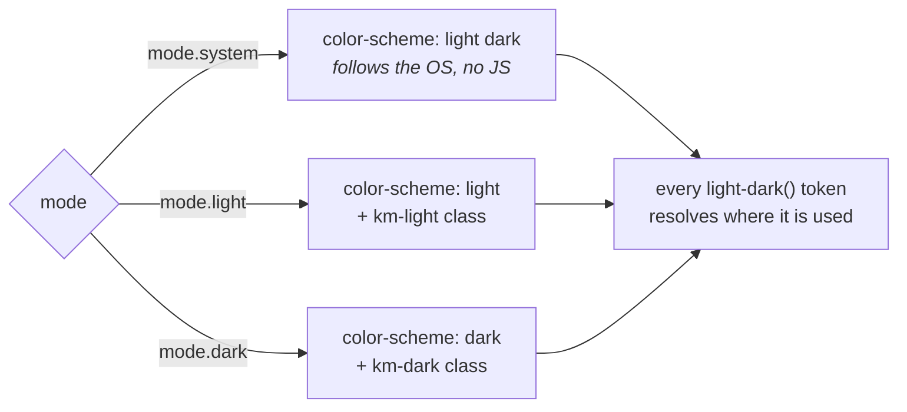
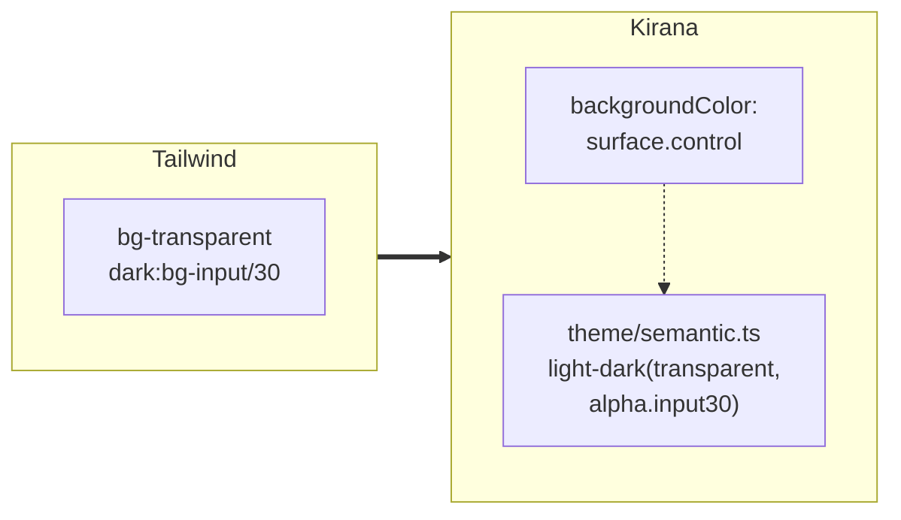
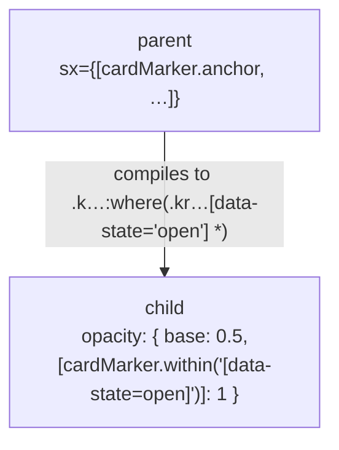
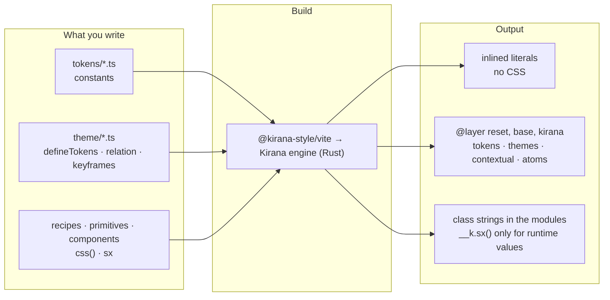

# Architecture

## The shape of it



Kirana is the styling compiler, installed from npm (`@kirana-style/*`); its
source, specification and decision log are in the
[kirana repository](https://github.com/kirana-style/kirana/blob/main/README.md) (`spec/`). This document covers the design
system built on it.

## Why each layer is the way it is

### Primitives are constants, not variables

The full Tailwind palette is 290 colours. As custom properties that is dead
weight on every page. A plain constant is inlined wherever a style uses it and
emits nothing, so the entire Tailwind vocabulary costs zero bytes until something
references it.

Kirana decides a token's representation from its definition alone
([tokens, themes and presets](https://github.com/kirana-style/kirana/blob/main/spec/07-tokens-themes-presets.md)):

| Written                                          | Compiles to                                            |
| ------------------------------------------------ | ------------------------------------------------------ |
| `export const spacing = { 4: "1rem" } as const`  | the literal, inlined                                   |
| `defineTokens("space", { 4: "1rem" })`           | the literal, inlined (a typed, namespaced token group) |
| `defineTokens("theme", {…}, { variable: true })` | one custom property per token on `:root`               |

The rule that falls out:

> **`variable: true` only for values something must reassign: a theme, a parent
> handing a value to a child, or a derived token that must stay unresolved.
> Everything else is a constant.**

Spacing, blur and shadows re-export `@kirana-style/preset-scales`, the Tailwind-compatible
scale package generated from Tailwind's own `theme.css`. The other scale files keep
this design system's own values (rounded line-height ratios, shadcn's `3xl`
breakpoint, named z-index layers).

### Semantic tokens come in three groups



**`theme`** is the shadcn palette, one-for-one with the old `--background` set.

**`alpha`** replaces Tailwind's `bg-primary/80` slash syntax. Each entry is a
`color-mix` over a `theme` variable rather than a baked colour, so it follows the
mode. Only the combinations actually used are defined — adding an opacity is a
design decision, not something to do inline.

**`surface`** is the reason there is no `dark:` variant anywhere in the codebase.
See below.

### Light and dark are one value, not three themes

Every colour token is written once, as `light-dark(<light>, <dark>)`:

```ts
export const theme = defineTokens(
  "theme",
  { background: "light-dark(oklch(1 0 0), oklch(0.145 0 0))" /* … */ },
  { variable: true }
)
```

The mode is the root element's `color-scheme`, set from ThemeProvider's mode
through Kirana's `mode` handles:



`light-dark()` and `color-mix()` stay unresolved inside the custom property and
are computed on the element that uses them, against that element's
`color-scheme`, so derived tokens follow the mode for free.

It goes on `<html>`, not `<body>`. The root element's scheme is what the browser
uses for the page's own scrollbars and canvas; with the scheme on the body, an
iframe got light scrollbars in dark mode and an opaque light backdrop.

Three surface tokens are not colours — a blend mode, a brightness factor, a
filter — and `light-dark()` only takes colours. They are mode tokens,
`{ light, dark }` objects, which Kirana compiles to a custom property declared for
`prefers-color-scheme` and again under the `km-light` / `km-dark` classes the mode
handles add. The mode handle on `<html>` is the whole theme.

The cost is a browser floor: `light-dark()` needs Chrome 123, Safari 17.5 and
Firefox 120. That is Kirana's default target floor, so the output stays native.

### `surface` exists because `dark:` was doing two different jobs

shadcn used `dark:` for more than swapping a colour. A form control is
_transparent_ in light mode and a _translucent fill_ in dark. An outline button
borrows `border` in light and `input` in dark. Those are structural differences:
re-pointing the palette underneath cannot express them. So each one became a
named token with two values:



The component says what it means, and the light/dark decision lives in one
reviewable value instead of being reconstructed from `dark:` utilities at forty
call sites.

### Contextual relationships go through relations

Tailwind's `group-*`, `peer-*` and `in-*` became Kirana relations. A relation is
the direct analogue of the `group` class, and a named relation of `group/name`.
Plain `has-*` needs none: it is a `":has(…)"` key.



| Tailwind           | Kirana                           | Anchor sits on      |
| ------------------ | -------------------------------- | ------------------- |
| `group-*` / `in-*` | `rel.within(sel)`                | the ancestor        |
| `peer-*`           | `rel.after(sel)`                 | the earlier sibling |
| (reversed peer)    | `rel.before(sel)`                | the later sibling   |
| `has-*`            | a `":has(sel)"` key, no relation | —                   |
| `group-has-*`      | `rel.within(":has(sel)")`        | the ancestor        |

**The anchor always sits on the element whose state is read.** The compiler
checks it: a read whose anchor is applied nowhere is `relation-without-anchor`, an
anchor nobody reads is `relation-unused`, and in one JSX tree a `within` reader
with the anchor beside it rather than above it is `relation-placement`. The StyleX
port needed a hand-written script for these after 36 of its relationship rules
compiled and never matched.

### Contextual styles lose to own styles

A parent can style a descendant with `select.descendant("svg")`. Those rules live
in a lower layer than every element's own styles, so a child's own style always
wins — which is what Tailwind's `[&_svg:not([class*='size-'])]` guard was faking.
`packages/ui` still prefers handing a value down (`ctx.iconSize` read by the `Icon`
primitive): the contract is a named token rather than a selector reaching into
markup. The registry cannot: once installed, a control's icons are the project's
own icon library's components, which shadcn/ui's CLI puts in place of the
placeholder, or icons the project adds itself, and none of them reads a token. So
each registry control sets `ctx.iconSize` and sizes every `svg` inside it to it
(`controlIcons` in `registry/styles/control.ts`). Controls nest, a button in a
menu row: each sets the variable and every one sizes its `svg`s to it, so an icon
takes the nearest control's size.

## Merging and precedence

Kirana merges styles into a table keyed by **(target, longhand, condition set)**.
A single-component box shorthand (`padding: spacing[4]`, `gap`, `borderColor`)
stays one CSS rule — a _shorthand atom_ — but merges as if it were its
longhands: a later `paddingTop` still overrides one side, and removing a side
keeps the others ([shorthand atoms](https://github.com/kirana-style/kirana/blob/main/packages/kirana/design-notes/shorthand-atoms.md)). A later
style replaces only the entries it names:

| Written later                         | Effect                                                   |
| ------------------------------------- | -------------------------------------------------------- |
| `borderColor: x`                      | replaces the base entry; `:hover`, `:focus` entries stay |
| `borderColor: { ":hover": x }`        | replaces that entry only                                 |
| `borderColor: { base: null }`         | removes the base entry                                   |
| `borderColor: null`                   | removes every entry of the property                      |
| `borderColor: { "*": null, base: x }` | removes the rest, keeps only what is listed              |

When two entries can match one element, one global ladder decides: more
conditions win; then attribute > pseudo-class > relation > at-rule; then order
within a class (a larger `min-width` wins, `:disabled` beats `:hover`); then the
declaration that set fewer longhands. `kirana trace <file>:<line> <property>`
prints the entries and the step that ordered each pair. Every rule has
specificity (0,1,0) and lives in a cascade layer, so nothing depends on insertion
order or selector weight.

## What came from where

| Idea                                                                 | Source                          |
| -------------------------------------------------------------------- | ------------------------------- |
| Token names, scales, breakpoints, the whole vocabulary               | Tailwind                        |
| Semantic token names (`primary`, `muted`, `destructive`, `sidebar*`) | shadcn                          |
| Component structure, variant names, `data-slot` convention           | shadcn                          |
| Primitive / semantic token split, recipes as a concept               | Panda                           |
| Atomic compilation, `sx`, typed style objects                        | StyleX, carried into Kirana     |
| Merge table, ladder, relations with validation, the compiler itself  | Kirana                          |
| `surface` intent tokens                                              | this project, forced by `dark:` |

## Decisions worth knowing about

**Everything takes `sx`, not `className`.** Under Tailwind every component took
`className` and merged with `cn`, which had to understand Tailwind's utility
families. Kirana merges by longhand and condition, so a caller's override is
unambiguous. The one name covers both kinds of element:

| Written                                        | What happens                                                                                                                 |
| ---------------------------------------------- | ---------------------------------------------------------------------------------------------------------------------------- |
| `<div sx={[styles.a, sx]} />`                  | Compiled to `className` (and `style` for runtime values), merged with the element's own `className`, `style` and spreads     |
| `<Button sx={styles.a} />`                     | A plain prop the component forwards to its root                                                                              |
| `<Menu.Popup {...styleProps(styles.a, sx)} />` | For components from installed packages, which do not know `sx`. Writing `sx` there is the `sx-on-external-component` warning |

`sx` compiles in any module; nothing has to be imported for it.

**The global stylesheet names no tokens.** `styles/globals.css` is a structural
reset plus a few rules for markup no component owns — a chart library's SVG, the
children a Field lays out, the links a caller writes in an alert. Kirana hashes
its variable names, so there is nothing stable for plain CSS to reference;
anything theme-dependent is applied with `sx` starting at `<html>`, and where a
global rule needs a colour, the component hands it down as a plain custom
property. Tailwind's reset gave every element `border-color: var(--border)`; that
implicit default is deliberately gone.

**One package, internal layers.** Token and relation identities hash from the
package name plus the namespace and key, never the file path, so files can move
freely. The same group name in two packages is two sets of properties: the
registry's `theme` and `packages/ui`'s `theme` never collide.

**The design system is a set of attributes on `<html>`.** Being rebuilt in
`registry/` (its README has the details). Every customization axis is an
attribute (`data-style`, `data-base-color`, `data-theme`, `data-radius` …), and
every value of every axis is compiled into the stylesheet ahead of time, so
choosing a design changes attributes and never writes CSS: Kirana makes no rules
at runtime. Colours, fonts and the radius are variable tokens reassigned under
conditions on `<html>`; the visual styles are conditions components read through
a relation anchored there. It replaces shadcn/ui's approach of a `<style>` element
of custom properties and a class per style on `<body>`. What a project installs is
the same code with one design flattened into it.

**A component's look is a style module, written once for every style and every
base.** `registry/styles/<component>.styles.ts` holds the `css()` handles a
component's parts use, separate from the component, which is written per
framework and base. Nova, the default style, is the base value of each property;
Vega, Lyra and Maia add an `axes.style.*` entry only where they differ. Where the
base value has a state or a breakpoint entry and a style's differs, the style
restates the entry under its own condition: a pseudo-class or an attribute outranks
a relation read, so the Nova entry would otherwise win in that state. States are
written once for every base with `when(state, value)` (`registry/core/states.ts`),
which spreads Base UI's, React Aria's and Ark UI's key for it; a component is built
on one base, so only that base's attributes ever appear on it, and
`registry/core/kirana.ts` tells Kirana so (`conditions.exclusive`) for the states
two bases name differently. A condition that needs two states, such as a side
during the first frame, is written per base, never as one `when()` inside
another. It replaces shadcn/ui's `cn-*` class per part and its copy of each rule in
every style's stylesheet. Popups move with transitions, which reverse mid-flight;
Ark UI keeps a popup mounted only for an animation, so on Ark the same fade and
zoom are keyframes on its `data-state`.

**Markup is written per framework and base, and holds no style values.**
`registry/bases/react-base`, `react-aria` and `vue-ark` each hold their copy of a
component, applying the same style modules: `sx` on elements, `props()` spread
on a library's part. Part and prop names follow upstream's copy for that base,
so a shadcn/ui user on React Aria finds the API they know (its `Dialog` is the
modal, inside `DialogTrigger`), and every copy writes the same `data-slot`s. A
Vue component cannot receive `sx` as a prop: a caller's `:sx` reaches it as a
`class`, which Vue adds to the root's own classes instead of merging them, so
each Vue part turns attribute fallthrough off and merges its styles with the
caller's through `useStyleAttrs` (`registry/lib/vue.ts`), the same per-property
merge `sx` gets. Icons are named once for every library (`IconPlaceholder`) and
drawn from framework-neutral data, so one map serves React and Vue. In an installed
React project the placeholder is gone: shadcn/ui's CLI replaces each one with the
project's icon library's component, keeping its other attributes, and drops the
import of any module whose path holds `icon-placeholder` (hence
`registry/icons/icon-placeholder.tsx`). So a placeholder takes only what an icon
component takes: a style is spread on it as `{...props(…)}`, never given as `sx`,
which an icon library would not read.

**What a project installs is the same module, flattened, and Kirana checks it.**
`packages/builder` writes the registry (`vp run registry`): for each combination of
framework, base and style, every style module with the other styles' entries and
the other bases' state keys removed and the chosen style's merged into the base
look, as readable source. Removing a condition that always holds can change which
entry wins (a style's override outranks a breakpoint only while it is a
condition), so the builder asks Kirana, through `kirana-style trace`, which value
wins in every combination of the remaining conditions, before and after, and fails
on a difference. It reads the modules by running them with Kirana's functions
recording their arguments, and proves that reading faithful by writing each
module back unflattened and comparing Kirana's ranking with the source's. State
keys carry their base from `core/states.ts`, so a component's own attribute that
looks like another base's key is never removed. Styles that merge are flattened
merged: a recipe's variant merges over its base entry by entry, and on the site a
style's entry in the base outranks the variant's plain one, which it no longer
does once its condition is removed. So a variant is written as what it changes
in the flattened base, and the check compares the flattened base and variant
merged, as the installed recipe merges them. The items speak shadcn/ui's schema
and are validated with its own.

**Kirana's own CLI installs the registry; shadcn/ui's CLI works from an export.**
The registry's source of truth will be one item per component, holding its style
module as written (every style) and its markup per framework and base.
`kirana-style ui` (Kirana's CLI, from the `@kirana-style/registry` package)
installs it into React, Vue, Svelte, Solid or Angular projects, flattened for the
project's own design at install, checked by the compiler, recorded in a lockfile
for `diff` and `update`, and re-flattened when the design changes. The same
format serves anyone who publishes a registry of their own. shadcn/ui's CLI could
not be the installer: `shadcn init` refuses a project without Tailwind, with no
way to skip the check; `components.json` is a strict schema with no room for a
framework, a base or a design; and without flattening at install, every item
would ship once per combination of framework, base and style.

So the builder also writes an export for it: React only, each combination
flattened ahead. `shadcn add @kirana/<item>` installs from it into a Vite, React
and Kirana project with no Tailwind, and its import, icon and `"use client"`
transforms apply as they do to upstream's items. Installed this way, every React
combination of the slice builds, type-checks, and renders the computed styles of
the site's preview pages, value for value. The project's `components.json` comes
from this site (`shadcn add` installs a design-system item's files and packages
but does not merge its configuration), and what no item can do is left to
`kirana-style init` and the app's entry: Kirana's plugin and configuration
(spreading the design system's `registryConfig`, with the `reset` layer), the
stylesheet, the reset, the font, and the design system's classes on `<html>` and
`<body>`. The export stays while it costs nothing to keep.

**A preview is the item alone, in the design its URL names, on every framework.**
`/preview/react/<base>/<item>` is a route of the site, rendered by the Worker
with the design's attributes already on `<html>`; `/preview/vue/ark/<item>` is a
page of the Vue preview app, built into the same Worker's static files, since a
Vue component cannot render inside the React site. Both read the same query and
take the same message (`registry/core/preview.ts`): upstream's `?preset=` and
`design-system-params`, so shadcn/ui's customizer and ours can drive either, and
the conformance harness can open one item and preset on both sites. A change of
design changes attributes and the URL, never CSS.

## The build setup

`packages/vite-config` exports `defineAppConfig()`; each app's `vite.config.ts` is
two lines. The Kirana plugin runs ahead of the framework plugins so modules reach
them already compiled.

Everything else is in the app's `kirana.config.ts`:

- `layers: { before: ["reset", "base"] }` places the hand-written reset below every
  Kirana rule. The stylesheet begins with `@layer reset, base, kirana;`, the same in
  development and production.
- Targets default to the `light-dark()` floor (Chrome 123, Safari 17.5, Firefox
  120). Colours are never rewritten at that floor.

The root route links `@kirana-style/core/stylesheet.css?url` first, so its layer
statement fixes the order before `globals.css` loads. In development the plugin
serves the live stylesheet with CSS hot updates; in a build it writes the finished
stylesheet into that asset, renamed by content hash.



Server rendering needs nothing extra: compiled modules contain class strings and
a pure 1 kB merge runtime, and the stylesheet is an ordinary asset.
