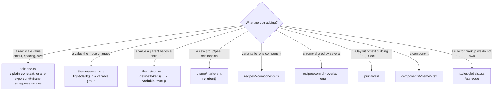

# Catalogue

What already exists. Check here before writing a new token, recipe or primitive —
the point of this file is that you do not rebuild something that is already here
under a different name.

This repository carries all of `packages/ui` (61 components), `packages/shell`
and the three apps — the demo, blocks and examples — ported from a StyleX port of
the same apps (kept in kirana-lab as `baselines/stylex`).

## Where things live



`packages/ui/kirana.config.ts` exports `uiConfig` (from `src/kirana.ts`) for tools
run inside the package — the lint plugin, `kirana check`, the language server.
Apps spread the same object into their own configuration.

## Layer 1 — tokens (constants, emit no CSS)

| File             | Exports                                                                     | Notes                                                                                                                                                                                                                        |
| ---------------- | --------------------------------------------------------------------------- | ---------------------------------------------------------------------------------------------------------------------------------------------------------------------------------------------------------------------------- |
| `colors.ts`      | `color`                                                                     | The full Tailwind 4.3 palette, 26 hues × 11 steps, in oklch. `color.red500`                                                                                                                                                  |
| `spacing.ts`     | `spacing`                                                                   | Re-exports `space` from `@kirana-style/preset-scales`. `spacing[4]`, `spacing["2.5"]`                                                                                                                                        |
| `typography.ts`  | `fontFamily` `fontSize` `lineHeight` `fontWeight` `letterSpacing` `leading` | `fontSize.sm` pairs with `lineHeight.sm` — always set both. Ratios are stored rounded up; see the file                                                                                                                       |
| `shadows.ts`     | `shadow`                                                                    | Re-exports `@kirana-style/preset-scales`. `shadow.sm` … `shadow.2xl`                                                                                                                                                         |
| `blur.ts`        | `blur`                                                                      | Re-exports `@kirana-style/preset-scales`. Lengths for `blur(${blur.xs})`. `backdrop-blur-xs` is 4px, not 2px                                                                                                                 |
| `breakpoints.ts` | `breakpoint` `screen` `pointer`                                             | `breakpoint.md` is a condition key; `screen.md` is the raw width. `3xl` (100rem) is shadcn's addition, not Tailwind's. `pointer.coarse` is a touch screen                                                                    |
| `container.ts`   | `container` `containerName` `fieldGroupQuery` `cardHeaderQuery`             | Named container queries                                                                                                                                                                                                      |
| `motion.ts`      | `duration` `easing` `motion`                                                | `easing.inOut` for transitions. `easing.cssOut` for ported `animate-*` keyframes. `easing.cssEase` for overlay enter/exit. `duration[2000]` and `easing.pulse` exist for `animate-pulse`, which is 2 s on a curve of its own |
| `z-index.ts`     | `zIndex`                                                                    | Named layers: `base` … `toast`. `overlay` and `popover` are both 50, as shadcn's `z-50`                                                                                                                                      |
| `ring.ts`        | `ring`                                                                      | `ring.width`                                                                                                                                                                                                                 |
| `scroll-fade.ts` | `scrollFadeVars`                                                            | A registered custom property (`syntax: "<length-percentage>"`), so the fade can animate; read by `scrollFadeStyles`                                                                                                          |

`@kirana-style/preset-scales` also has `duration`, `easing` and `zIndex` in Tailwind's
own steps; this package keeps its own named versions above.

## Layer 2 — semantic (variable tokens)

All in `theme/semantic.ts`, each group `defineTokens(…, { variable: true })`.
Every colour is one `light-dark(<light>, <dark>)` value; the `color-scheme` on
`<html>` decides which half applies.

| Group     | For                                                 | Example                                         |
| --------- | --------------------------------------------------- | ----------------------------------------------- |
| `theme`   | The shadcn palette                                  | `theme.primary`, `theme.mutedForeground`        |
| `alpha`   | Translucent derivatives of `theme`                  | `alpha.ring50`, `alpha.destructive20`           |
| `surface` | Component intent that differs structurally per mode | `surface.control`, `surface.inactiveForeground` |
| `radius`  | The derived roundness scale                         | `radius.lg`                                     |

Three `surface` tokens are not colours (`imageRingBlend`, `imageBrightness`,
`imageDim`) and are written as mode objects, `{ light, dark }`. `theme/themes.ts`
holds only `THEME_MODES`; ThemeProvider's `themeStyles(mode)` is Kirana's
`mode[mode]` handle, which the root route puts on `<html>`.

> **Adding a colour token** is one line: `name: "light-dark(<light>, <dark>)"`.
> A token derived from another (`color-mix` over `theme.x`, or
> `light-dark(${theme.muted}, ${theme.background})`) needs nothing more. A new
> **non-colour** per-mode token is a `{ light, dark }` object in `surface`.

## Layer 3 — conditions

**`theme/markers.ts`** — 31 relations, one per relationship that is actually read,
plus the unnamed `peer`. The `…Marker` names are kept from the StyleX port.

**`theme/button-group-marker.ts`** — `buttonGroupMarker`, on its own. A relation
read by a component an app can render **without** the anchoring one (every `Button`
reads the group; only `ButtonGroup` anchors it) gets a module of its own, imported
only by the reader and the anchor. A build checks a relation only when it compiled
the declaring module (D-062), and the import leaves with the styles that use it —
so an app that never renders the anchor never compiles the declaration. In the
shared `markers.ts`, which every app compiles, the docs app failed its build as soon
as it stopped rendering a `ButtonGroup`. `kirana check` still checks the relation
project-wide.

**`theme/scheme-marker.ts`** — `schemeMarker`, the colour mode on `<html>`: every app's
root applies its anchor with `data-mode="light" | "dark" | "system"`, and the theme
controls read it to show the mode's icon (`schemeMarker.within('[data-mode="dark"]')`).
It is for what `light-dark()` cannot switch, such as an image per scheme. On its own
for the same reason as `buttonGroupMarker`.

A relation earns its place only when some element applies its `anchor` **and**
some style reads it. The anchor goes on the element whose state is read: the
ancestor for `within`, the earlier sibling for `after`, the later sibling for
`before`. `has-*` needs no relation: use a `":has(…)"` key. The compiler reports
a read with no anchor anywhere (error) and an anchor never read (warning).

**`theme/context.ts`** — values a parent hands to a child:

| Token                 | Set by                                                       | Read by                                                                  |
| --------------------- | ------------------------------------------------------------ | ------------------------------------------------------------------------ |
| `ctx.iconSize`        | every control                                                | the `Icon` primitive                                                     |
| `ctx.cardSpacing`     | `Card`, picked by `size`                                     | its header, content, footer                                              |
| `ctx.gap`             | a layout that spaces its groups                              | the columns and nested grids inside it                                   |
| `ctx.controlPadding*` | `InputGroup`                                                 | the control inside it                                                    |
| `ctx.skeletonWidth`   | `SidebarMenuSkeleton`                                        | `Skeleton`                                                               |
| `menuCtx.*`           | a menu popup, via `menuStyles.content` or `menuStyles.glass` | its rows and separators: highlight, destructive colour, separator colour |
| `toastCtx.*`          | `Toast`                                                      | the stack transform                                                      |
| `drawerCtx.*`         | `Drawer`                                                     | the gesture transform                                                    |
| `sidebarCtx.*`        | `SidebarProvider`                                            | the sidebar's parts                                                      |
| `calendarCtx.*`       | `Calendar`                                                   | its grid                                                                 |

Assign one with the token as a key: `css({ [ctx.iconSize]: "0.875rem" })`, with
conditions like any property. Every default in `context.ts` is inert. The
component that sets a variable assigns its real value on its own element, because
a default is evaluated on `:root`: there it cannot see a library's element-level
variables.

**`theme/animations.ts`** — `animation.spin` `pulse` `caretBlink` `shimmer`, from
`keyframes()`. Use them as `animationName` from any module.

## Layer 4 — recipes

| Export                                      | From                      | Use for                                                                                           |
| ------------------------------------------- | ------------------------- | ------------------------------------------------------------------------------------------------- |
| `recipe()`                                  | `recipes/recipe.ts`       | Any variant set. The `cva` replacement (a lookup over compiled styles; see below)                 |
| `button`, `buttonRing`, `buttonLabel`       | `recipes/button.ts`       | Buttons, and anything that should look like one. `buttonLabel` trims element labels to cap height |
| `badge`, `badgeRing`                        | `recipes/badge.ts`        | Badges                                                                                            |
| `toggle`                                    | `recipes/toggle.ts`       | Toggle and ToggleGroupItem                                                                        |
| `buttonGroup`, `groupedItem`, `groupedFill` | `recipes/button-group.ts` | A control that can sit in a ButtonGroup                                                           |
| `controlStyles`                             | `recipes/control.ts`      | Anything that reads as a form field                                                               |
| `overlayStyles`                             | `recipes/overlay.ts`      | Enter/exit motion: `popup` `modal` `panel` `backdrop`                                             |
| `menuStyles`, `menuItem`                    | `recipes/menu.ts`         | Any menu-shaped popup. `content` is solid; add `glass` after it for the translucent surface       |
| `scrollFadeStyles`                          | `recipes/scroll-fade.ts`  | Fading a scroll container's trailing edge while there is more to scroll                           |
| `touchTarget`                               | `recipes/touch.ts`        | The site's own small controls: 44 × 44 px on a touch screen. Never on a ported shadcn component   |

The package's `recipe()` helper predates Kirana's own `recipe()` from
`@kirana-style/core`, which adds compound variants, slots and build-time resolution.
New recipes may use either; moving the existing ones is part of the follow-up
port.

Menus come in two surfaces, matching the originals. ContextMenu and Menubar are
solid: `accent` highlight, red destructive rows, `border` separators.
DropdownMenu, Select and Combobox are glass: `foreground/10` highlight, destructive rows in the normal text colour,
`foreground/5` separators. The rows never know which they are in; they read
`menuCtx`.

Using a recipe:

```tsx
<ButtonPrimitive
  {...styleProps(buttonRing, ...button({ variant, size }), groupedItem, sx)}
/>
```

Order matters: ring, then the recipe, then anything contextual, then `sx` last so
callers can override. On a plain element the same list goes in
`sx={[buttonRing, ...button({ variant, size }), sx]}`.

## The colour mode (`packages/shell`)

The same system as the Kirana site's. Every app's root route wires it the same way:

| Piece                                        | File                    | Does                                                                                                                         |
| -------------------------------------------- | ----------------------- | ---------------------------------------------------------------------------------------------------------------------------- |
| `THEME_COOKIE`, `readThemeMode()`            | `theme-mode.ts`         | The `kirana-theme` cookie, read in the root's `beforeLoad` on the server and in the browser                                  |
| `ThemeProvider` with `cookie={THEME_COOKIE}` | `@workspace/ui/theme/…` | Writes the cookie on a change and tells the site's other tabs (a `BroadcastChannel`)                                         |
| `themeDocumentProps(mode)`, `THEME_SCRIPT`   | `theme-document.ts`     | `<html>`'s classes and the scheme anchor; an inline script that applies the saved mode (or a frame's `?theme=`) before paint |
| `ThemeMenu`                                  | `theme-menu.tsx`        | The app shell's header control: sun or moon, opening Light, Dark and System                                                  |
| `ThemeToggle`, `useThemeHotkey`              | `theme-toggle.tsx`      | A pill stepping System, Light, Dark with the `D` key; the hotkey alone. One hotkey per page                                  |
| `headMeta`, `headLinks`, `siteTitle()`       | `head.ts`               | The Kirana mark as the icons, the manifest, `theme-color` per scheme, "Blocks · Kirana UI" titles                            |

`<html>` renders `data-mode={mode}`, `{...themeDocumentProps(mode)}` and
`suppressHydrationWarning`, with `THEME_SCRIPT` first in `<head>`: a prerendered page
hydrates in the system mode while the script has already set the saved one. A theme
control shows its mode from `data-mode` in CSS, never from React state, for the same
reason.

## The design system (`registry/core`, being built)

The customizable design system the components move to. Nothing renders from it
yet; see `registry/README.md`.

| Export                                                 | File          | For                                                                                                                  |
| ------------------------------------------------------ | ------------- | -------------------------------------------------------------------------------------------------------------------- |
| `theme` `radiusBase` `radius` `font`                   | `tokens.ts`   | The variable tokens components read. Same names as `theme/semantic.ts`; `radius.*` derive from `radiusBase.value`    |
| `root`                                                 | `root.ts`     | Applied to `<html>`: reassigns the tokens for each base colour, theme, chart colour, font and radius                 |
| `axes` (`style.*`, `menuColor.*`, `pointer`), `on`     | `axes.ts`     | `axes.*` read `<html>` through the `ui` relation, inside a property; `on.*` are conditions on `<html>` for `root.ts` |
| `AXIS_ATTRIBUTES`                                      | `axes.ts`     | The attribute each axis is written to (`data-base-color` …)                                                          |
| `AXES`, `DEFAULT_DESIGN_SYSTEM`, `resolveDesignSystem` | `config.ts`   | Every axis's values (append-only), the defaults, the rules between axes                                              |
| `encodePreset`, `decodePreset`, `readDesignSystem`     | `preset.ts`   | `k` codes, shadcn/ui's `a` and `b` codes, the design system a URL asks for                                           |
| `baseColors`, `themeColors`, `chartColors`             | `palettes.ts` | The colours, as `light-dark()` pairs; each axis owns a disjoint group of tokens                                      |
| `alpha`, `surface`                                     | `tokens.ts`   | Translucent colours (`alpha.foreground10`) and what shadcn/ui wrote with `dark:` (`surface.control`)                 |
| `ctx`, `menuCtx`                                       | `context.ts`  | Values a parent hands its children: the icon size, and the colours a menu surface gives its rows                     |
| `when`, `overlay`, `side`, `item`, `placeholder`       | `states.ts`   | Component states with each base's key; `...when(item.highlighted, x)` writes every base's                            |
| `space`, `fontSize`, `lineHeight`, `duration` …        | `scales.ts`   | The Tailwind vocabulary styles are written in (constants); `lineHeight` is rounded up so text keeps whole pixels     |
| `registryConfig`                                       | `kirana.ts`   | What every app compiling the registry spreads into its `kirana.config.ts`: the states that never hold together       |

Adding a value to an axis: append it to its list in `config.ts` (never insert or
reorder: saved codes would change meaning), add its colours or family, an `on`
condition in `axes.ts`, and its entries in `root.ts`.

## The registry's styles (`registry/styles`, being built)

Each component's look in every style, as `css()` handles its parts compose. Nova
is the base value; Vega, Lyra and Maia override per property. Nothing renders
from them yet.

| Module                    | Exports                                                                                                                          | For                                                                                    |
| ------------------------- | -------------------------------------------------------------------------------------------------------------------------------- | -------------------------------------------------------------------------------------- |
| `button.styles.ts`        | `button` (a recipe: `variant`, `size`), `buttonLabel`                                                                            | Button, and the controls drawn as one (the dialog's close)                             |
| `dialog.styles.ts`        | `dialog.overlay` `.content` `.close` `.header` `.footer` `.title` `.description`                                                 | Dialog                                                                                 |
| `select.styles.ts`        | `select.trigger` `.triggerIcon` `.value` `.content` `.list` `.group` `.item` `.itemText` `.indicator` `.scrollButton` `.empty` … | Select, over the menu parts                                                            |
| `dropdown-menu.styles.ts` | `dropdownMenu.content` `.subContent` `.subTrigger` `.subTriggerIcon`                                                             | DropdownMenu, over the menu parts                                                      |
| `menu.styles.ts`          | `menuSurface`, `menuRowBase`, `menuRowPadding`, `menuCheckableRowPadding`, `menuRowDestructive`, `menuIndicator`, `menuLabel` …  | What every menu-shaped popup shares; the menu colour axis (inverted, translucent) here |
| `overlay.styles.ts`       | `popupMotion`, `modalMotion`, `backdropMotion`, `ANCHOR_WIDTH`, `TRANSFORM_ORIGIN`                                               | How popups, modals and backdrops come and go; the positioner's variables of any base   |
| `ring.ts`                 | `focusRing`, `controlShadow`                                                                                                     | A control's focus and invalid rings, with Vega's `shadow-xs` composed under them       |

Writing one:

- name the upstream rule each part comes from (`// cn-select-trigger`) and the
  commit it was read at, and say in the header what differs on purpose;
- write Nova as `base` and each other style as `[axes.style.<name>]` inside the
  property. A state or breakpoint entry whose value differs in a style is
  restated under that style (`[SMALL]: { base: …, [vega]: … }`);
- write a state with `...when(state, value)`; a value that needs two states is a
  block per base (`overlay.styles.ts`), and a state two bases name differently is
  an exclusive pair in `kirana.ts`;
- `vp run styles` compiles the registry with its own config and fails on any
  warning.

## Layer 5 — primitives

| Component        | For                                                                                          |
| ---------------- | -------------------------------------------------------------------------------------------- |
| `Box`            | A div with padding, background, radius props                                                 |
| `Flex` / `Stack` | Rows and columns. `Stack` is a `Flex` that defaults to column                                |
| `Grid`           | Column counts, gaps, `center`                                                                |
| `Text`           | Sizes, weights, colours, `truncate`, `clamp`, `heading`                                      |
| `Icon`           | **Always** use this instead of `HugeiconsIcon`. Reads `ctx.iconSize`; stroke defaults to 2   |
| `Link`           | Inline links. Replaces `[&_a]` descendant styling                                            |
| `VisuallyHidden` | Replaces `sr-only`. Capped at 1px wide, so a vertical Field's full-width rule cannot grow it |

Props index into precompiled tables in `primitives/styles.ts`. The vocabulary is
deliberately narrow: layout and the semantic palette, nothing else. Anything more
specific belongs in a component's own `css()`, where it is named and reviewable.

## Layer 6 — components

61 files in `components/`, each taking `sx?: Sx` instead of `className`.
`lib/sx.ts` has the `Sx` type (from `@kirana-style/core`, with the React augmentation
that types `sx` on every DOM and SVG element), `WithSx`, and `mergeSx`.

> Compose with an array, `sx={[a, b, sx]}`, on elements and components alike.
> `mergeSx(a, b)` is the same thing as a call, for props built outside JSX. For a
> Base UI part or any component from an installed package, spread
> `{...styleProps(a, sx)}` (`props` from `@kirana-style/core`, imported under that name
> because components name their rest parameter `props`).

Parts that style something the caller renders take a second style prop, named
for what it reaches:

| Component                 | Prop                              | Styles                                                                                         |
| ------------------------- | --------------------------------- | ---------------------------------------------------------------------------------------------- |
| `Progress`                | `indicatorSx`                     | the filled bar it renders for you                                                              |
| `ComboboxInput`           | `inputSx`                         | the text input inside its InputGroup                                                           |
| `Calendar`                | `modifiersSx`                     | days carrying a modifier: `{ booked: { day, button } }`                                        |
| `Example` (apps/examples) | `containerSx`                     | the column around the title and card                                                           |
| `NavigationMenuLink`      | `sx={navigationMenuTriggerStyle}` | a plain link that should look like the triggers beside it                                      |
| `Sidebar`                 | `innerSx`                         | the inner panel holding the content, e.g. `flexDirection: "row"` for two side-by-side sidebars |
| `FieldSeparator`          | `contentSx`                       | the label that interrupts the line, e.g. its fill on a card                                    |

Some forms are detected rather than opted into, matching the original:
`FieldLabel` becomes a selectable card when it wraps a `Field`; a table body's
or footer's last row drops its rule; a `ToggleGroup`
joins its items at `spacing={0}` (it also accepts `1` and `2`). A `TabsTrigger`
reads its orientation and active state from Base UI and its list's variant from
context, so the line indicator needs no props. The unstyled `Collapsible` parts
keep a class another component hands them, so
`<SidebarMenuButton render={<CollapsibleTrigger />}>` still looks like the button.
`AlertIcon` renders the svg itself (`<AlertIcon icon={AlertCircleIcon} />`) and an
alert's descriptions turn destructive with the alert.

A component that forwards its props to a Base UI part or to an element must take
`sx` out of them and pass it on (`{...styleProps(a, sx)}` or `sx={[a, sx]}`): `sx`
left inside a spread reaches nothing, and the compiler reports it where the
component is used (`sx-on-external-component`).

## Global CSS

`styles/globals.css` holds what component styles do not reach, each block scoped
by the `data-slot` it serves:

| Block              | Why it is not a component style                                                                                 | Layer     |
| ------------------ | --------------------------------------------------------------------------------------------------------------- | --------- |
| Reset              | Structural defaults, Tailwind's preflight where components relied on it                                         | `reset`   |
| Recharts internals | Markup a library renders with its own class names (the chart component)                                         | `base`    |
| Inline content     | Links and paragraphs a caller writes inside an alert, an accordion panel, or a field, empty or item description | `base`    |
| Calendar day meta  | A span a custom `DayButton` renders beneath the date                                                            | `base`    |
| Sidebar label      | The plain span a caller puts last in a sidebar menu button truncates                                            | `base`    |
| Field layout       | A Field stretches whatever children it is given, over their own width — as `*:w-full` did                       | unlayered |

None of it names a token: hashed names cannot be written in plain CSS. Where a
rule needs a theme colour, the component hands it down as a plain custom
property, as `--inline-link-hover` does.
