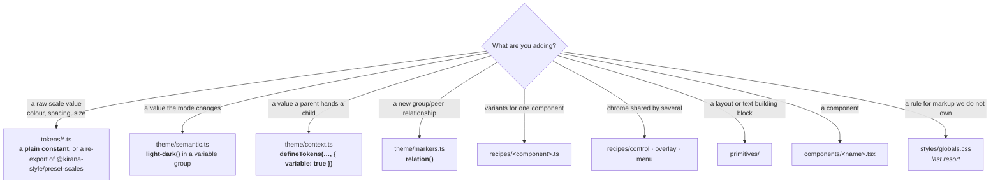

# Catalogue

What already exists. Check here before writing a new token, recipe or primitive —
the point of this file is that you do not rebuild something that is already here
under a different name.

This repository carries all of `packages/ui` (61 components), `packages/shell`
and the three apps — the demo, blocks and examples — ported from a StyleX port of
the same apps (kept in kirana-lab as `baselines/stylex`).

## Where things live



`packages/ui/kirana.config.ts` exports `uiConfig` (from `src/kirana.ts`) for tools
run inside the package — the lint plugin, `kirana check`, the language server.
Apps spread the same object into their own configuration.

## Layer 1 — tokens (constants, emit no CSS)

| File             | Exports                                                                     | Notes                                                                                                                                                                                                                        |
| ---------------- | --------------------------------------------------------------------------- | ---------------------------------------------------------------------------------------------------------------------------------------------------------------------------------------------------------------------------- |
| `colors.ts`      | `color`                                                                     | The full Tailwind 4.3 palette, 26 hues × 11 steps, in oklch. `color.red500`                                                                                                                                                  |
| `spacing.ts`     | `spacing`                                                                   | Re-exports `space` from `@kirana-style/preset-scales`. `spacing[4]`, `spacing["2.5"]`                                                                                                                                        |
| `typography.ts`  | `fontFamily` `fontSize` `lineHeight` `fontWeight` `letterSpacing` `leading` | `fontSize.sm` pairs with `lineHeight.sm` — always set both. Ratios are stored rounded up; see the file                                                                                                                       |
| `shadows.ts`     | `shadow`                                                                    | Re-exports `@kirana-style/preset-scales`. `shadow.sm` … `shadow.2xl`                                                                                                                                                         |
| `blur.ts`        | `blur`                                                                      | Re-exports `@kirana-style/preset-scales`. Lengths for `blur(${blur.xs})`. `backdrop-blur-xs` is 4px, not 2px                                                                                                                 |
| `breakpoints.ts` | `breakpoint` `screen` `pointer`                                             | `breakpoint.md` is a condition key; `screen.md` is the raw width. `3xl` (100rem) is shadcn's addition, not Tailwind's. `pointer.coarse` is a touch screen                                                                    |
| `container.ts`   | `container` `containerName` `fieldGroupQuery` `cardHeaderQuery`             | Named container queries                                                                                                                                                                                                      |
| `motion.ts`      | `duration` `easing` `motion`                                                | `easing.inOut` for transitions. `easing.cssOut` for ported `animate-*` keyframes. `easing.cssEase` for overlay enter/exit. `duration[2000]` and `easing.pulse` exist for `animate-pulse`, which is 2 s on a curve of its own |
| `z-index.ts`     | `zIndex`                                                                    | Named layers: `base` … `toast`. `overlay` and `popover` are both 50, as shadcn's `z-50`                                                                                                                                      |
| `ring.ts`        | `ring`                                                                      | `ring.width`                                                                                                                                                                                                                 |
| `scroll-fade.ts` | `scrollFadeVars`                                                            | A registered custom property (`syntax: "<length-percentage>"`), so the fade can animate; read by `scrollFadeStyles`                                                                                                          |

`@kirana-style/preset-scales` also has `duration`, `easing` and `zIndex` in Tailwind's
own steps; this package keeps its own named versions above.

## Layer 2 — semantic (variable tokens)

All in `theme/semantic.ts`, each group `defineTokens(…, { variable: true })`.
Every colour is one `light-dark(<light>, <dark>)` value; the `color-scheme` on
`<html>` decides which half applies.

| Group     | For                                                 | Example                                         |
| --------- | --------------------------------------------------- | ----------------------------------------------- |
| `theme`   | The shadcn palette                                  | `theme.primary`, `theme.mutedForeground`        |
| `alpha`   | Translucent derivatives of `theme`                  | `alpha.ring50`, `alpha.destructive20`           |
| `surface` | Component intent that differs structurally per mode | `surface.control`, `surface.inactiveForeground` |
| `radius`  | The derived roundness scale                         | `radius.lg`                                     |

Three `surface` tokens are not colours (`imageRingBlend`, `imageBrightness`,
`imageDim`) and are written as mode objects, `{ light, dark }`. `theme/themes.ts`
holds only `THEME_MODES`; ThemeProvider's `themeStyles(mode)` is Kirana's
`mode[mode]` handle, which the root route puts on `<html>`.

> **Adding a colour token** is one line: `name: "light-dark(<light>, <dark>)"`.
> A token derived from another (`color-mix` over `theme.x`, or
> `light-dark(${theme.muted}, ${theme.background})`) needs nothing more. A new
> **non-colour** per-mode token is a `{ light, dark }` object in `surface`.

## Layer 3 — conditions

**`theme/markers.ts`** — 31 relations, one per relationship that is actually read,
plus the unnamed `peer`. The `…Marker` names are kept from the StyleX port.

**`theme/button-group-marker.ts`** — `buttonGroupMarker`, on its own. A relation
read by a component an app can render **without** the anchoring one (every `Button`
reads the group; only `ButtonGroup` anchors it) gets a module of its own, imported
only by the reader and the anchor. A build checks a relation only when it compiled
the declaring module (D-062), and the import leaves with the styles that use it —
so an app that never renders the anchor never compiles the declaration. In the
shared `markers.ts`, which every app compiles, the docs app failed its build as soon
as it stopped rendering a `ButtonGroup`. `kirana check` still checks the relation
project-wide.

**`theme/scheme-marker.ts`** — `schemeMarker`, the colour mode on `<html>`: every app's
root applies its anchor with `data-mode="light" | "dark" | "system"`, and the theme
controls read it to show the mode's icon (`schemeMarker.within('[data-mode="dark"]')`).
It is for what `light-dark()` cannot switch, such as an image per scheme. On its own
for the same reason as `buttonGroupMarker`.

A relation earns its place only when some element applies its `anchor` **and**
some style reads it. The anchor goes on the element whose state is read: the
ancestor for `within`, the earlier sibling for `after`, the later sibling for
`before`. `has-*` needs no relation: use a `":has(…)"` key. The compiler reports
a read with no anchor anywhere (error) and an anchor never read (warning).

**`theme/context.ts`** — values a parent hands to a child:

| Token                 | Set by                                                       | Read by                                                                  |
| --------------------- | ------------------------------------------------------------ | ------------------------------------------------------------------------ |
| `ctx.iconSize`        | every control                                                | the `Icon` primitive                                                     |
| `ctx.cardSpacing`     | `Card`, picked by `size`                                     | its header, content, footer                                              |
| `ctx.gap`             | a layout that spaces its groups                              | the columns and nested grids inside it                                   |
| `ctx.controlPadding*` | `InputGroup`                                                 | the control inside it                                                    |
| `ctx.skeletonWidth`   | `SidebarMenuSkeleton`                                        | `Skeleton`                                                               |
| `menuCtx.*`           | a menu popup, via `menuStyles.content` or `menuStyles.glass` | its rows and separators: highlight, destructive colour, separator colour |
| `toastCtx.*`          | `Toast`                                                      | the stack transform                                                      |
| `drawerCtx.*`         | `Drawer`                                                     | the gesture transform                                                    |
| `sidebarCtx.*`        | `SidebarProvider`                                            | the sidebar's parts                                                      |
| `calendarCtx.*`       | `Calendar`                                                   | its grid                                                                 |

Assign one with the token as a key: `css({ [ctx.iconSize]: "0.875rem" })`, with
conditions like any property. Every default in `context.ts` is inert. The
component that sets a variable assigns its real value on its own element, because
a default is evaluated on `:root`: there it cannot see a library's element-level
variables.

**`theme/animations.ts`** — `animation.spin` `pulse` `caretBlink` `shimmer`, from
`keyframes()`. Use them as `animationName` from any module.

## Layer 4 — recipes

| Export                                      | From                      | Use for                                                                                           |
| ------------------------------------------- | ------------------------- | ------------------------------------------------------------------------------------------------- |
| `recipe()`                                  | `recipes/recipe.ts`       | Any variant set. The `cva` replacement (a lookup over compiled styles; see below)                 |
| `button`, `buttonRing`, `buttonLabel`       | `recipes/button.ts`       | Buttons, and anything that should look like one. `buttonLabel` trims element labels to cap height |
| `badge`, `badgeRing`                        | `recipes/badge.ts`        | Badges                                                                                            |
| `toggle`                                    | `recipes/toggle.ts`       | Toggle and ToggleGroupItem                                                                        |
| `buttonGroup`, `groupedItem`, `groupedFill` | `recipes/button-group.ts` | A control that can sit in a ButtonGroup                                                           |
| `controlStyles`                             | `recipes/control.ts`      | Anything that reads as a form field                                                               |
| `overlayStyles`                             | `recipes/overlay.ts`      | Enter/exit motion: `popup` `modal` `panel` `backdrop`                                             |
| `menuStyles`, `menuItem`                    | `recipes/menu.ts`         | Any menu-shaped popup. `content` is solid; add `glass` after it for the translucent surface       |
| `scrollFadeStyles`                          | `recipes/scroll-fade.ts`  | Fading a scroll container's trailing edge while there is more to scroll                           |
| `touchTarget`                               | `recipes/touch.ts`        | The site's own small controls: 44 × 44 px on a touch screen. Never on a ported shadcn component   |

The package's `recipe()` helper predates Kirana's own `recipe()` from
`@kirana-style/core`, which adds compound variants, slots and build-time resolution.
New recipes may use either; moving the existing ones is part of the follow-up
port.

Menus come in two surfaces, matching the originals. ContextMenu and Menubar are
solid: `accent` highlight, red destructive rows, `border` separators.
DropdownMenu, Select and Combobox are glass: `foreground/10` highlight, destructive rows in the normal text colour,
`foreground/5` separators. The rows never know which they are in; they read
`menuCtx`.

Using a recipe:

```tsx
<ButtonPrimitive
  {...styleProps(buttonRing, ...button({ variant, size }), groupedItem, sx)}
/>
```

Order matters: ring, then the recipe, then anything contextual, then `sx` last so
callers can override. On a plain element the same list goes in
`sx={[buttonRing, ...button({ variant, size }), sx]}`.

## The colour mode (`packages/shell`)

The same system as the Kirana site's. Every app's root route wires it the same way:

| Piece                                        | File                    | Does                                                                                                                         |
| -------------------------------------------- | ----------------------- | ---------------------------------------------------------------------------------------------------------------------------- |
| `THEME_COOKIE`, `readThemeMode()`            | `theme-mode.ts`         | The `kirana-theme` cookie, read in the root's `beforeLoad` on the server and in the browser                                  |
| `ThemeProvider` with `cookie={THEME_COOKIE}` | `@workspace/ui/theme/…` | Writes the cookie on a change and tells the site's other tabs (a `BroadcastChannel`)                                         |
| `themeDocumentProps(mode)`, `THEME_SCRIPT`   | `theme-document.ts`     | `<html>`'s classes and the scheme anchor; an inline script that applies the saved mode (or a frame's `?theme=`) before paint |
| `ThemeMenu`                                  | `theme-menu.tsx`        | The app shell's header control: sun or moon, opening Light, Dark and System                                                  |
| `ThemeToggle`, `useThemeHotkey`              | `theme-toggle.tsx`      | A pill stepping System, Light, Dark with the `D` key; the hotkey alone. One hotkey per page                                  |
| `headMeta`, `headLinks`, `siteTitle()`       | `head.ts`               | The Kirana mark as the icons, the manifest, `theme-color` per scheme, "Blocks · Kirana UI" titles                            |

`<html>` renders `data-mode={mode}`, `{...themeDocumentProps(mode)}` and
`suppressHydrationWarning`, with `THEME_SCRIPT` first in `<head>`: a prerendered page
hydrates in the system mode while the script has already set the saved one. A theme
control shows its mode from `data-mode` in CSS, never from React state, for the same
reason.

## The design system (`registry/core`, being built)

The customizable design system the components move to. Nothing renders from it
yet; see `registry/README.md`.

| Export                                                                                                             | File            | For                                                                                                                                                                                                                                            |
| ------------------------------------------------------------------------------------------------------------------ | --------------- | ---------------------------------------------------------------------------------------------------------------------------------------------------------------------------------------------------------------------------------------------- |
| `theme` `radiusBase` `radius` `font`                                                                               | `tokens.ts`     | The variable tokens components read. Same names as `theme/semantic.ts`; `radius.*` derive from `radiusBase.value`                                                                                                                              |
| `root`                                                                                                             | `root.ts`       | Applied to `<html>`: reassigns the tokens for each base colour, theme, chart colour, font and radius                                                                                                                                           |
| `axes` (`style.*`, `menuColor.*`, `pointer`, `mode.*`), `DARK_SCHEME`, `on`                                        | `axes.ts`       | `axes.*` read `<html>` through the `ui` relation, inside a property; `on.*` are conditions on `<html>` for `root.ts`; `axes.mode` with `DARK_SCHEME` for a value that is not a colour (a blend mode)                                           |
| `AXIS_ATTRIBUTES`, `POINTER_ATTRIBUTE`                                                                             | `attributes.ts` | The attribute each axis is written to (`data-base-color` …), with no Kirana call, so a test or a script can read it                                                                                                                            |
| `AXES`, `DEFAULT_DESIGN_SYSTEM`, `resolveDesignSystem`                                                             | `config.ts`     | Every axis's values (append-only), the defaults, the rules between axes                                                                                                                                                                        |
| `encodePreset`, `decodePreset`, `readDesignSystem`                                                                 | `preset.ts`     | `k` codes, shadcn/ui's `a` and `b` codes, the design system a URL asks for                                                                                                                                                                     |
| `baseColors`, `themeColors`, `chartColors`                                                                         | `palettes.ts`   | The colours, as `light-dark()` pairs; each axis owns a disjoint group of tokens                                                                                                                                                                |
| `alpha`, `surface`                                                                                                 | `tokens.ts`     | Translucent colours (`alpha.foreground10`) and what shadcn/ui wrote with `dark:` (`surface.control`)                                                                                                                                           |
| `ctx`, `menuCtx`, `cardCtx`, `sidebarCtx`                                                                          | `context.ts`    | Values a parent hands its children: the icon size, a menu surface's row colours, a card's rhythm, a sidebar's widths                                                                                                                           |
| `when`, `overlay`, `presence`, `side`, `item`, `tab`, `tabOrientation`, `disclosure`, `placeholder`, `orientation` | `states.ts`     | Component states with each base's key; `...when(item.highlighted, x)` writes every base's                                                                                                                                                      |
| `space`, `fontSize`, `lineHeight`, `duration` …                                                                    | `scales.ts`     | The Tailwind vocabulary styles are written in (constants); `lineHeight` is rounded up so text keeps whole pixels                                                                                                                               |
| `registryConfig`                                                                                                   | `kirana.ts`     | What every app compiling the registry spreads into its `kirana.config.ts`: the states that never hold together; it imports no module of its own, since Node loads it (`orientation` is declared there for that, and `states.ts` re-exports it) |
| `readPreviewDesign`, `readPageDesign`, `documentAttributes`, `listenForDesign` …                                   | `preview.ts`    | The preview pages' protocol: the design a URL or a framing page's message names, as attributes on `<html>`                                                                                                                                     |

Adding a value to an axis: append it to its list in `config.ts` (never insert or
reorder: saved codes would change meaning), add its colours or family, an `on`
condition in `axes.ts`, and its entries in `root.ts`.

## The registry's styles (`registry/styles`, being built)

Each component's look in every style, as `css()` handles its parts compose. Nova
is the base value; Vega, Lyra, Maia, Mira, Luma, Rhea and Sera override per
property. The markup in
`registry/bases` applies them; the Vue preview renders the `vue-ark` copy.

| Module                      | Exports                                                                                                                                                                                                                                                                                                                                       | For                                                                                                                                                                                                                                                                              |
| --------------------------- | --------------------------------------------------------------------------------------------------------------------------------------------------------------------------------------------------------------------------------------------------------------------------------------------------------------------------------------------- | -------------------------------------------------------------------------------------------------------------------------------------------------------------------------------------------------------------------------------------------------------------------------------- |
| `button.styles.ts`          | `button` (a recipe: `variant`, `size`), `buttonLabel`                                                                                                                                                                                                                                                                                         | Button, and the controls drawn as one (the dialog's close)                                                                                                                                                                                                                       |
| `dialog.styles.ts`          | `dialog.overlay` `.content` `.inner` `.close` `.header` `.footer` `.title` `.description`                                                                                                                                                                                                                                                     | Dialog (`.inner` is React Aria's `Dialog` inside its modal)                                                                                                                                                                                                                      |
| `select.styles.ts`          | `select.trigger` `.triggerIcon` `.value` `.content` `.popover` `.list` `.group` `.item` `.itemText` `.indicator` `.root` `.separator` …                                                                                                                                                                                                       | Select, over the menu parts (its separator alone ignores the pointer)                                                                                                                                                                                                            |
| `dropdown-menu.styles.ts`   | `dropdownMenu.content` `.subContent` `.subTrigger` `.subTriggerIcon`                                                                                                                                                                                                                                                                          | DropdownMenu, over the menu parts                                                                                                                                                                                                                                                |
| `menu.styles.ts`            | `menuSurface`, `menuPositioner`, `menuList`, `menuRowBase`, `menuRowPadding`, `menuCheckableRowPadding`, `menuLabel` …                                                                                                                                                                                                                        | What every menu-shaped popup shares; the menu colour axis (inverted, translucent) here                                                                                                                                                                                           |
| `overlay.styles.ts`         | `popupMotion`, `modalMotion`, `backdropMotion`, `ANCHOR_WIDTH`, `TRANSFORM_ORIGIN`                                                                                                                                                                                                                                                            | How popups, modals and backdrops come and go, on every base; the positioner's sizes                                                                                                                                                                                              |
| `card.styles.ts`            | `card.root` `.header` `.title` `.description` `.action` `.content` `.footer`, `cardScope`                                                                                                                                                                                                                                                     | Card; its rhythm is `cardCtx.spacing`                                                                                                                                                                                                                                            |
| `tabs.styles.ts`            | `tabs.root` `.list` `.listDefault` `.listLine` `.trigger` `.content`, `tabsScope`, `tabsList`                                                                                                                                                                                                                                                 | Tabs: the root's orientation and the list's variant read by the triggers; a line list's bar in `::after`                                                                                                                                                                         |
| `chart.styles.ts`           | `chart.container` `.plot` `.tooltip` … `.indicator` `.legend` …                                                                                                                                                                                                                                                                               | Chart on TanStack Charts: the container, the tooltip body and the legend (with a legend, `.withLegend` is Recharts' wrapper: the plot and the legend in a column inside the container's row); the drawing's colours are `chartTheme` (`ui/chart.tsx`)                            |
| `field.styles.ts`           | `field.set` `.legend` `.group` `.root` `.content` `.label` `.title` `.description` `.separator` `.error` …, `fieldLegend`, `fieldGroup`                                                                                                                                                                                                       | Field and its parts                                                                                                                                                                                                                                                              |
| `input.styles.ts`           | `input`                                                                                                                                                                                                                                                                                                                                       | Input                                                                                                                                                                                                                                                                            |
| `textarea.styles.ts`        | `textarea`                                                                                                                                                                                                                                                                                                                                    | Textarea: Input's field, grown to its content (`field-sizing: content`)                                                                                                                                                                                                          |
| `checkbox.styles.ts`        | `checkbox.root` `.indicator`                                                                                                                                                                                                                                                                                                                  | Checkbox, over `checkControl`; dims in a Field holding a disabled control                                                                                                                                                                                                        |
| `radio-group.styles.ts`     | `radioGroup.root` `.item` `.indicator` `.dot`                                                                                                                                                                                                                                                                                                 | Radio Group, over `checkControl`; in Luma and Rhea a checked item keeps the edge its state gives                                                                                                                                                                                 |
| `switch.styles.ts`          | `switchStyles.root` `.thumb`, `switchScope`                                                                                                                                                                                                                                                                                                   | Switch, over `checkControl`; the thumb reads the switch's size                                                                                                                                                                                                                   |
| `check.styles.ts`           | `checkControl`                                                                                                                                                                                                                                                                                                                                | What a checkbox, a radio and a switch share: edge, fill and rings over their states, read from `checkCtx`, which each control sets for its style                                                                                                                                 |
| `table.styles.ts`           | `table.container` `.root` `.header` `.body` `.footer` `.row` `.head` `.cell` `.caption` `.figcaption`, `tableBody`, `tableFooter`                                                                                                                                                                                                             | Table: a row reads whether it is the last of a body or a footer, rather than being reached from them                                                                                                                                                                             |
| `kbd.styles.ts`             | `kbd.root` `.group`                                                                                                                                                                                                                                                                                                                           | Kbd: in a tooltip's colours inside one, and an InputGroup addon's look inside an addon (it reads them, `scope.styles.ts`)                                                                                                                                                        |
| `spinner.styles.ts`         | `spinner`                                                                                                                                                                                                                                                                                                                                     | Spinner: the loader icon's size and spin, which a spinner of one's own can take too                                                                                                                                                                                              |
| `toggle.styles.ts`          | `toggle` (a recipe: `variant`, `size`), `toggleScope`, `IN_PRESSED_TOGGLE`, `IN_SELECTED_TOGGLE`, `togglePadding`                                                                                                                                                                                                                             | Toggle, and Toggle Group's items; what is inside a pressed toggle reads it                                                                                                                                                                                                       |
| `toggle-group.styles.ts`    | `toggleGroup.root` `.item`, `toggleGroupScope`                                                                                                                                                                                                                                                                                                | Toggle Group: its gap from `--gap`; joined items (`spacing={0}`) square inside, rounded at the ends, sharing borders                                                                                                                                                             |
| `native-select.styles.ts`   | `nativeSelect.wrapper` `.select` `.icon` `.option`, `nativeSelectScope`                                                                                                                                                                                                                                                                       | Native Select: the browser's select drawn as Input's field, the chevron over its end                                                                                                                                                                                             |
| `slider.styles.ts`          | `slider.root` `.control` `.track` `.range` `.rangeAria` `.thumb` `.thumbAria`, `sliderScope`                                                                                                                                                                                                                                                  | Slider: Base UI's root holds a control, React Aria's root is the control; each part reads the root's orientation                                                                                                                                                                 |
| `input-group.styles.ts`     | `inputGroup.root` `.addonScope` `.addon` (a recipe: `align`) `.button` (a recipe: `size`) `.text` `.input` `.textarea`                                                                                                                                                                                                                        | Input Group: the field around an Input or Textarea that draws none; the input reads the group for the padding beside an addon                                                                                                                                                    |
| `input-otp.styles.ts`       | `inputOtp.container` `.input` `.group` `.slot` `.caret` `.caretLine` `.separator`                                                                                                                                                                                                                                                             | Input OTP, on `input-otp`: slots joined into one field per group                                                                                                                                                                                                                 |
| `badge.styles.ts`           | `badge` (a recipe: `variant`)                                                                                                                                                                                                                                                                                                                 | Badge: a link's hover darkens it; Sera's is small spaced capitals with no box                                                                                                                                                                                                    |
| `alert.styles.ts`           | `alert.scope` `.root` (a recipe: `variant`) `.title` `.description` `.action`, `alertScope`                                                                                                                                                                                                                                                   | Alert: an icon child takes its own column; the title and description read the alert                                                                                                                                                                                              |
| `aspect-ratio.styles.ts`    | `aspectRatio`                                                                                                                                                                                                                                                                                                                                 | Aspect Ratio: its ratio from `--ratio`, which the markup sets                                                                                                                                                                                                                    |
| `empty.styles.ts`           | `empty.root` `.header` `.media` (a recipe: `variant`) `.title` `.description` `.content`                                                                                                                                                                                                                                                      | Empty: a dashed outline, its media plain or an icon tile                                                                                                                                                                                                                         |
| `item.styles.ts`            | `item.scope` `.root` (a recipe: `variant`, `size`) `.media` (a recipe: `variant`) `.content` `.title` `.description` `.actions` `.header` `.footer` `.group` `.separator`, `itemScope`                                                                                                                                                        | Item: the parts read the item's size and whether it has a description                                                                                                                                                                                                            |
| `progress.styles.ts`        | `progress.root` `.track` `.indicator` `.label` `.value`                                                                                                                                                                                                                                                                                       | Progress: the bar from Sera's hairline to Maia's `h-3`                                                                                                                                                                                                                           |
| `marker.styles.ts`          | `marker.scope` `.root` (a recipe: `variant`) `.icon` `.content`, `markerScope`                                                                                                                                                                                                                                                                | Marker: a separator draws a rule each side, its content keeping its own width                                                                                                                                                                                                    |
| `button-group.styles.ts`    | `buttonGroup.root` (a recipe: `orientation`) `.text` `.separator`                                                                                                                                                                                                                                                                             | Button Group: the parts join through `joinedInButtonGroup` (`scope.styles.ts`)                                                                                                                                                                                                   |
| `scroll-area.styles.ts`     | `scrollArea.root` `.viewport` `.native` `.scrollbar` `.thumb`                                                                                                                                                                                                                                                                                 | Scroll Area: Base UI's own scrollbar; React Aria's element scrolls with the browser's thin one                                                                                                                                                                                   |
| `popover.styles.ts`         | `popover.positioner` `.content` `.header` `.title` `.description`                                                                                                                                                                                                                                                                             | Popover: a popup (`popupMotion`) on the popover surface                                                                                                                                                                                                                          |
| `hover-card.styles.ts`      | `hoverCard.positioner` `.content`                                                                                                                                                                                                                                                                                                             | Hover Card: Base UI's PreviewCard, React Aria's PreviewTrigger and Popover                                                                                                                                                                                                       |
| `alert-dialog.styles.ts`    | `alertDialog.overlay` `.content` `.inner` `.header` `.media` `.title` `.description` `.footer`, `alertDialogScope`                                                                                                                                                                                                                            | Alert Dialog: the parts read the content's size and whether it holds a media                                                                                                                                                                                                     |
| `context-menu.styles.ts`    | `contextMenu.trigger` `.content` `.contentAria` `.subContent` `.subContentAria` `.checkableRow` `.subTrigger` `.subTriggerIcon` `.indicator`                                                                                                                                                                                                  | Context Menu: the shared menu (`menu.styles.ts`), with what is its own                                                                                                                                                                                                           |
| `drawer.styles.ts`          | `drawer.overlay` `.viewport` `.popup` `.motion` `.swipeHandle` `.content` `.header` `.footer` `.title` `.description`, `drawerScope`                                                                                                                                                                                                          | Drawer: Base UI's on both bases, placed by the custom properties it hands the popup                                                                                                                                                                                              |
| `menubar.styles.ts`         | `menubar.root` `.trigger` `.content` `.subContent` `.inset` `.label` `.separator` `.checkableRow` `.checkboxRow` `.indicator`                                                                                                                                                                                                                 | Menubar (Base UI only): DropdownMenu's parts with its own laid over them, and checkable rows whose check sits at the start                                                                                                                                                       |
| `navigation-menu.styles.ts` | `navigationMenu.root` `.list` `.item` `.trigger` `.triggerLook` `.triggerIcon` `.content` `.positioner` `.popup` `.viewport` `.link` `.indicator` `.arrow`, `navigationMenuContentScope`, `navigationMenuTriggerScope`                                                                                                                        | Navigation Menu (Base UI only): a popup that morphs between panels; `.triggerLook` is `navigationMenuTriggerStyle`                                                                                                                                                               |
| `command.styles.ts`         | `command.root` `.dialog` `.inputWrapper` `.inputGroup` `.inputIcon` `.input` `.list` `.empty` `.group` `.separator` `.item` `.itemIndicator` `.shortcut`, `commandItemScope`                                                                                                                                                                  | Command: cmdk on Base UI, React Aria's Autocomplete and Menu; restyles its InputGroup and its Dialog's content                                                                                                                                                                   |
| `combobox.styles.ts`        | `combobox.content` `.contentAria` `.list` `.listAria` `.item` `.indicator` `.label` `.empty` `.input` `.triggerOwn` `.trigger` `.triggerIcon` `.chips` `.chip` `.chipRemove` `.chipInput` `.contents`, `comboboxContentScope`, `comboboxPopupScope`                                                                                           | Combobox: the shared menu (`menu.styles.ts`) for its popup and rows, an InputGroup drawn otherwise inside its popup, and a field of chips                                                                                                                                        |
| `scroll-fade.styles.ts`     | `scrollFade`                                                                                                                                                                                                                                                                                                                                  | shadcn/ui's `scroll-fade` utility, for the examples: a scrolling region fades at an edge with more to scroll                                                                                                                                                                     |
| `scope.styles.ts`           | `tooltipScope`, `inputGroupScope`, `inputGroupAddonScope`, `dropdownMenuScope`, `IN_TOOLTIP`, `IN_INPUT_GROUP`, `IN_ADDON`, `CHILD_OF_ADDON`, `IN_BUTTON_GROUP`, `BUTTON_GROUP_CHILD`, `IN_OUTLINE_BUTTON_GROUP`, `joinedInButtonGroup`, `FOCUSED_IN_BUTTON_GROUP`                                                                            | Optional relations a component reads of another it may be installed without (Kbd of a tooltip and an input group, Item of a dropdown menu), and where a part sits in a ButtonGroup                                                                                               |
| `label.styles.ts`           | `label`                                                                                                                                                                                                                                                                                                                                       | Label, and FieldLabel under the field's own; after a checkbox, radio or switch (`controlPeer`) React Aria's dims beside a disabled one and Sera's reads as plain text                                                                                                            |
| `separator.styles.ts`       | `separator`                                                                                                                                                                                                                                                                                                                                   | Separator, on Base UI's `data-orientation` and React Aria's `aria-orientation`                                                                                                                                                                                                   |
| `sidebar.styles.ts`         | `sidebar.wrapper` `.root` `.gap` `.container` `.inner` `.rail` `.inset` `.header` `.content` `.group` … `.menuButton` (with `.menuButtonDefault` `.menuButtonSm` `.menuButtonLg` `.menuButtonOutline`) `.menuAction` `.menuSub` …, `sidebarScope`, `sidebarWrapper`, `sidebarMenuItem`, `sidebarMenuButton`, `COLLAPSED`, `WRAPPER_COLLAPSED` | Sidebar: its parts read the sidebar's collapsed state, side and variant; the inset reads it as a sibling; Maia, Luma, Rhea and Sera re-base every radius token inside the header and content                                                                                     |
| `sheet.styles.ts`           | `sheet.overlay` `.content` `.side.top` `.side.right` `.side.bottom` `.side.left` `.inner` `.close` `.header` `.footer` `.title` `.description`                                                                                                                                                                                                | Sheet: one handle per side, chosen from its `side` prop                                                                                                                                                                                                                          |
| `tooltip.styles.ts`         | `tooltip.positioner` `.content` `.arrow`                                                                                                                                                                                                                                                                                                      | Tooltip, over `popupMotion`; React Aria places its arrow from the placement                                                                                                                                                                                                      |
| `avatar.styles.ts`          | `avatar.root` `.image` `.fallback` `.fallbackAfterImage` `.badge` `.group` `.groupCount`, `avatarScope`, `avatarGroup`, `avatarImage`                                                                                                                                                                                                         | Avatar; React Aria's fallback shows only after an image that failed                                                                                                                                                                                                              |
| `breadcrumb.styles.ts`      | `breadcrumb.list` `.item` `.link` `.page` `.separator` `.ellipsis`                                                                                                                                                                                                                                                                            | Breadcrumb                                                                                                                                                                                                                                                                       |
| `skeleton.styles.ts`        | `skeleton`                                                                                                                                                                                                                                                                                                                                    | Skeleton                                                                                                                                                                                                                                                                         |
| `collapsible.styles.ts`     | `collapsibleScope`, `OPEN`                                                                                                                                                                                                                                                                                                                    | Collapsible draws nothing; what a page puts in one reads it open (`group/collapsible`)                                                                                                                                                                                           |
| `control.ts`                | `focusRing`, `laterRings`, `controlShadow`, `controlTransition`, `controlIcons`, `GROUP_MD`                                                                                                                                                                                                                                                   | What controls share: rings, Vega's `shadow-xs` under them, how colours move, icon size; `fillInField` is the width a part with its own `w-fit` takes to fill a vertical field (label, title, select trigger), here so a control needs no Field markup where a framework has none |
| `field-scope.styles.ts`     | `fieldScope`, `fieldLabelScope`, `IN_FOCUSED_CARD`, `controlPeer`, `fillInField`, `CHILD_OF_VERTICAL`, `CHILD_OF_RESPONSIVE`                                                                                                                                                                                                                  | Field's relations, optional: the field; its label, which a control inside a focused choice card reads; the checkbox, radio or switch a label after it reads (Tailwind's `peer`); and the width a part with its own `w-fit` takes as a field's child                              |
| `visually-hidden.styles.ts` | `visuallyHidden`                                                                                                                                                                                                                                                                                                                              | Text only a screen reader reaches (`sr-only`)                                                                                                                                                                                                                                    |
| `page.styles.ts`            | `page.document`, `page.body`, `page.example`, `page.narrow`                                                                                                                                                                                                                                                                                   | The colour scheme on `<html>`; the page's background, text colour and font; a demo's frame, centring it as upstream's component preview does, and the width a docs demo takes in it where upstream's preview narrows it (`*:max-w-xs`)                                           |
| `example.styles.ts`         | `example.page` `.wrapper` `.oneColumn` `.root` `.title` `.content` `.centred` `.row`                                                                                                                                                                                                                                                          | The frame upstream's examples sit in on a preview page; the site's, not installable                                                                                                                                                                                              |
| `reset.css`                 | the `reset` layer                                                                                                                                                                                                                                                                                                                             | Tailwind's preflight as far as the components rely on it; no pointer cursor                                                                                                                                                                                                      |
| `typeset.css`               | the `typeset` layer: rendered markdown in a `typeset` container (shadcn/ui's, on `--typeset-*` variables)                                                                                                                                                                                                                                     | plain CSS: its rules reach descendants by combinators; `typeset.styles.ts`'s `typeset` handle sets the variables from the tokens                                                                                                                                                 |

A chart is a TanStack Charts definition handed to `ChartContainer` with a
`ChartConfig`. The config names each series' colour by its token,
`color: theme.chart1`, where shadcn/ui's charts write `var(--chart-1)`: the
registry's tokens are custom properties Kirana names, so `--chart-1` does not
exist. A mark reads the series as upstream's does, `var(--color-desktop)`, which
the container sets. `chartTheme` gives a definition the axis, grid and palette
colours and no focus ring, as upstream's charts draw none.

Writing one:

- name the upstream rule each part comes from in a `//` comment above it
  (`// cn-select-trigger`; several hooks in one comment are fine, each written
  out in full) and the commit it was read at, and say in the header what differs
  on purpose. The upstream scan reads these comments as each hook's place, and
  `vp run upstream -- accept` refuses an item with a hook no comment names;
- write Nova as `base` and each other style as `[axes.style.<name>]` inside the
  property. A state or breakpoint entry whose value differs in a style is
  restated under that style (`[SMALL]: { base: …, [vega]: … }`). In a recipe, a
  style's entry in the base outranks a variant's plain value, so a variant
  restates the value for every style whose base entry it must beat (Button's
  `xs` sets `[sera]: "0.75rem"` for its icons, over the base's Sera `0.875rem`);
- a property only some styles set goes under each of those styles, Nova
  included, with no `base`: `backgroundColor: { [nova]: alpha.muted50 }`, not
  `{ base: alpha.muted50, [vega]: "transparent", … }`. A style that sets nothing
  then gets what the reset or inheritance gives, as upstream's does, and its
  installed code carries no dead declaration (Dialog's footer). Keep
  unconditional what a style without the property still reads: Card's footer
  rule has a width only in Nova and Lyra, but its colour in every style, since
  the reset gives an element no border colour. Compare the site before and after
  in the browser; a reset that changes no pixel can still change a computed
  value;
- upstream draws its style rules in a layer below its components' own classes:
  where both set a property, write the component's value;
- write a state with `...when(state, value)`; a value that needs two states is a
  block per base (`overlay.styles.ts`): one `when()` inside another pairs every
  base's key with every other's. Kirana leaves the pairs that never match out of
  the stylesheet, but reports each as an `unreachable-entry` info, ten for the
  popup's slide alone. Two bases' keys for one state are
  exclusive through `exclusiveAcross` in `kirana.ts`; a key written by hand,
  which no vocabulary names (React Aria's `aria-orientation`), needs a pair in
  `exclusive`;
- a part that styles itself by its parent, where upstream's parent reached in
  with `*:`, reads the parent's relation with `parent()`:
  `fieldScope.parent('[data-orientation="vertical"]')`, or `fieldGroup.parent()`
  for a group directly inside another. It ranks as a pseudo-class, so it beats a
  style's override as upstream's `*:` did; a relation's `within` means any
  ancestor, not the parent. A part of another component reads the same relation
  through `fillInField` (`field-scope.styles.ts`): `fieldScope` is declared
  `relation("field", { optional: true })` there, in a module every framework
  installs, so a select installed without Field (the Vue slice) reads it and
  never matches, where a read of a missing anchor would be an error;
- a relation's condition is the anchor's state, not the reader's:
  `tableBody.within(":last-child")` asks whether the body is the last child. A
  reader's own state goes inside the read, `[tableBody.within()]: {
  ":last-child": "0" }` (a table's last row). Upstream reaching into a child from
  outside (`[&_tr:last-child]:border-0`) becomes such a read on the child, since
  Kirana writes a descendant style below the child's own;
- build a relation's read (`within`, `parent`, `after`, `before`) in a module
  that holds a style: a module of entries other modules spread (`check.styles.ts`)
  keeps the call as code, which fails when the page loads; import the condition
  from the relation's own module (`IN_FOCUSED_CARD`, in `field-scope.styles.ts`);
- where a base writes an attribute that upstream's copy for that base ignores,
  another base's key for it would match it on the site, which serves every base's
  keys at once: Base UI's checkbox writes `data-disabled`, which upstream reads
  only on React Aria's, so `check.disabled`'s React Aria key also asks for the
  `data-rac` every React Aria element carries (`[data-rac][data-disabled]`). The
  builder counts each attribute of such a key as that base's;
- a value per style that a helper computes is a literal object read whole
  (`END` in `toggle-group.styles.ts`): one built with `Object.fromEntries` is
  set at runtime (`dynamic-bridged`);
- an attribute condition outranks a style axis: a size or state written at the
  base level (`'[data-size="sm"]': …`) reaches every style, so each style that
  differs restates it under its own block (`both()` in
  `native-select.styles.ts`);
- a group that joins whatever is put in it (ButtonGroup) cannot name its parts'
  relations, so each part reads where it sits with a condition on itself,
  `:is([data-slot="button-group"] > [data-slot])`, and spreads one set of entries
  for it (`joinedInButtonGroup` in `scope.styles.ts`). Such a condition ranks as a
  pseudo-class, over a style axis; nested under `IN_BUTTON_GROUP` and
  `[data-slot]` it has enough conditions to outrank a part's own corners under an
  attribute and a style (a small Select's), as upstream's group does. An entry
  that sets `position` lives in its own set (`FOCUSED_IN_BUTTON_GROUP`), so a
  part already positioned does not lose its own `position` to the spread;
- a part that is its parent's own child reads it with `parent()`, not `within()`
  (Drawer's swipe handle, `drawerScope.parent('[data-swipe-axis="y"]')`): one
  parent holds one value of an attribute, so two of its values never both apply,
  where `within()` reaches every anchor up the tree (a drawer nested in another
  of the other axis). The builder counts two `parent()` reads of one relation as
  exclusive when their states are;
- shadcn/ui's style rules sit in a layer under Tailwind's utilities, so where a
  component's own classes set a property they win in every style (Menubar's
  separator keeps `-mx-1 my-1`, Navigation Menu's trigger `h-9`); where they come
  later in the file, one component's rules win over another's it is laid on
  (Menubar's over DropdownMenu's, Command's over InputGroup's only in Luma and
  Rhea), and `!important` ones win everywhere (Command's `rounded-xl!`);
- an entry under a relation ties a style's own entry under its axis (two
  conditions each), and the flattening check says so: when the relation's must win
  in every style, restate it under each style (`NO_RING` in
  `navigation-menu.styles.ts`, a panel's links that draw no ring);
- a library that hands its element custom properties (Base UI's Drawer:
  `--drawer-swipe-movement-y`, `--nested-drawers` …) is styled by reading them
  in the element's own entries, and the style may set its own (`"--peek":
  "1rem"`) as any property;
- a reading of a later sibling (Tailwind's `[&+x]:`) is the element's own
  condition, `:is([data-slot="item-content"] + *)`: a relation's `after()` needs
  the anchor on an earlier sibling where the component is defined, which a part
  repeated by its caller never has;
- controls that share their states but not their looks (Checkbox, Radio Group,
  Switch) share the states through variables the control sets on itself for its
  style (`checkCtx.edge`, `.checkedEdge`, `.fill`, `.ringWidth` …) and spread one
  set of entries that reads them (`checkControl`), rather than restating every
  state under every style;
- a control with icons spreads `...controlIcons`: every `svg` inside it is
  `ctx.iconSize`, never shrunk, never the target of a click, and a size variant
  only changes `ctx.iconSize`. An icon's own style is spread on the placeholder as
  `{...props(…)}`, never `sx`: once installed, the placeholder is the project's
  icon component;
- `vp run styles` compiles the registry with its own config and fails on any
  warning.

## The registry's markup (`registry/bases`, being built)

The components, once per framework and base, applying the style modules and
holding no style values of their own. Part names, `data-slot` names and props
follow upstream's copy for that base.

| Folder                          | Holds                                                                                                                                                                                                                                                                                                                                                                                                                                                                                                                                                                                                                                                                                              |
| ------------------------------- | -------------------------------------------------------------------------------------------------------------------------------------------------------------------------------------------------------------------------------------------------------------------------------------------------------------------------------------------------------------------------------------------------------------------------------------------------------------------------------------------------------------------------------------------------------------------------------------------------------------------------------------------------------------------------------------------------- |
| `react-base/ui`                 | Button, Dialog, Select, DropdownMenu, Tabs, Chart, Card, Field, Input, Textarea, Checkbox, Radio Group, Switch, Table, Kbd, Spinner, Toggle, Toggle Group, Native Select, Slider, Input Group, Input OTP, Label, Separator, Sidebar, Sheet, Tooltip, Avatar, Breadcrumb, Skeleton, Collapsible on Base UI; `sx` on each part                                                                                                                                                                                                                                                                                                                                                                       |
| `react-base/blocks`, `examples` | `login-01`, `sidebar-07`; a demo per component (`button-demo` …, fifteen, upstream's where the registry has what they use) in the shared `page.example` frame; upstream's `button-example`, `dialog-example`, `select-example`, `dropdown-menu-example`, `tabs-example`, `chart-example` (its Bar Chart), `textarea-example`, `checkbox-example`, `radio-group-example`, `switch-example`, `table-example`, and the `-example` of Kbd, Spinner, Toggle, Toggle Group, Native Select, Slider, Input Group and Input OTP, layout and all (sections that need a component not ported yet wait for it); and the docs demos of each component ported since P2-06 (`checkbox-invalid`, `table-footer` …) |
| `*/components`                  | `example.tsx`: `ExampleWrapper` and `Example`, the frame upstream's examples sit in (`containerSx` for its outer part)                                                                                                                                                                                                                                                                                                                                                                                                                                                                                                                                                                             |
| `*/previews.ts`                 | Each base's items by registry name, each loaded on its own, for its preview pages                                                                                                                                                                                                                                                                                                                                                                                                                                                                                                                                                                                                                  |
| `react-aria/ui`, `blocks`       | The same on React Aria. Its Dialog is the modal (inside `DialogTrigger`), its DropdownMenu the menu in its popover                                                                                                                                                                                                                                                                                                                                                                                                                                                                                                                                                                                 |
| `vue-ark/ui`                    | Button, Card, Dialog, Select, DropdownMenu, Skeleton, Tabs on Ark UI, one single-file component per part, `index.ts` per component                                                                                                                                                                                                                                                                                                                                                                                                                                                                                                                                                                 |
| `svelte-ark/ui`                 | Button, Card, Skeleton on Svelte, one component per part (the caller's `sx` arrives as `class`), `index.ts` per component                                                                                                                                                                                                                                                                                                                                                                                                                                                                                                                                                                          |
| `solid-ark/ui`                  | Button, Card, Skeleton on Solid, one `.tsx` per component, as React's                                                                                                                                                                                                                                                                                                                                                                                                                                                                                                                                                                                                                              |
| `angular-ng/ui`                 | Button, Card, Skeleton on Angular, a directive per part (`kuiButton`, `kuiCard` …) that merges its `sx` input onto the host's `class`; ng-primitives is the base, though no part reads one of its states yet                                                                                                                                                                                                                                                                                                                                                                                                                                                                                       |

And what they share:

| File                                        | For                                                                                                      |
| ------------------------------------------- | -------------------------------------------------------------------------------------------------------- |
| `icons/data.ts`                             | The icons components name through `IconPlaceholder`, as Lucide's and Hugeicons' framework-neutral data   |
| `icons/icon-placeholder.tsx`                | `IconPlaceholder` and `IconLibraryProvider` for React; named for shadcn/ui's CLI, which drops its import |
| `icons/IconPlaceholder.vue`, `icons/vue.ts` | `IconPlaceholder` for Vue, and `ICON_LIBRARY`, the key a page provides its library under                 |
| `lib/sx.ts`                                 | The `Sx` type and `WithSx<P>`                                                                            |
| `lib/use-mobile.ts`                         | `useIsMobile()`: whether the screen is narrower than `md`, for the sidebar's sheet                       |

Writing a Vue part:

- `defineOptions({ inheritAttrs: false })`, `const { sx, attrs } = useSx()`
  (`@kirana-style/core/vue`), and on the root `v-bind="attrs"` with
  `:sx="[ownStyles, sx]"`, so a caller's `:sx` overrides per property rather
  than adding a second class for it. The lint rule `kirana/diagnostics` is off
  for these files (it reads the script block alone and reports that `sx` as
  unused); `vp run styles` and the Vue preview's build check them whole;
- declare only the component's own props, with a type written in the file:
  Vue resolves an imported props type through TypeScript's JavaScript API,
  which TypeScript 7 does not have. Ark's own props pass through as attributes,
  except those Ark requires, which a project's `vue-tsc` reports missing
  otherwise: declare each and pass it on. A plain one is typed in the file
  (a menu item's `value`, a checkbox item's `checked`, `SelectItem`'s `item` as
  `unknown`); one of an imported type is declared at runtime,
  `{ type: Object as PropType<…>, required: true }` (Select's `collection`). A
  listener, such as `v-model:checked`'s, still passes through as an attribute;
- Ark UI builds a select from a collection (`createListCollection`), so its
  `SelectItem` takes `item`, and every menu item a `value`.

## The site's pages

`apps/site` is the `ui` Worker. Its own pages (`/` and `/docs` so far) are drawn with the
registry's components on Base UI and take the registry's design on `<html>`, as a
preview does: the URL's design when it names one, else the reader's saved one (the
`kui-preset` cookie, a `k` code), else the default, written before the first paint by
`registry/core/design-script.ts` (`readPageDesign`). The customizer follows shadcn/ui's
own `(create)` route. Its picker (`apps/site/src/components/picker.tsx`, upstream's on Base
UI's Menu) is a trigger showing an axis's name, its value and an icon, opening a dark glass menu
of radio items; pointing at a value previews it (`previewDesign`, unsaved), a click commits it
(`setDesign`: `<html>`'s attributes at once, the cookie, the preset in a URL that names one,
upstream's `design-system-params` message to every framed preview with that frame's own `rtl`
and `pointer`). `components/design-pickers.tsx` is one picker per axis in upstream's order and
groups (the theme's own colour apart from the hues, fonts by Sans/Serif/Mono, the menu as Colour
and Appearance), each with its icon (a swatch from `palettes.ts`, the font's own letters, the
radius corner) and, where shuffling is offered, a lock that shows on hover. The pickers offer only
what draws (`lib/design-choices.ts`: every base colour and theme with a palette, all 26 fonts:
the site links Inter and Geist, and `packages/fonts` loads any other family when a design names it
or a picker points at it, in the page (the root, `previewDesign`) and in every framework's preview
(`followPageDesign`'s callback); the registry's `font-<name>` items install the same packages); Lyra and Sera show the radius as None and wait; what a style or menu cannot take is offered greyed, as upstream's (Rhea's Large, Bold on a translucent menu). On
every page but `/create`, the customizer is a pill at the bottom (`components/customizer.tsx`)
opening into a bar of the quick axes (More shows every axis that draws on the page, wrapping onto
a second row from `md`; the icon library is left out, since the site draws Hugeicons whatever it
is) over the preset's code, Shuffle and Reset, with no overlay. Its glass (`components/glass.ts`,
the kirana.style mega menu's: a frosted frame round a dark card) is rounded by the preset's
radius, square under Lyra and Sera. `/create` (`components/create-page.tsx`, the dialogs in
`create-dialogs.tsx`, the logic in `lib/create.ts`) is the full editor laid out as upstream's: a
dark glass panel beside the preview, its Menu (from `md`) holding the actions and their keys
(Navigate Ctrl+P, `O`, `R`, `D`, Ctrl+Z, Ctrl+Shift+Z, `⇧R`), then every axis, then the footer:
the preset's code; Open, Shuffle, Reset; Get Code. The base is the project's, chosen in Get Code.
The previewed item's name sits on the preview and opens Navigate, every example, block and demo
the base has. Get Code has New Project (framework, template and
base cards, the pointer and right-to-left switches, `kirana-style ui init` for each package
manager) and Existing Project (`kirana-style ui preset`). A framed preview is created once the page
has hydrated, so it loads once; it follows the colour mode through the theme provider's channel.
`?theme=` is the colour mode when its value is `light`, `dark` or `system`, and the design's
colour theme otherwise. The site's chrome is the Kirana site's, at the maintainer's call. The header: the petal K and
the wordmark ("kirana ui", Crimson Pro's italic, where Kirana writes "kirana style"); Components,
Blocks and Charts as links of their own (kirana/ui is its components); Docs (Colors with it) and Community
as mega menus (`components/header/`, featured destinations on the Kirana site's landscapes,
`public/scenes/`, titled columns of links, the panels loaded on demand); then search, the GitHub
mark, the sponsor heart and **Create**, the pill in the place of Kirana's Quick start
(`components/cta.tsx`, the one label for starting a project); below `lg` a sheet. The docs bar
keeps to the brand and its actions, as the Kirana site's docs do (no menus; its tab row is the
docs' own sections). Outside the docs and `/create`, the header, every section and the footer
stand in the page's rail (`components/page/rail.tsx`, Kirana's `Rail`: a centred column, 80rem at
most, ruled on both sides from `md` up, each section's bottom border crossing the rules); the
home page's showcase is the one band that runs across it: its grid keeps upstream's 1600 px, and
beyond it, from 1700 px, upstream's skeleton rails go on to the page's edges at half strength
(`components/showcase/skeleton-rails.tsx`, four of upstream's skeleton cards); the
footer's top rule closes the grid. Each page stands in a scene (`components/header/nav.ts`'s
`SCENES`, `Page`'s `scene`): its picture (the hero's and the footer's), and its hue
(`components/page/hue.ts`, the Kirana site's scene hues), which tints the hero's pixel and italic
word, the chapters' numbers, Create's chip and the engine's tile. The home page stands in the
heritage street (terracotta), the blocks in the rock garden (tea), the charts by still water
(lake), the colours at city dusk, the project pages in the old hall and the golden fields (ochre).
Each menu glyph and featured card takes the hue of the page it leads to; the Docs menu's featured
cards stand in misty hills and by the turquoise lake, scenes the Kirana site's menus do not show. The hue gives way to the
design's primary once the customizer picks a hued colour theme (blue, rose …); under the greys it
stays the page's. A scene's canvas is hidden when WebGL will not draw it (none, or in software),
so the plain picture shows. The home page opens with Kirana's hero
(`components/home/hero.tsx`: the claim in Kirana's display face, EB Garamond with its italic,
`components/kirana-type.ts`; Create and Get started; the heritage street in pixels with Kirana's
"one engine" drawing, `components/scenery/kit.tsx`: the engine on top and the frameworks only in
a row under it, React, Vue, Svelte, Solid and Angular, each named and its tile's title naming its
base, a wire fanning down to each, as the Kirana site's agent-skills drawing; a meta-framework is
its framework's and a build tool belongs to none, so neither has a mark). The chrome's corners are the design's:
the pills keep the registry Button's corner, the menus, cards, tiles and pictures derive theirs
from the radius tokens, concentric where one sits in another, square under Lyra and Sera. The project pages, `/open-source`,
`/license`, `/sponsor` and `/partners`, are Kirana's page layout (`components/page/`: a hero with
its scene, numbered chapters, cards), not the docs layout; Contributing is a docs page, and the home, blocks, charts and
colours pages end with Kirana's footer (`components/site-footer.tsx`: the brand, the licence, the
colour mode as Kirana's pill with its `D` chip, three link groups, the landscape dissolving up). The landscapes are drawn with
`components/scenery/scene-pixels.tsx`, from the Kirana site's, in WebGL with the plain picture
until it draws. The chrome carries the Kirana brand; the components and their pages still follow
shadcn/ui. The header carries the docs' search on every page (⌘K; a field from `xl`, an icon below), its
dialog loaded on first open. The home page is upstream's: the hero, its two calls to action (Get
Started, New Project), and the showcase (`components/showcase/`, a file per card, as upstream's
`(root)/cards`): the cards of upstream's home and `preview` block the registry can draw, live in
the reader's design, four columns from 1400 px, the chart card in its own chunk. Site code, not a
registry item, since a block holding some of upstream's `preview` cards would differ from upstream's
whole block.
Above it, the framework switch (`components/showcase/frameworks.ts`): React, Vue, Svelte, Solid
and Angular. React is the grid itself, drawn on Base UI; another framework swaps it for its preview
app's showcase page in a frame (`/preview/<framework>/<base>/showcase`, the cards it can draw with
the components it has, laid out by `registry/styles/showcase.styles.ts`), which takes the design as
every framed preview does. The choice is the docs' combination (docs-ui's `combination.ts`), so a
component page opens on the framework chosen here.
`/blocks` and `/blocks/<category>` are upstream's blocks pages (`routes/blocks*.tsx`, the parts in
`components/blocks/`): Kirana's page hero (`components/page/`, as the project pages; the charts and
colours pages open with it too), the categories that have a block (Featured, then upstream's order), then each block in its viewer:
Preview or Code, its description, the framework and base (docs-ui's shared choice), the frame's
width (desktop, tablet, phone, or dragged by its handle), open in a new tab, reload, and
`kirana-style ui add`. The frame is the block's preview page, `/preview/<framework>/<base>/<name>`,
the block alone at one combination, so the blocks page needs no `/view` route of its own; the code
is the block's registry document in the docs' code frame (the muted frame, its caption row with the path and copy, the inset panel holding the tree, folders first, beside the code); `/blocks` loads `docs.css`, which carries the code colours. The code panels read `/r`,
which `vp run registry` writes into the build; in development the site's dev server serves the same
folder (`registryInDev` in `apps/site/vite.config.ts`), writing it on the first request when it is
missing, so a change to the registry's sources shows in the code after `vp run registry` again. `registry/blocks.ts` holds
each block's title, description and categories, which the builder writes into the registry and the
pages read: a block ported into `bases/<base>/blocks/<name>/` is added there once.
`/charts` and `/charts/<type>` are upstream's charts pages (`routes/charts*.tsx`, the parts in
`components/charts/`): the page header, the types that have a chart (upstream's order) with the
framework and base at the row's end, then the type's charts in a grid of up to three columns. Each
chart is upstream's toolbar (its type and icon, copy, View Code, which opens its installed file in
a sheet) over its preview page in a 460px frame. `registry/charts.ts` holds each chart's title,
description and type; a chart is a registry item (`bases/<base>/charts/<name>.tsx`, installed into
`components/`, as upstream's), ported from upstream's `new-york-v4/charts` on TanStack Charts: the
cartesian ones as `chart-example` is, the pie, radar and radial ones on TanStack Charts' polar
entry, with d3-shape's curves where Recharts draws `type="natural"`. `/colors` is upstream's
colours page (`routes/colors.tsx`, `components/colors/`, the data in `lib/scale-colors.ts`): every
palette of `@kirana-style/preset-scales`, each shade copied as a Kirana token (`color.red[500]`),
its `oklch()` value or hex, the format one choice for the page. `/typeset` is upstream's typeset builder
(`routes/typeset.tsx`, `components/typeset/`, the model in `lib/typeset.ts`): the body, heading
and mono fonts, size, leading, flow and measure, each previewed when pointed at, the choices in the
URL's search; the preview a frame, `/preview/typeset/<item>` (docs, chat, article, changelog,
notes), which takes each change by message and loads the fonts a typeset names (through
`packages/fonts`); the docs panel (from `xl`, Get Code below it) writes the
steps and an agent's prompt with the picks (`code.ts`, loaded with the page only). R shuffles, ⇧R
resets, Ctrl/⌘ Z undoes, in the page and the frame. The `typeset` item installs `typeset.css`, in
the `typeset` layer that `installConfig` lists after `reset`, and its `typeset` handle. The code views share
`lib/installed-files.ts`: an item's registry document, its files for a combination and style, and
the highlighter loaded on demand.
The docs sidebar collapses (Ctrl+B) to a rail holding the button that opens it again. `/docs` is the docs framework (`packages/docs-core` and
`packages/docs-ui`, copied from the Kirana site's, `packages/docs-ui/CHANGES.md`) over
`apps/site/content/docs`: `generate:content` (the workspace's `content` task, before every check
and build) parses it into `apps/site/src/generated`, not committed, with `llms.txt`, `llms-full.txt` and a
markdown twin per page (`/docs/<slug>.md`, `/docs/index.md` for `/docs`): each page's text without
its own title, which the twin's header writes, its blocks' markers dropped, its links absolute (a
docs page's to its twin), a preview as a link to its page and the code panel as links to the item's
registry document and its flattened shadcn/ui file. A page embeds an item's live preview with `<!-- ::preview item="button-demo" -->`.
Each ported component has one source, `apps/site/content/docs/components/<item>.md`, and a page
per framework and base it has markup for, at `/docs/components/<framework>/<base>/<item>` (the
scheme `/preview` and the registry use), so each framework's page is its own for search engines:
`variants` in its frontmatter (checked against the registry's items), and the generator
(docs-core's `variants.ts`) narrows the source for each: `::only` passages, usage `tabs` headed by
variant labels, embeds pinned to the page's combination, and an override
(`<item>/<framework>-<base>.md`) where a variant differs throughout. Each page has its preview,
the install commands (shadcn/ui's CLI on React's pages), its usage, and
`<!-- ::component-code name="…" -->`, the files installing it writes, read from `/r/<item>.json` in
the browser. Under the title, `::frameworks`: the page's other variants as tabs, each a link
(prerendered from them). Its `<title>` names the framework (`Button for Vue · kirana/ui`) and it
has a canonical link to itself. The sidebar, search, the pager and `llms.txt` list a component once,
by the URL its variants share, `/docs/components/<item>`, which `DocsLink` sends to the reader's
framework (the page's, else their choice, else React with Base UI) and which answers with a 301 to
React with Base UI, as shadcn/ui's does to its Base UI page. Each variant has its markdown twin,
whose header names the framework and links the others. A component without an upstream demo the registry can draw shows
another item's (Label the Card's, Field the Input's, Sidebar `sidebar-07`). A demo's frame
(`page.example`) is upstream's preview frame: the demo centred, filling its own width.
`/demo` is `packages/ui`'s demo, the maintainer's check, linked from no page or menu, with its own
document and stylesheet, kept in step with kirana-lab's baselines
(`docs/workflows.md`) until `packages/ui` retires.

## The preview pages

Each item alone on a page, in the design its URL names, as upstream's
`/preview/<base>/<item>?preset=…` (so the conformance harness can open the same
item and preset on both sites):

| Route                                  | Served by                                                                                       |
| -------------------------------------- | ----------------------------------------------------------------------------------------------- |
| `/preview/react/base/<item>`, `aria/…` | `apps/site`'s route, prerendered per item and base; the design by an inline script before paint |
| `/preview/vue/ark/<item>`              | `apps/preview-vue`, built into the Worker's static files (`ark/<item>.html`); port 3003 in dev  |
| `/preview/svelte/ark/<item>`           | `apps/preview-svelte`, the same way; port 3004 in dev                                           |
| `/preview/solid/ark/<item>`            | `apps/preview-solid`, the same way; port 3005 in dev                                            |
| `/preview/angular/ng/<item>`           | `apps/preview-angular` (Analog's Vite plugin, Angular's compiler run first); port 3006 in dev   |
| `/preview/<framework>/<base>/showcase` | each preview app's showcase: the home showcase's cards the framework can draw so far            |

- **The design** is `?preset=` (a `k` code or shadcn/ui's `a` and `b` codes),
  upstream's axis parameters (`style`, `theme` …), and `rtl` and `pointer`;
  `registry/core/preview.ts` turns it into the attributes on `<html>`. A React
  preview is a static page in the default design: `registry/core/design-script.ts`,
  inline first in `<head>`, writes the URL's design before the first paint, and the
  page reads it from the router's location (`apps/site/src/lib/page-design.ts`),
  never the route's context, which a prerendered page took at build time. What
  `<html>` does not carry, the direction and the icon library, follows the URL once
  the page has hydrated.
- **Each item is its own chunk** (`*/previews.ts` maps names to `import()`s), so a
  preview downloads its item only: the dialog demo is 178 KB of script, gzip.
- **Live changes** come from the framing page as upstream's message,
  `{ type: "design-system-params", data: { preset, style, … } }`; the page takes
  the new design, and its URL with it, so a reload keeps it. The base and item
  stay the page's own.
- **The colour mode** is the site's: its cookie, or `?theme=`. In a frame, `D`
  is sent to the parent (`{ type: "dark-mode-forward" }`) as upstream's previews
  do.
- A preview page loads the registry's `reset.css` and fonts, never the demo's
  `globals.css`, whose rules would reach the registry's components.
- **Compared with upstream's own preview pages** by the conformance harness in
  URL-pair mode (`docs/workflows.md`): upstream reads a preset code over the axis
  parameters, so a comparison names the design with `?preset=`.

## The registry build (`packages/builder`)

`vp run registry` writes the registry into the site's static files,
`apps/site/dist/client/r`, in two formats:

- **Kirana's**, which `kirana-style ui` reads (`view`, `search`, and `add` to come):
  `r/<item>.json`, one item for every framework and base, and `r/index.json`.
  - The style modules travel as written, one source for every framework, since
    installation flattens them for a project's design.
  - Each base's markup travels on its own, with the packages and items only it
    needs.
  - Each item also carries its style modules flattened for every style and base
    (`flattened`), the very modules checked for the shadcn export, which
    `kirana-style ui add` takes for the project's design.
  - The `kirana` item describes the design (`design`): every axis with the
    attribute it sets on `<html>` and its values, `style` as the axis flattened
    for, and the preset layouts (`k`, and shadcn/ui's `a` and `b`), which
    `kirana-style ui preset <code>` reads.
  - A file names another installed file by its type and path, as the item lists
    it: `@/registry/<type>/<path>` (`@/registry/component/login-form`), which
    installation rewrites to the project's alias for the type.
- **shadcn/ui's**, for its CLI: `r/shadcn/<combination>/<item>.json`,
  `<combination>/registry.json` and `r/shadcn/index.json`, for every combination of
  `react-base`, `react-aria`, `vue-ark`, `svelte-ark`, `solid-ark`, `angular-ng`
  and the eight styles, each style module flattened. A combination is checked on
  the style modules its items install, and a composition on the bases whose
  markup writes it.

The `kirana` item is the design system: besides its tokens and axes it carries
the reset and its wiring, which `kirana-style ui init` follows: `installConfig`
(`core/kirana.ts`, `registryConfig` with the reset layer) spread into the project's
configuration, `reset.css` imported after Kirana's stylesheet, and `htmlStyles`
(`core/document.ts`: the colour scheme, page colours and font, the root tokens and
the axes' anchor) on `<html>`.

Two items exist for Kirana's format's sake. `sx` (React only) is the props helper
React components import. `control-styles` is the helper several style modules
import, which flattening inlines into shadcn/ui's.

| Module                           | Does                                                                                                                                |
| -------------------------------- | ----------------------------------------------------------------------------------------------------------------------------------- |
| `kirana-stub.ts`, `evaluate.ts`  | Runs a style module with Kirana's functions recording their arguments; tags the state keys of `core/states.ts` with their base      |
| `flatten.ts`                     | One style and one base: other styles' and bases' entries out, the style's merged into the base look                                 |
| `generate.ts`                    | Writes a module back as source: tokens, relations, targets and keyframes as code; each `css()` line                                 |
| `session.ts`                     | One Kirana session (`Driver` from `@kirana-style/compiler`): batched `trace()`, conditions as data, `check()` for diagnostics       |
| `check.ts`, `winners.ts`         | The round trip (recipes by part) and the winners, before and after; every probe in one module per side                              |
| `compose.ts`                     | Every composition of handles in the markup, as probes for the winners: merged live, and each handle flattened then merged           |
| `items.ts`, `registry.ts`        | The items, their files' places, imports rewritten, dependencies read, shadcn/ui's schema                                            |
| `kirana-items.ts`                | Kirana's format: an item's files shared by every base, each base's own, dependencies split the same way, the axes it reads          |
| `upstream.ts`, `upstream-cli.ts` | The provenance manifest (`upstream/shadcn.json`) and the scan against shadcn/ui at a commit; drafts with Kirana's Tailwind lowering |
| `kirana-check.ts`                | Kirana's items checked with `@kirana-style/registry`'s `check()`, and every dependency installable wherever its item is             |

An item's files install as markup and style modules in `ui/`, the design system
in `lib/kirana/`, a block's parts in `components/`; an import between items is
`@/registry/<combination>/…`, which shadcn/ui's CLI rewrites to the project's
aliases. A relation is declared by one module, which a flattened module imports
it from. A React component does not depend on the `icon-placeholder` item: the
CLI replaces its placeholders with the project's icon library
(`components.json`'s `iconLibrary`), whose package the project installs once.

## Layer 5 — primitives

| Component        | For                                                                                          |
| ---------------- | -------------------------------------------------------------------------------------------- |
| `Box`            | A div with padding, background, radius props                                                 |
| `Flex` / `Stack` | Rows and columns. `Stack` is a `Flex` that defaults to column                                |
| `Grid`           | Column counts, gaps, `center`                                                                |
| `Text`           | Sizes, weights, colours, `truncate`, `clamp`, `heading`                                      |
| `Icon`           | **Always** use this instead of `HugeiconsIcon`. Reads `ctx.iconSize`; stroke defaults to 2   |
| `Link`           | Inline links. Replaces `[&_a]` descendant styling                                            |
| `VisuallyHidden` | Replaces `sr-only`. Capped at 1px wide, so a vertical Field's full-width rule cannot grow it |

Props index into precompiled tables in `primitives/styles.ts`. The vocabulary is
deliberately narrow: layout and the semantic palette, nothing else. Anything more
specific belongs in a component's own `css()`, where it is named and reviewable.

## Layer 6 — components

61 files in `components/`, each taking `sx?: Sx` instead of `className`.
`lib/sx.ts` has the `Sx` type (from `@kirana-style/core`, with the React augmentation
that types `sx` on every DOM and SVG element), `WithSx`, and `mergeSx`.

> Compose with an array, `sx={[a, b, sx]}`, on elements and components alike.
> `mergeSx(a, b)` is the same thing as a call, for props built outside JSX. For a
> Base UI part or any component from an installed package, spread
> `{...styleProps(a, sx)}` (`props` from `@kirana-style/core`, imported under that name
> because components name their rest parameter `props`).

Parts that style something the caller renders take a second style prop, named
for what it reaches:

| Component                 | Prop                              | Styles                                                                                         |
| ------------------------- | --------------------------------- | ---------------------------------------------------------------------------------------------- |
| `Progress`                | `indicatorSx`                     | the filled bar it renders for you                                                              |
| `ComboboxInput`           | `inputSx`                         | the text input inside its InputGroup                                                           |
| `Calendar`                | `modifiersSx`                     | days carrying a modifier: `{ booked: { day, button } }`                                        |
| `Example` (apps/examples) | `containerSx`                     | the column around the title and card                                                           |
| `NavigationMenuLink`      | `sx={navigationMenuTriggerStyle}` | a plain link that should look like the triggers beside it                                      |
| `Sidebar`                 | `innerSx`                         | the inner panel holding the content, e.g. `flexDirection: "row"` for two side-by-side sidebars |
| `FieldSeparator`          | `contentSx`                       | the label that interrupts the line, e.g. its fill on a card                                    |

Some forms are detected rather than opted into, matching the original:
`FieldLabel` becomes a selectable card when it wraps a `Field`; a table body's
or footer's last row drops its rule; a `ToggleGroup`
joins its items at `spacing={0}` (it also accepts `1` and `2`). A `TabsTrigger`
reads its orientation and active state from Base UI and its list's variant from
context, so the line indicator needs no props. The unstyled `Collapsible` parts
keep a class another component hands them, so
`<SidebarMenuButton render={<CollapsibleTrigger />}>` still looks like the button.
`AlertIcon` renders the svg itself (`<AlertIcon icon={AlertCircleIcon} />`) and an
alert's descriptions turn destructive with the alert.

A component that forwards its props to a Base UI part or to an element must take
`sx` out of them and pass it on (`{...styleProps(a, sx)}` or `sx={[a, sx]}`): `sx`
left inside a spread reaches nothing, and the compiler reports it where the
component is used (`sx-on-external-component`).

## Global CSS

`styles/globals.css` holds what component styles do not reach, each block scoped
by the `data-slot` it serves:

| Block              | Why it is not a component style                                                                                 | Layer     |
| ------------------ | --------------------------------------------------------------------------------------------------------------- | --------- |
| Reset              | Structural defaults, Tailwind's preflight where components relied on it                                         | `reset`   |
| Recharts internals | Markup a library renders with its own class names (the chart component)                                         | `base`    |
| Inline content     | Links and paragraphs a caller writes inside an alert, an accordion panel, or a field, empty or item description | `base`    |
| Calendar day meta  | A span a custom `DayButton` renders beneath the date                                                            | `base`    |
| Sidebar label      | The plain span a caller puts last in a sidebar menu button truncates                                            | `base`    |
| Field layout       | A Field stretches whatever children it is given, over their own width — as `*:w-full` did                       | unlayered |

None of it names a token: hashed names cannot be written in plain CSS. Where a
rule needs a theme colour, the component hands it down as a plain custom
property, as `--inline-link-hover` does.
