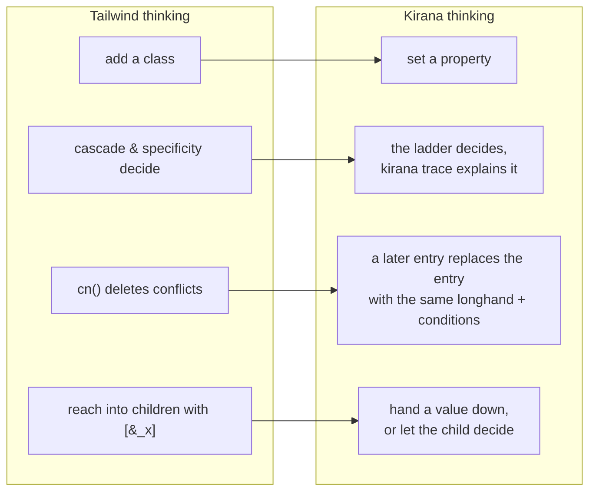
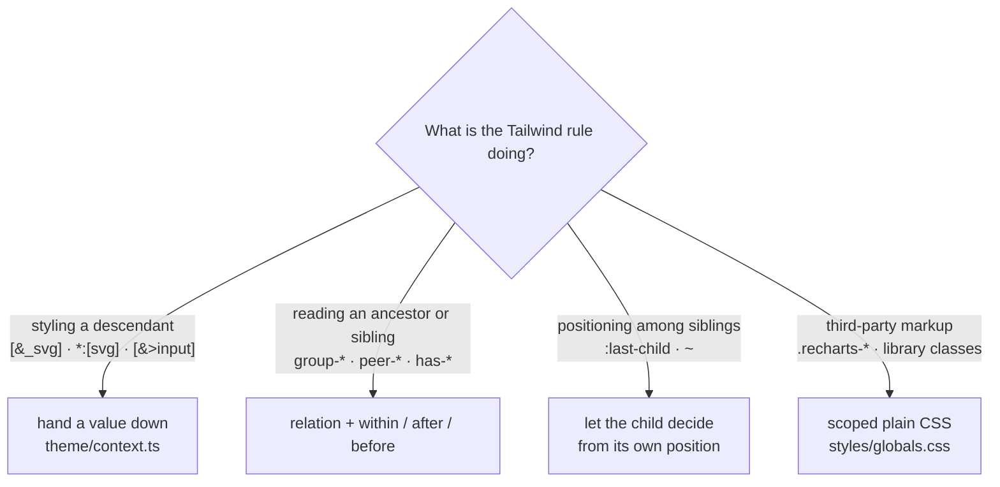
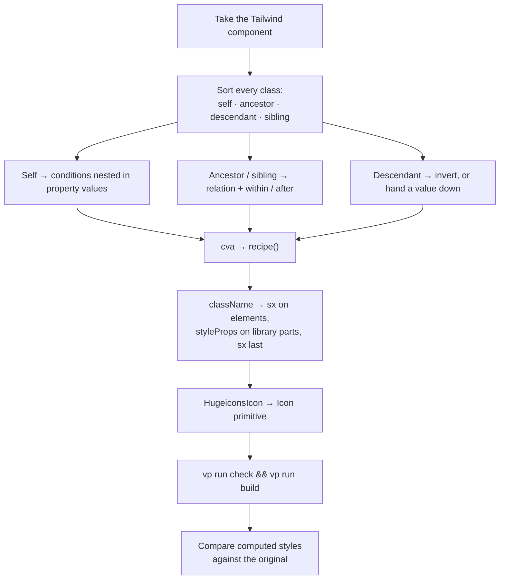

# Porting from Tailwind

## The shift in point of view

Tailwind is a **vocabulary of classes** resolved by the cascade. Kirana is a
**compiler over typed objects** that merges them into a table and orders the
result with one documented ladder. Four consequences follow, and nearly every
porting mistake traces back to one of them.



1. **A style is a property, not a class.** You set the property, and the last
   style to set that longhand under the same conditions owns it.
2. **Precedence is the ladder, not order or specificity.** More conditions win;
   then attribute > pseudo-class > relation > at-rule; then a larger `min-width`,
   a stronger pseudo-class; then the declaration that set fewer longhands.
   `kirana trace src/file.tsx:42 paddingTop` shows why a value won.
3. **Merging is per entry.** A later `borderColor: x` replaces only the base
   entry; the `:hover` and `:focus` entries of the earlier style survive. `null`
   removes on purpose.
4. **Prefer not to style what you do not render.** `select.descendant` exists,
   but a named hand-off (`ctx.iconSize`) or a relation is the better contract.

## The mapping table

The governing syntax rule: pseudo-classes, attribute selectors, relation reads
and at-rules nest **inside a property value**. Only pseudo-_elements_ and
`select.*` targets are top-level keys. A condition written at the top level is the
`unknown-condition` error.

| Tailwind                             | Here                                                                                                           |
| ------------------------------------ | -------------------------------------------------------------------------------------------------------------- |
| `bg-red-500`                         | `backgroundColor: color.red500`                                                                                |
| `bg-primary`                         | `backgroundColor: theme.primary`                                                                               |
| `bg-primary/80`                      | `backgroundColor: alpha.primary80`                                                                             |
| `p-4`, `gap-2`                       | `padding: spacing[4]`, `gap: spacing[2]`                                                                       |
| `rounded-lg`                         | `borderRadius: radius.lg`                                                                                      |
| `text-sm`                            | `fontSize: fontSize.sm` **and** `lineHeight: lineHeight.sm`                                                    |
| `p-4 md:p-6 lg:p-12`                 | `padding: { base: spacing[4], [breakpoint.md]: spacing[6], [breakpoint.lg]: spacing[12] }`                     |
| `dark:bg-card`                       | nothing — the token is `light-dark()`; if structural, a `surface.*` token                                      |
| `bg-muted dark:bg-background` once   | `` `light-dark(${theme.muted}, ${theme.background})` `` inline, or a `surface.*` token if it repeats           |
| `hover:`, `disabled:`                | `{ base: x, ":hover": y }`                                                                                     |
| `data-[state=open]:`                 | `{ base: x, '[data-state="open"]': y }`                                                                        |
| `aria-invalid:`                      | `{ base: x, '[aria-invalid="true"]': y }`                                                                      |
| `aria-haspopup:active:`              | `{ '[aria-haspopup]:active': y }` — a compound key is one condition set                                        |
| `placeholder:`                       | `"::placeholder": { … }` as a top-level key                                                                    |
| `group-data-[state=open]:`           | `[fooMarker.within('[data-state="open"]')]`, anchor on the group                                               |
| `peer-disabled:`                     | `[fooMarker.after(":disabled")]`, anchor on the earlier sibling                                                |
| `has-[:focus-visible]:`              | `":has(:focus-visible)"`, no relation                                                                          |
| `group-has-[:disabled]/field:`       | `[fieldMarker.within(":has(:disabled)")]`                                                                      |
| `in-data-[slot=x]:`                  | `[xMarker.within('[data-slot="x"]')]`                                                                          |
| `@container/name` + `@md/name:`      | `containerName` + `'@container name (min-width: …)'`                                                           |
| `[&_svg]:size-4` in a parent         | `ctx.iconSize` read by `Icon`; `[select.descendant("svg")]: { … }` when there is no component to read it       |
| `*:[a]:hover:text-x`                 | `[select.child("a:hover")]: { color: x }`; under `select.child("a")`, `:hover` is the parent's                 |
| `style-vega:h-9`                     | `height: { base: …, [axes.style.vega]: space[9] }` in a registry style module                                  |
| `data-open:`, `data-entering:`       | `...when(overlay.starting, x)` in the registry: every base's key (`core/states.ts`)                            |
| `animate-in fade-in-0`               | transitions against `data-starting-style`                                                                      |
| `animate-spin`                       | `animationName: animation.spin` (`keyframes()` in `theme/animations.ts`)                                       |
| `ring-3`                             | `boxShadow: \`0 0 0 ${ring.width} …\``                                                                         |
| `transition-colors`                  | longhands + `duration[150]` + `easing.inOut`                                                                   |
| `transition-all` on a moved element  | name the property you animate — `translate`, not `transform`. What that costs in fidelity: `docs/workflows.md` |
| `sr-only`                            | the `VisuallyHidden` primitive                                                                                 |
| `no-scrollbar`                       | `scrollbarWidth: "none"` + `"::-webkit-scrollbar"`                                                             |
| `line-clamp-2`                       | `Text clamp="2"`, or the four `-webkit-box` properties                                                         |
| `className={cn(a, b)}` on an element | `sx={[a, b]}`                                                                                                  |
| `className` on a Base UI part        | `{...styleProps(a, b, sx)}`                                                                                    |
| `cva(…)`                             | `recipe()` (this package's helper, or Kirana's with compound variants and slots)                               |
| `!important`                         | nothing — reorder the `sx` array, or nest the condition that must win                                          |
| `[class*='size-']`                   | nothing — class names are hashed. Use an explicit prop                                                         |

### Defaults worth memorising

Tailwind's bare `transition-*` utilities imply `150ms` and
`cubic-bezier(0.4, 0, 0.2, 1)`. That curve is `easing.inOut` here, **not**
`easing.out`. An unadorned `transition-colors` ports to:

```ts
transitionProperty: "color, background-color",
transitionDuration: duration[150],
transitionTimingFunction: easing.inOut,
```

Tailwind's font-size utilities set a **paired line-height**. `fontSize` alone
leaves text on the document's 1.5, which is about a pixel taller per line and
shifts every box around it.

**Read the custom variants before trusting a data attribute.** shadcn defines
`data-open:`, `data-selected:` and friends in its own stylesheet, and they are
not all presence checks. `data-selected:` means `[data-selected="true"]`,
because cmdk writes `"true"` or `"false"` on every row. Base UI adds and removes
its attributes instead, so presence selectors are right there.

**`cn` deleted classes, and the deletion was part of the design.** When a
component wrote `text-sm` and a variant added `text-[0.8rem]`, `cn` dropped
`text-sm` entirely, line-height included. Kirana merges per longhand, so the
base's line-height survives. Restate what the deletion removed, usually as
`inherit`. Compare computed values to catch these; the class string will not
show it.

A few smaller translations that are easy to get slightly wrong:

| Tailwind                       | Correct port                                                                | Not                                                                                                                               |
| ------------------------------ | --------------------------------------------------------------------------- | --------------------------------------------------------------------------------------------------------------------------------- |
| `top-1/3`                      | `calc(100% / 3)`                                                            | `33%`, which is 3px off on a 900px viewport                                                                                       |
| `shadow-md ring-1`             | ring layer first, then `shadow.md`                                          | shadow first. Tailwind emits ring before shadow, and the first layer paints on top                                                |
| `animate-accordion-down`       | `keyframes()`, `easing.cssOut`                                              | a transition, or `easing.out`. `tw-animate-css` uses the CSS `ease-out` keyword                                                   |
| `p-0` on an icon button        | the longhands the button sets (`paddingInlineStart`, `paddingInlineEnd`, …) | `padding: 0`, which sets the physical longhands beside the button's logical ones                                                  |
| padding on a `span`            | add `display: "block"`                                                      | vertical padding on an inline box, which does not grow the line                                                                   |
| `backdrop-blur-xs`             | `` `blur(${blur.xs})` ``                                                    | a guessed pixel value. The scale is `blur` from `@kirana-style/preset-scales`                                                     |
| `animate-in duration-100`      | a transition at `duration[100]`, `easing.cssEase`                           | Tailwind's transition defaults. `tw-animate-css` uses the CSS `ease` keyword                                                      |
| `calc(1.25 / 0.875)`           | the rounded-up ratio in `lineHeight`                                        | the expression, which the minifier rounds down to 1/64px short                                                                    |
| text in a fixed-height control | the label wrapped in an element with `textBox: "trim-both cap alphabetic"`  | a centred line box. Inter's capitals sit up to 3px high once the baseline snaps, and by a different amount per sub-pixel position |

## The four patterns that do not translate directly



**1. Descendant selectors.** `[&_svg:not([class*='size-'])]:size-4` appeared 25
times. It became the `Icon` primitive reading a `ctx.iconSize` variable each
control sets. The same hand-off replaced `[&>input]`, `*:[img:first-child]` and
`[&_a]` — the last became the `Link` primitive. `select.descendant` can express
the selector half (and contextual styles always lose to the child's own), but the
`[class*='size-']` half never works with hashed names.

**2. Parent-driven child styling.** `ButtonGroup` styled its children's corners
from the parent. Inverted: each child decides its own corners from its own
position.

**3. Position among injected siblings.** Base UI injects focus-guard elements
while a popup is open, so `:last-child` silently stops matching. Use
`:not(:has(~ [data-slot]))` — "last real control" — which is what the Tailwind
original matched on.

**4. Markup the component does not own.** Recharts renders its own SVG with
fixed class names and hard-coded `#ccc`. A Field lays out whatever children it is
handed; an alert description holds the caller's links and paragraphs. That stays
in `globals.css`, scoped by `data-slot`. The catalogue lists every block and why.

## Pitfalls

Ordered by how much time each one cost.

### Components from installed packages do not read `sx`

`<Menu.Popup sx={styles.popup} />` compiles, and Base UI drops the prop: the popup
renders unstyled. The compiler reports `sx-on-external-component`. Spread the
props instead: `<Menu.Popup {...styleProps(styles.popup, sx)} />`. Import
`props` under the name `styleProps`, because components name their rest parameter
`props`.

### The anchor goes on the element whose state is read

`fooMarker.within(sel)` compiles to `.k…:where(.kr…<sel> *)`: the anchor is the
**ancestor** whose state `sel` describes. `after` reads an earlier sibling,
`before` a later one. Applying the anchor to the element being styled is the
`relation-placement` error when both sit in one JSX tree; across components the
compiler cannot prove placement, so check it in the browser. An anchor passed
through a component's `sx` counts as applied.

Use the form that matches the question:

```ts
// has-data-[icon=inline-end]:pe-2 — "do I contain it"
paddingInlineEnd: { base: spacing["2.5"], ':has([data-icon="inline-end"])': spacing[2] },

// group-has-data-[slot=item-description]/item:self-start — "does my ancestor contain it"
alignSelf: { [itemMarker.within(':has([data-slot="item-description"])')]: "flex-start" },
```

### Attribute keys outrank `:hover`

The ladder ranks attribute conditions above pseudo-classes, while Tailwind's
stacked `dark:hover:` out-specifies `aria-expanded:`. When the original lets a
stacked variant win, nest it inside the condition it beats — two conditions beat
one — as the outline button does with hover inside its open state:

```ts
backgroundColor: {
  base: surface.outlineBackground,
  ":hover": surface.outlineHover,
  '[aria-expanded="true"]': { base: surface.outlineExpanded, ":hover": surface.outlineHover },
},
```

Two conditions of the same class that can match together (`[data-starting-style]`
and `[data-ending-style]`) tie on the ladder; the compiler warns with
`ambiguous-precedence`. Nest the one that should win inside the other, or, when
the library guarantees they never match at once, declare the pair in
`packages/ui/src/kirana.ts`. Pairs that set the same value, or that selectors
prove exclusive (`X` and `:not(X)`), do not warn.

### Logical and physical longhands are different entries

Button sets `paddingInline` plus conditional `paddingInlineStart` and
`paddingInlineEnd`. A style that zeroes a button's padding must name those
logical longhands: `padding: 0` is one atom covering `paddingTop`…`paddingLeft`,
the physical sides, which sit beside the logical ones instead of replacing them
(the compiler warns with `mixed-logical-physical`). Before writing a shorthand over a component's style,
look at which longhands it set.

A `px-*` in `sx` also replaces a Button's icon-side padding, which in Tailwind
was a `has-*` variant that outranked the caller's utility and survived. Restate
it: `{ base: spacing["2.5"], ':has([data-icon="inline-start"])': spacing[2] }`.

### `null` removes; omitting keeps

`{ base: null }` removes an earlier style's base value; `prop: null` removes every
entry of the property. Omitting `base` keeps what an earlier style set. The StyleX
port's `default: null` meant "no base here"; carried over as `base: null` it
erased real values across the design system. Write nothing when you mean nothing.

### Token defaults are evaluated on `:root`

A variable token's default that reads a variable a library sets further down,
such as `var(--nested-drawers)` or `var(--toast-index)`, is invalid on `:root`. An
invalid custom property then poisons every value composed from it, so the whole
`transform` silently computed to `none`. Keep defaults inert and assign the real
formula on the element that owns the library's variables:
`css({ [drawerCtx.stackScale]: "calc(…var(--nested-drawers)…)" })`.

### Styling the element a part renders as

Base UI merges a part's `className` with its `render` element's by concatenating
strings. If both carry atomic classes for the same property, the cascade picks a
winner and the compiler's merge never runs. Pass the part's styles as `sx` to the
rendered component instead; `withSx` in `components/toast.tsx` does this for the
toast's action and close buttons.

The reverse fails more quietly. One of our components used as the `render`
element — `render={<Label />}` — takes `sx`, not `className`, so the classes the
outer part hands it are dropped. Compose the other way round: the unstyled
primitive renders the styled component, or render a plain element.

### Animate the property you actually set

`translate`, `scale` and `rotate` are separate animatable properties.
`transitionProperty: "transform"` does not cover them — the element jumps instead
of easing.

### shadcn examples still speak Radix

The registry's examples and blocks were written against Radix attributes, and
some of them survived into the Base UI versions where they never match:
`data-[state=open]` and `data-open` on a collapsible trigger (Base UI marks it
`data-panel-open`), `data-open` on a menu trigger (`data-popup-open`),
`data-[state=on]` on a toggle (`aria-pressed`). Port the intent with the
attribute Base UI renders, and fix the Tailwind original to match, so the
comparison sees the same behaviour on both sides.

### Markup and variables blocks bring with them

- **An inline brand logo** (`<svg>` in a "Login with Google" button) was sized by
  the button's `[&_svg]:size-4`. Give it `width: ctx.iconSize` and
  `height: ctx.iconSize`.
- **`style={{ "--sidebar-width": … }}`** on a SidebarProvider set Tailwind's
  variable. The width is `sidebarCtx.width`, a hashed name, so set it in `sx`:
  `css({ [sidebarCtx.width]: "20rem" })`. The same goes for `--cell-size`
  (`calendarCtx.cellSize`).

### Pseudo-elements with a state or a direction

`hover:after:bg-x` is a condition inside the pseudo-element's own property:

```ts
"::after": {
  backgroundColor: { ":hover": theme.sidebarBorder },
}
```

That compiles to `.k…:where(:hover)::after`. A relation or attribute condition
works the same way. When the original sets a pseudo-element's position per
direction — `data-[swipe-direction=up]:after:bottom-full`,
`data-[swipe-direction=left]:after:end-full` — keep every direction. The port
first placed the drawer's bleed after the popup for all four, so top and left
drawers showed a 48px strip beside the panel.

### Wrappers must keep the original's default props

A component that wraps another often changed its defaults, not just its classes:
`MenubarContent` passes `align="start" alignOffset={-4} sideOffset={8}` and a
wider `min-w-36` to the dropdown it wraps. Read the function signature, not just
`className`.

The reverse matters as much: a prop the wrapper destructures for its own styling
must still reach the primitive when the primitive uses it. `Tabs` and
`ToggleGroup` took `orientation` to write `data-orientation` and never passed it
on, so Base UI kept vertical groups horizontal.

And prefer the attribute the library already writes to a prop of your own:
condition on `aria-orientation`, `data-orientation`, `data-side`.

### Utilities that do less than their name

- `shadow-none` clears only the drop shadow. A Card keeps its `ring-1`, so do
  not translate it to `boxShadow: "none"`.
- `border` sets a width and inherits the style. On an `Empty`, which is
  `border-dashed`, it draws a dashed line: add widths only.
- `data-open`, `data-closed`, `data-checked`, `data-unchecked`, `data-selected`,
  `data-disabled`, `data-active`, `data-horizontal` and `data-vertical` are
  shadcn's custom variants (`shadcn-tailwind.css` in the original), not
  attribute-presence checks. `data-horizontal` is
  `[data-orientation="horizontal"]`. Look the variant up before translating it.
- `group-has-*` asks whether the group **contains** a match, never the group
  itself: `fieldMarker.within(':has([data-orientation="horizontal"])')`.
- `[&>a]:underline` on a description part styles links the caller writes into
  it. It is a `globals.css` rule scoped to the part's `data-slot`, with the hover
  colour handed down as `--inline-link-hover`.
- `*:[div:not([class*='w-'])]:w-full` skips any child whose class _contains_
  `w-` — `max-w-*`, and `overflow-hidden` too. Check which children it really
  reached before reproducing it.

## The process



The last step is not optional. Screenshots miss about a pixel of line-height, a
wrong easing curve, and a variant that quietly dropped a state.
[workflows.md](workflows.md) has the method.
