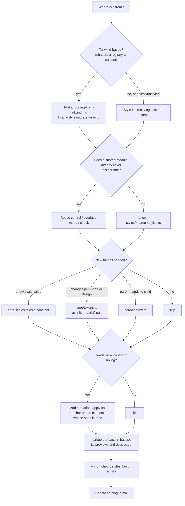
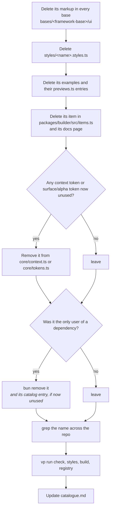
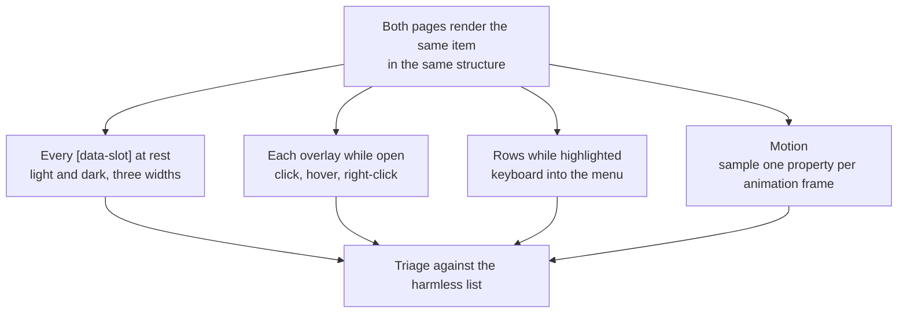
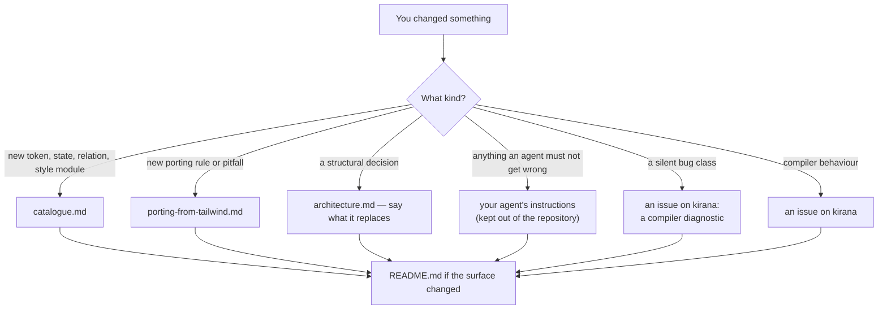

# Workflows

## Adding a component



Concretely, for a component that arrives as Tailwind:

1. **Read the classes before writing anything.** Sort them into self-state,
   ancestor, descendant and sibling. That sort decides the whole shape.
2. **Check the catalogue.** Most chrome already exists. A new popup reads
   `overlay.styles.ts` and `menu.styles.ts`; a new field `control.ts`.
3. **Swap the dependencies.** `cn` → `sx={[…]}` on elements and
   `{...styleProps(…)}` on Base UI and React Aria parts, `cva` → a variant's
   handles in the style module, an icon → `IconPlaceholder` naming it in every
   library (`lucide="…" tabler="…" hugeicons="…" phosphor="…" remixicon="…"`),
   `@/components/ui/x` → a relative import, `className` → `sx`.
4. **Read the compiler's diagnostics.** `vp run styles` checks the registry with
   `registry/kirana.config.ts`, `vp run build` prints every app's, and
   `bunx kirana-style check registry` lists every one with its source line. Errors fail the build; warnings name
   real risks (`ambiguous-precedence`, `mixed-logical-physical`,
   `sx-on-external-component`). `unresolved-import` means an import did not
   resolve — usually dependencies are not installed — so every token behind it
   compiled as a runtime value.
5. **Verify against the source** if one exists, with the computed-style diff
   below.
6. **Give a registry component its page.** Port upstream's `<item>-demo` on every
   base it has (`registry/bases/<base>/examples`, listed in that base's
   `previews.ts`), and write `apps/site/content/docs/components/<item>.md`:
   upstream's page for that component, section for section (its preview, an
   `installation` embed, usage, composition, every example with its docs demo,
   the API reference), from its `base` and `aria` copies, with Kirana's own words
   only where Kirana differs (`sx` for `className`). Upstream's docs demos
   (`apps/v4/examples/<base>/`) port as a block's cards do (`kirana-style migrate
   tailwind`, "Adding a block"), wrapped in the preview's frame (`page.example`);
   each preview's code panel then comes from the builder (`/r/demos/<item>.json`),
   with no step of its own. Its `<item>-example` page (upstream's
   `bases/<base>/examples/`) ports the same way but is a page, not a demo: it
   renders `ExampleWrapper` at its root, with no `page.example` around it, as
   upstream's do, and is stamped with `vp run upstream -- accept <item>-example`. Its `<item>-rtl` demo goes under **RTL**, before the
   API reference, with `direction="rtl"` on the preview; it imports
   `useTranslation` from `../components/language-selector` and sets its own
   `dir`, as upstream's. The `installation` embed is
   both CLIs and the manual steps, with every file the item installs. That one
   file is the
   component's page for every framework and base it has: list them in its
   frontmatter, `variants: [react/base, react/aria, vue/ark]`, in the order
   `apps/site/src/lib/variants.ts` gives (the content generator fails when they
   differ from the frameworks the registry has markup for), and the generator
   writes a page for each, at `/docs/components/<framework>/<base>/<item>`. A
   guide to building a component from others, as upstream's Data Table and Date
   Picker, has no item of its own: it takes the variants of the item it builds
   on (`BUILT_ON` in `apps/site/scripts/generate-content.ts`). Say where they
   differ:
   - `<!-- ::start:only react/base,react/aria -->` … `<!-- ::end:only -->` for
     a passage only some variants have (shadcn/ui's CLI is React's, a note is
     one base's);
   - a `tabs` block whose headings are variant labels (`### Base UI`, `### Vue`,
     or several sharing code, `### Base UI, React Aria, Solid`) for the usage:
     each page keeps its own section;
   - an embed's `combinations="…"` for the variants it can show: a preview whose
     demo a framework lacks is left off that framework's page;
   - and for a variant that differs throughout, an override beside the source,
     `components/<item>/<framework>-<base>.md`, which is that page whole.

   Upstream's other page parts have theirs: a guide's `<Steps>` is
   `<!-- ::start:steps -->` … `<!-- ::end:steps -->` around its h3 steps, its
   `<Callout>` a `> [!NOTE]` (`> [!WARNING]` …, each a quiet surface box like
   upstream's, only the icon differing; upstream's `**Note:**` stays in the text,
   and `> [!NOTE] Title` gives a heading), and a preview upstream sets
   on `bg-surface` takes `surface="true"`; upstream's `hideCode` is
   `code="false"`, its `type="block"` (a block shown as on a desktop, Sidebar)
   `block="true"`, and its `figcaption` `caption="…"`. A preview is a frame, so
   a demo's CSS breakpoints read the frame's width (about 650px on a wide
   screen) where upstream's inline demos read the page's; its scripts are told
   the page's width (`useIsMobile`, a drawer's side), and a demo that hides
   something below a breakpoint the frame does not reach (`hidden md:flex`)
   takes `wide="true"`, a frame the page's width, centred and clipped. A demo
   that opens a menu, select, combobox or popover gets a frame tall enough to
   show it whole below its trigger, as upstream's overflows its box; measure it
   rather than guess. An illustration upstream shows (Sidebar's structure) is
   `<!-- ::figure light="…" dark="…" alt="…" caption="…" -->`, its files in
   `apps/site/public/images/`, its caption saying whose it is. The components
   index lists the pages itself (`<!-- ::components-list -->`); a page with
   `new: true` in its front matter is in its New Components list and carries
   the sidebar's blue dot.

   An AI Elements pattern is written the same way, in
   `apps/site/content/docs/ai-elements/<pattern>.md` with `section: ai-elements`: its demos ported
   as a component's, its `variants` the React bases that have every demo it previews (the
   generator checks), and its Installation naming the components it is built from, the first
   its own (`name="trace code-block"`). The section's index lists it by itself
   (`<!-- ::section-cards section="ai-elements" -->`).

   A Forms guide (`apps/site/content/docs/forms/<library>.md`, `section: forms`) is written the
   same way. Its forms are upstream's Radix ones ported to each base, so a sample built on a
   control is one `::only` block per base, with that base's props, and the finished form is
   shown whole with `<!-- ::demo-source item="…" title="form.tsx" -->`.

   A chat demo streams a scripted conversation as upstream's do, with
   `@shadcn/helpers/ai-sdk`'s `createChat` and the AI SDK's `useChat`
   (`registry/lib/ai.ts`, upstream's `@/lib/ai`): no model and no network.

   Link a component by the URL its variants share, `/docs/components/<item>`:
   every link to it leads to the reader's framework, and the URL itself
   redirects to the default.

If the component needs a library that is not installed, install it — but check
first whether it is really needed. Versions shared by more than one workspace
live once, in the Bun catalog in the root `package.json`
(`"workspaces": { "catalog": { … } }`), and each workspace lists them as
`"catalog:"`. A library only one workspace uses stays a plain version in that
workspace's own `package.json`.

### Adding a block

A block is ported into `registry/bases/<base>/blocks/<name>/` for each React base (`page.tsx`, its
parts in `components/`), as `login-01` and `sidebar-07` are. Then, once:

1. its title, description and upstream's categories in `registry/blocks.ts`, which the builder
   writes into the registry's item and `/blocks` reads, so its category's page lists it and the
   category joins the blocks navigation with its first block;
2. its entry in `packages/builder/src/items.ts` (its files per combination), and in each base's
   `previews.ts`, which gives it its preview page, the frame `/blocks` shows;
3. `vp run registry`, `vp run build` (the preview page and the category page are prerendered),
   and `vp run conformance -- --pages <name> --styles all` against upstream's site.

A block of many cards (`preview`, `preview-02`) is ported with `kirana-style migrate tailwind`, from a
scratch folder whose `kirana.config.mjs` adds `@kirana-style/preset-scales/preset` and points
`utilities.scales.color` and `radius` at `registry/core/tokens.ts`'s `theme` and `radius`, and
`utilities.variants` at the eight `style-*` conditions. Its output then needs what Tailwind's
cascade does and Kirana's per-entry merge does not:

- a card's style on a registry component replaces that component's value in every style, so each
  property but the colours is `{ "*": null, base: … }` (upstream's per-style rules sit in
  `@layer base`, under every utility);
- under a card's `text-*`, a component keeps its own line height in the styles where it sets
  `leading-*` (Tailwind's `--tw-leading`) and takes the size's where its line height comes with its
  size: read it per style from upstream's `registry/styles/style-*.css`;
- `p-*`, `m-*` and `inset-*` are the shorthands, a gradient is a `backgroundImage`, `border` needs
  no `borderStyle` (the reset's is `solid`), and the composition variables (`compose[…]`) resolve
  to the values a hand port writes;
- an upstream custom property a component reads through a context (`--cell-size`) is the context's
  key (`calendarCtx.cellSize`), and Recharts becomes TanStack Charts by hand.

What the codemod should do itself is logged for Kirana.

### Adding a chart

A chart is ported from upstream's `registry/new-york-v4/charts/<name>.tsx` (the one place upstream
has its charts) into `registry/bases/<base>/charts/<name>.tsx` for each React base, on TanStack
Charts: a `defineChart` definition beside the card, as `chart-area-default` and the others are. A
config colour is a token (`theme.chart1`); Recharts' angles start at 3 o'clock and turn
counter-clockwise, TanStack Charts' at 12 and clockwise, so a pie or radial chart starts at
`Math.PI / 2` and ends at `Math.PI / 2 - Math.PI * 2`. What Recharts does by itself is written
out:

- **The value axis.** Upstream hides it and draws the grid on its ticks, which Recharts rounds
  its own way (0 to 320 in steps of 80 for a top of 305). `niceTicks(values)` gives that domain and
  those ticks; the scale takes `scaleLinear().domain(ticks.domain)` and the hidden axis
  `hiddenAxis(ticks.ticks)`. A shown axis puts `ticks.values` on its own ticks.
- **Stacked areas.** Each row's layers are worked out once, bottom to top in the order Recharts
  draws the series: an `areaY` with the series' raw value as `y` between `y1` and `y2` (so the
  tooltip reads the raw value), and the top edge a `lineY` on `y2`, wrapped in `decorative()` so
  it adds no tooltip rows. Recharts' area stroke is its top edge only; an `areaY` stroke outlines
  the whole shape.
- **The active dot.** Recharts draws one on each series at the hovered point: a `dot` wrapped in
  `whenFocused(…, { match: "x" })`, `r: 4` (or the chart's `activeDot` radius), the series' colour
  with a 2px ring in the background colour. A per-row colour is a `color` channel with the chart's
  `color` scale; `dot`'s `fill` is one colour.
- **The tooltip cursor.** Where upstream leaves Recharts' cursor on (no `cursor={false}`), a bar
  chart's is the focused band in the muted colour, `whenFocused(bandX(…, { fill: theme.muted }))`,
  and a line chart's a rule, `whenFocused(ruleX(…, { stroke: theme.border }))`.
- **The tooltip's order.** Recharts lists the series in the order it draws them; TanStack Charts
  top to bottom. A stacked or multiple-series chart gives the tooltip `sort`, by the series' order.
- **Labels** (`LabelList`) are `text` marks, `decorative()`, offset with `dy`.
- **A legend** is `legend={<ChartLegendContent />}`: the chart then fills what the legend leaves of
  the box. Where upstream gives the chart negative margins to keep it whole under its legend (the
  radar's `margin={{ top: -40, bottom: -10 }}`), the legend's own margins pull it over the chart's
  foot instead, so the chart keeps the box.

Pies, radars and radial charts are TanStack Charts' polar entry (`@tanstack/charts/polar`):

- **The radius.** Recharts takes its 5px margin off before the 80% radius: `polar({ inset: 5,
  radiusRatio: 0.8, … })` (`inset: 10` where upstream sets a 10px margin). A radial chart's bars
  sit in Recharts' bands, `barCategoryGap` 10% and a bar 80% of its band in whole pixels:
  `radius: radialBands(categories, innerRadius, outerRadius)`.
- **Drawing the tooltip must not reach** (a radar's areas and grid, a pie's labels, a donut's
  text, a radial chart's track) is a polar container of its own wrapped in `decorative()`, over
  or under the interactive one with the same `scales`: `decorative` inside a `polar` leaves its
  children interactive. A centre label sits in a container whose angle scale is radians
  (`scaleLinear().domain([0, Math.PI * 2])`) at `angle: () => 0, radius: () => 0`.
- **A radar's tooltip** reads a `radialDot` of long rows (month, series, value) grouped by
  `z: "series"`, `r: 0` and `r: 4` when focused, with `focus: focusGroupAngle`, so every series at
  the month is listed, as Recharts does.
- **A radial chart's tooltip** that lists every part wherever the pointer is on the bars (the
  stacked one) reads unseen arcs, one per part over the whole sweep (`fillOpacity: 0`), with
  `focus: "group-y"`: TanStack Charts' own focus presets hit-test the shapes, a custom strategy
  does not.
- **Labels along a curve** (Recharts' `position="insideStart"` on a radial bar) have no TanStack
  Charts counterpart, since its text is straight: Recharts' own `textPath` arcs, in an SVG over
  the chart's centre (`chart-radial-label`).
- **Upstream's site is Recharts 3**, which draws no pie labels (`chart-pie-label`,
  `chart-pie-label-list`) and scales a stacked radial chart's angle to its largest part alone:
  those are drawn as upstream meant them, the labels shown and the stack the whole half ring.

Then, once:

1. its title, description (the file's own `description`) and type in `registry/charts.ts`, which
   the builder writes into the registry's item and `/charts/<type>` reads;
2. its entry in each base's `previews.ts`, the frame the charts page shows;
3. `vp run registry`, `vp run build`, and `vp run upstream -- accept` for its stamp.

## Removing a component



The checklist, in grep form:

```bash
NAME=drawer
grep -rln "$NAME" registry apps/site packages  # markup, styles, examples, pages, items
grep -n "${NAME}Ctx" registry/core/context.ts
```

Unused constants and tokens cost nothing in the stylesheet — Kirana emits only
what a compiled style references — but they are still a second name for nothing.
An anchor left applied with no reader is the `relation-unused` warning; a reader
left with no anchor is the `relation-without-anchor` error.

**What is exclusive and what is shared.** Safe to delete with the component:

- its markup in every base, its style module and its examples
- relations declared in its style module (`drawerPopup`)
- context tokens named after it (`drawerCtx`)

Not safe without checking — these are shared:

- anything in `core/scales.ts` (the vocabulary, not per-component)
- `theme` and `alpha` tokens
- `surface` tokens — named by intent, not by component. Grep before removing
- `styles/control.ts`, `overlay.styles.ts`, `menu.styles.ts`, `check.styles.ts`
- a relation another component's module reads (`collapsibleScope`, `fieldScope`)

## Verifying a port

Screenshots miss a pixel of line-height, a wrong easing curve, and a variant that
quietly dropped a state. Compare computed styles instead.

### The conformance harness

The harness lives in [kirana-lab](https://github.com/kirana-style/kirana-lab)
(`packages/harness/conformance`); here it compares the site's preview pages with
the same pages on shadcn/ui's own site, element by element, in Chrome through
Playwright (`vp run conformance`, [below](#against-shadcnuis-own-site)). The full
method, what to prepare and how to read a report are in its README. kirana-lab
also keeps its own copies of the apps this repository started from, with their
StyleX port and Tailwind original, as its baselines.

It walks every `[data-slot]` element, portals included, at three widths in light
and dark, and reads the property list below plus `::before` and `::after`.

Colours are normalised by letting the browser convert them to one space: set
`background-color: color-mix(in srgb, <colour> 100%, transparent)` on a probe
element and read the computed value back. A canvas `fillStyle` does **not** work
in current Chrome: it keeps `lab()` and `oklch()` strings as written.

### What to compare

The page at rest is only half of it. Most of the bugs found in the ported
components only showed up in a state.



The harness covers pages at rest and, with `--states`, 20 interactive states on
any route that has their trigger: overlays open, highlighted rows, menus, hover,
focus and a toggled sidebar. Motion is still checked by hand (tracked in the
implementation tracker). Read more than box
and colour. A sweep that compared layout, spacing, colour and type at 1400px still
missed six visible bugs, each in a property it never read:

| Missed property                     | What it hid                                                        |
| ----------------------------------- | ------------------------------------------------------------------ |
| `text-wrap`                         | field descriptions balanced where the original wraps normally      |
| `text-decoration-line`              | links inside field, empty and item descriptions lost the underline |
| `border-style`                      | three Empties drew solid where the original is dashed              |
| `::after` position, on hover        | the sidebar rail's edge line, and the drawer bleed's side          |
| an open menu's offset and min-width | the menubar menu sat 4px off and 48px narrower                     |

Text-wrap differences also need a tight width to show.

Also compare bounding boxes: each card's position and size, and every slot's
position relative to its card. A computed-style diff only sees the properties you
list, and it missed an avatar sitting 4px low because `align-self` was not on the
list.

For motion, sample a property with `requestAnimationFrame` right after the
trigger and compare the sequences. Expect the port to start overlay motion one
frame later: Base UI needs one frame in `data-starting-style` before a transition
can run, while the original's keyframes start on mount.

When the original itself is wrong, fix the original.

### Against shadcn/ui's own site

The registry's preview pages are compared with the same pages on shadcn/ui's
site, a production build of its `apps/v4` at the manifest's commit (`next
build` once, then `next start` on port 4000, from a clone of shadcn/ui kept for
it), by the same harness in URL-pair mode: each route is loaded from both sites, with the
expected site's path rewritten. `scripts/conformance.ts` compares only the
pages a run names, on both React bases: `vp run conformance -- --pages
tabs-example,login-01`, in Nova and at rest unless `--styles lyra,sera` (`all`
for the eight) and `--states` ask for more. A page an earlier run compared is
not compared again unless the change concerns it. `vp run conformance:pr`
(`--changed`) keeps the pages whose own sources reach a file changed since
`origin/main`, and stops when more than eight do, so a run names the ones the
change concerns instead; `--all` is the whole matrix, for a change that truly
reaches every page. It needs the site's Worker on 8787, upstream's site on 4000
and a kirana-lab checkout beside this repository (`KIRANA_LAB` otherwise);
`--shard 1/3` splits the routes, `--list` prints them. Upstream's captures are kept between runs
(`node_modules/.cache/kirana-ui-conformance/upstream-<pin>`), so its server is
needed only for a page not captured yet. A difference not in
`conformance/expected-differences.json` fails it; each entry there says why it
is not a bug. One route by hand:

```bash
bun conformance/compare.ts --actual http://localhost:8787 --expected http://localhost:4000 \
  --label upstream --expected-path "/preview/react/=/preview/" \
  --group '[data-slot="example"]' \
  --paths "/preview/react/base/button-example?preset=b0" [--states]
```

- **Name the design by preset code.** Upstream's preview reads `?preset=` (`b0`
  by default) over any axis parameter, so `?style=lyra` still shows Nova there.
  Each style's code is upstream's own `encodePreset({ style })`: Nova `b0`, Vega
  `bIkeymG`, Lyra `buFywKm` (upstream rewrites it as `buFywLo`, with Lyra's
  radius), Maia `bbVJxYW`. The site reads the same codes.
- **Upstream's examples are ported with their layout**, in
  `components/example.tsx`'s frame. `--group` pairs elements within each titled
  example rather than across the page, so a section whose components do not exist
  yet is left out and reported once, by its title, instead of shifting every pair
  after it.
- **React Aria's `DialogTrigger` and `MenuTrigger` render no element**, so the
  harness's `dialog-open` and `dropdown-open` states find no trigger slot there:
  name it, `--trigger 'dialog-open=[data-slot="example-content"] button'`. A state
  neither page reaches is skipped without a word, so check that each one ran.

On the slice (`button-example`, `dialog-example`, `select-example`,
`dropdown-menu-example` and `login-01`, on Base UI and React Aria, in Nova and
Lyra, at rest and in every state), nothing differs beyond these, each reviewed:

| Difference                                               | Why                                                                                                                                                                                                                                                                                                                                                                                                                                                                                                        |
| -------------------------------------------------------- | ---------------------------------------------------------------------------------------------------------------------------------------------------------------------------------------------------------------------------------------------------------------------------------------------------------------------------------------------------------------------------------------------------------------------------------------------------------------------------------------------------------- |
| `font-family`                                            | Next.js's `next/font` names Inter `Inter, "Inter Fallback"` ahead of the shared `"Inter Variable"`; the same face, as every width shows                                                                                                                                                                                                                                                                                                                                                                    |
| `transition-property`                                    | `transition-all` is written as the properties that change                                                                                                                                                                                                                                                                                                                                                                                                                                                  |
| `span[data-slot="button-label"]`                         | Button trims its text to its capitals in a label element                                                                                                                                                                                                                                                                                                                                                                                                                                                   |
| The line height of FieldLabel and of Nova's small Button | upstream's site and the copy its CLI installs disagree: the site's stylesheet keeps a line height that `cn` drops from the installed classes. The registry follows the installed copy                                                                                                                                                                                                                                                                                                                      |
| `scale: 1` and `translate: 0px` against `none`           | a dialog or popup at rest after its transition, where upstream's keyframes leave none                                                                                                                                                                                                                                                                                                                                                                                                                      |
| `text-align: start` against `left`                       | the same in left-to-right text, and what upstream's right-to-left install writes                                                                                                                                                                                                                                                                                                                                                                                                                           |
| The select value's `text-overflow`                       | upstream's `line-clamp-1` is written as an ellipsis on one line: the same drawing, computed as `ellipsis` where line-clamp leaves `clip`                                                                                                                                                                                                                                                                                                                                                                   |
| A toast viewport                                         | upstream's preview page mounts its toaster around every item                                                                                                                                                                                                                                                                                                                                                                                                                                               |
| The heights of examples, and React Aria popups' `bottom` | an example stretches to its grid row and a React Aria popup is placed from the page's end, so both move where a section is left out; what is inside is compared one by one                                                                                                                                                                                                                                                                                                                                 |
| A closed select popup's `max-height`                     | Base UI mounts it ahead, 0×0: version 1.9 gives it the available height, upstream's 1.6 none                                                                                                                                                                                                                                                                                                                                                                                                               |
| The pages' left-out sections                             | each is named in the exceptions by its title (`Area Chart › `), with what it waits for                                                                                                                                                                                                                                                                                                                                                                                                                     |
| A chart's drawing                                        | upstream draws with Recharts, the registry with TanStack Charts: the harness compares the chart's box, and the drawing is checked apart (bar, tick and grid colours, the tooltip in every style). Two differences there are on purpose: the month labels are the muted foreground, where upstream's `[&_.recharts-cartesian-axis-tick_text]` no longer matches Recharts 3's tick classes and leaves them `#666`; and a tooltip's figures are Tailwind's `font-mono`, where upstream's site sets Geist Mono |
| A highlighted React Aria menu row's background           | upstream's React Aria menus always carry `cn-menu-translucent-aria`, which its menu-colour switch never removes, so their rows highlight translucent in the default colour. Ours follow the menu colour, as Base UI's do upstream                                                                                                                                                                                                                                                                          |
| sidebar-07's avatar                                      | the block's `/avatars/shadcn.jpg` is a picture upstream's site serves and the site does not, so the avatar shows its fallback                                                                                                                                                                                                                                                                                                                                                                              |
| The sidebar collapsed to icons                           | upstream's bug: its sub-list stays drawn, a 12px stub with its border under the first section, because the style file's `group-data-[collapsible=icon]:hidden` loses to the component's own `flex`. Ours hides it, as the rule means; the heights above it follow                                                                                                                                                                                                                                          |
| The header separator of sidebar-07 on React Aria         | upstream's bug: the page's `data-vertical:h-4 data-vertical:self-auto` never holds on React Aria, whose separator writes `aria-orientation`, so it stretches to the header's height there. Ours is 1rem tall on both bases, as on Base UI upstream                                                                                                                                                                                                                                                         |

The first run found a real bug: Button gave a lone `" "` child (`Default{" "}`
before an icon) a label of its own, an empty flex item one gap wide. Adjacent
strings are now one label, and white space alone stays bare text, which the flex
container drops. The select and dropdown examples found two more port slips: a
select trigger inside a vertical Field stayed as wide as its text, where
upstream's `*:w-full` fills the field (the trigger, and React Aria's root, take
`fillInField` now); and the shared menu separator ignored the pointer, which only
upstream's select separator does.

### Another framework against React

Vue, Svelte, Solid and Angular are built against React's pages, not upstream's:
React already matches upstream, and upstream has no copy of these bases to
compare with. `vp run conformance -- --framework vue --pages button-example`
loads each page from `/preview/vue/ark/` and from `/preview/react/base/` on the
same site and compares them as above; `--all` takes every page the framework has
that React's Base UI has too, docs demos and `-example` pages alike. Its
reviewed differences are `conformance/framework-differences.json`.

A component on another framework follows React's file of the same name, and
keeps its parts' `data-slot`s, so the harness pairs them. On Ark UI (Vue,
Svelte and Solid):

- **Ark's own API, React's props where they carry over.** A part passes its
  caller's props to Ark's, so a Vue page writes Ark's names (`v-model:open`,
  `default-value`, a Splitter's `:panels`); where shadcn/ui's demos lean on Base
  UI's, the part takes those too: a popup's content takes `side`, `align` and
  their offsets and hands them to its root (`registry/lib/placement.ts`, as Ark
  places a popup from its root), a Select takes `items` and value-named items,
  one value or a list, and a control takes `aria-invalid`.
- **Ark's required props are declared** in the part and passed on, so a
  project's `vue-tsc` sees them; a menu item's `value` is optional, generated
  when absent.
- **Import Ark from its package root** (`@ark-ui/vue`), never a subpath: Vite
  bundles each entry apart in development, and a context provided through one is
  not found through another. The navigation menu is the exception: no package
  root exports it, so every one of its parts imports the same subpath
  (`@ark-ui/<framework>/navigation-menu`).
- **A control is a label around its box and a hidden input** on Ark (Checkbox,
  Switch, a radio item): the label leaves the layout (`display: contents`) and
  anchors the relations the box anchors, the box takes the `data-slot` and the
  style, and `id` names the hidden input so a `Label for` reaches it.
- **The same elements as React's.** Where Ark draws another element than Base
  UI (a `div` for a `span`, a `button` for a region), the part renders React's
  through `as-child`; where Ark draws one Base UI does not (Select's root, a
  control's label), it leaves the layout (`display: contents`). A popup or panel
  leaves the page while closed (`lazy-mount`, `unmount-on-exit`), as Base UI's.
  A part writes no attribute React's does not (Button writes no `data-variant`,
  which a message reads to find a ghost bubble).
- **A right-to-left demo gives Ark its locale.** Ark's parts write `dir` from
  the locale, where Base UI's write none, so a demo's `dir="rtl"` container alone
  is overridden: it wraps its content in `DirectionProvider :locale`, which
  `useTranslation` returns.
- **Write a boolean attribute's value.** React renders `aria-invalid` and
  `data-invalid` as `"true"`, Vue as `""`; the styles read `"true"`. A native
  input takes `value`, not `default-value`, which Vue writes as an attribute.
- **State keys per base.** A style reading a state writes it through `when()`
  with Ark's key beside Base UI's and React Aria's (`core/states.ts`), so the
  build flattened for Ark keeps it. A plain attribute Ark writes the same way as
  Base UI (`aria-pressed`, `data-orientation` on a part kirana-ui draws) needs
  nothing; one that matches another base's part too gets that base's marker
  (`[data-rac]` for React Aria, `[data-scope]` for Ark, a library's own, as
  `[data-separator]`), since the site serves every base's keys at once.
- **A demo's own selector names Ark's attribute** where React's element carries
  Base UI's: Ark writes `data-state="open"` where Base UI writes `data-open` (a
  collapsible's root), `data-panel-open` (its trigger) or `data-popup-open` (a
  menu's trigger). Where upstream's selector matches nothing on React's element
  (`data-open` on a trigger), the copy keeps it, so it draws nothing there
  either.
- **Svelte merges the caller's `class` last.** A Svelte part writes
  `sx={[own, className as Sx]}`, never `class={className}` beside its `sx`
  (Kirana folds an element's `class` in first, so the part would win), and an
  `asChild` child with its own `sx` names the props' class and style
  (`class={props().class} style={props().style}`), which a spread beside an
  `sx` loses (`docs/architecture.md`).
- **Ark's motion is keyframes.** Ark keeps a closing popup mounted only while
  an animation runs, so where Base UI's motion is a transition on its first
  frame and exit, Ark's is keyframes on its `data-state` (`presence`): Sheet's
  slide, Drawer's travel from `--closed-transform`, a collapsible panel's
  height over Ark's `--height`. Where Zag writes a part's transform inline (a
  drawer's), the keyframes animate that property and win over it.
- **Text keeps React's white space.** JSX drops white space that holds a line
  break; a Vue template keeps one space there. Inside an element that draws its
  text inline (a code block's title, beside its icon) or keeps white space
  (`pre-wrap` code), the text sits against its neighbours (`<Icon />Terminal`,
  `<CodeBlockContent>{{ code }}</CodeBlockContent>`), and a string holding line
  breaks stays an interpolation (`{{ "$ node --version\nv24.18.0" }}`).
- **A library's model where Ark has none of its own.** Calendar draws
  react-day-picker's elements and attributes (`data-selected`, `data-outside`,
  `data-range-*` …) from Ark's date picker's cell state, so its style module is
  React's; it takes `Date`s and day-picker's props. Combobox takes Base UI's
  `items` and filters them for Ark's collection, its list and collections
  drawing each match through a scoped slot (`v-slot="{ item }"`). Command is
  cmdk's model on Ark's listbox: items register from the markup, what is typed
  filters them, the first match is highlighted as cmdk's `data-selected`.
  Navigation Menu teleports each panel into the viewport, which Zag measures
  (`--viewport-*`).
- **A prop given markup is a slot.** React's `tooltip={<ChartTooltipContent />}`
  or a render function child is a named or scoped slot on Vue
  (`<template #tooltip>`, `<ComboboxList v-slot="{ item }">`), a snippet on
  Svelte (`{#snippet tooltip()}`, `{#snippet children({ item })}`), and React's
  own prop or function child on Solid. A part whose own children go inside the
  element given to it, as Base UI's `render` keeps them (Combobox's trigger and
  its chevron), hands them to the caller's `asChild` as its second argument.
- **A part's shared state is a context the caller's tree reads** on Svelte and
  Solid (Command's items and query, Combobox's filter, the sidebar's open state,
  a chart's focused points): getters over runes or signals, so every part
  follows it.
- **Base UI's API where a page calls one.** Drawer takes Base UI's physical
  sides and `disablePointerDismissal`; a Button rendered as
  its child (`as-child`) labels the text written inside that child, as React's
  labels its children inside the element it renders, while text a part passes
  on through a slot of its own stays bare, as Pagination's links. Svelte's and
  Solid's Button label the text nodes in the page, which cannot tell a
  component's text or a fragment's from its own: a Button whose text React leaves
  bare (a `ComboboxValue`, a date range in a fragment) takes `labelText={false}`. A demo's
  helpers have a Vue composable beside React's hook (`lib/vue/`), and Svelte's
  and Solid's their own (`lib/svelte/`, `lib/solid/`). TanStack Markdown has no
  Vue, Svelte or Solid adapter: Vue's renderer builds Vue's nodes, and Svelte's
  and Solid's draw one framework-free tree (`lib/markdown-tree.ts`). The AI
  SDK's current major has no Solid adapter either: `lib/solid/chat.ts` is its
  `AbstractChat` over signals, with Svelte's `Chat` API.

On Angular (ng-primitives):

- **A part is a directive on the element the caller writes** (`<div kuiAlert>`,
  `<button kuiButton variant="outline">`), so the page keeps React's elements
  and no wrapper element enters the layout. Its inputs are React's props, its
  `sx` input merged after its own styles (`partSx`) and bound to the host's
  `class` and `style`; `provideSxPart()` keeps Kirana's `SxDirective` off it, so
  a template writes `[sx]` on parts and plain elements alike. A part that draws
  markup of its own (Native Select's `<select>` and chevron, Breadcrumb's
  ellipsis, Field's separator, Table's scroll container) is a component on an
  attribute selector, the caller's content its `<ng-content>`, with a fallback
  where React's part has default children (Breadcrumb's chevron).
- **An attribute the caller writes stays on the element.** Angular sets a static
  attribute even when an input of the same name reads it, so a part whose input
  shares a name with an HTML attribute that styles (`align`, which is
  `text-align`) removes it (`"[attr.align]": "null"`), and a part writes no
  `data-*` attribute React's does not (a message reads `[data-variant]` to find
  a ghost bubble, which a Button's would match).
- **Write ARIA and `data-*` attributes as React does** (`aria-invalid="true"`,
  `data-icon="inline-start"`): they are attributes, not inputs.
- **An icon is a directive on its `<svg>`** (`<svg iconPlaceholder lucide="…"
  tabler="…" …>`, `registry/icons/angular.ts`), so it is the flex item a Button
  lays out and an `[sx]` styles it; a part that is an icon of its own (Spinner)
  extends the same `IconDrawing`. The library is one signal the preview provides
  under `ICON_LIBRARY`, following the design.
- **Button labels its text after it renders**, as Svelte's and Solid's do: each
  run of text is wrapped once the page is drawn and again as it changes;
  `labelText` false leaves it bare.

- **A component on ng-primitives puts its primitive on the part's host**
  (`hostDirectives: [{ directive: NgpSwitch, inputs: ["ngpSwitchChecked: checked"] }]`),
  Base UI's names as the inputs' aliases, and reads its state through ng-primitives'
  `inject…State()`. ng-primitives writes Base UI's attribute names nearly everywhere
  (`data-checked`, `data-open`, `data-active`, `aria-pressed`), so the styles' Base UI keys
  match it; a state takes an `ng` key in `core/states.ts` only where they differ.
- **Base UI's elements, not the primitive's defaults.** Switch, Checkbox and a radio are
  `span`s, as Base UI's, with a hidden input inside that takes the `id`, so a `<label for>`
  reaches it and its click bubbles to the control. ng-primitives' form-control binding clears
  an `aria-invalid` the template writes, so these parts read it as an input and write it again
  (`lib/angular/control.ts`).
- **A closed panel leaves the page**, as Base UI's do (Collapsible's, Accordion's, an
  inactive tab's, an avatar's fallback once its picture loads): `lib/angular/presence.ts`
  takes the element out and puts it back before a comment it leaves in its place, with Base
  UI's `data-starting-style` and `data-ending-style` and the height variable the motion reads,
  waiting for the exit's animations before it goes (`exitFinished`, which the popups and
  modals share): only those that end on the page's clock, since a scroll-driven one (a scroll
  fade's) or an endless one (a spinner's) never finishes.
- **Where ng-primitives has no match, the part is the registry's own:** Slider (one list of
  values, any number of thumbs, Base UI's edge-aligned geometry), since ng-primitives' sliders
  take one thumb or two. An accordion's `multiple` sets ng-primitives' `type` through its
  config, read from the host's attribute.

- **Popups are the registry's own layer** (`lib/angular/popup.ts`, on Floating UI):
  ng-primitives' overlays render a template the trigger is bound to in the caller's template,
  which a part cannot set from its code, and write `data-placement` where Base UI writes
  `data-side` and `data-align`. A root (`<ng-container kuiPopover>`, drawing no element, as
  Base UI's) provides the popup's state; its trigger writes `aria-expanded` and
  `data-popup-open`; its content, written in place beside the trigger, is moved into a portal
  and a positioner when it opens, with Base UI's attributes, variables
  (`--transform-origin`, `--anchor-width`, `--available-*`) and first and last frames, and
  out of the page while closed. The menus and Select add `lib/angular/menu.ts`: the highlight
  moving with focus, the keys, typeahead, checkbox and radio items and submenus. Select places
  its list over its trigger, the chosen item over the value (`alignItemWithTrigger`), and beside
  it where there is no room (the trigger near the viewport's edge, or under 100px for the list),
  as Base UI's.

- **Where a package's markup is not React's, the part is the registry's own too**, drawing the
  markup React's library draws: Input OTP (`input-otp`'s one input over the slots, the slot at
  the cursor `data-active` with its caret), Resizable (`react-resizable-panels`' group, panels
  and separators with their values) and Scroll Area (Base UI's viewport and scrollbars, the
  thumb through its variables); `angular-split` and `ngx-scrollbar` draw elements of their own.
  Sonner is `ngx-sonner`, Sonner's Angular port, whose toaster the preview mounts once.
- **Measure once rendered, not at the next frame.** A size read by a `ResizeObserver` or a
  `requestAnimationFrame` arrives late, or never, in a page the browser does not draw (a
  background tab, a headless comparison): read it after render too (`afterNextRender`,
  `afterRenderEffect`), and on the events that change it (`load` inside a scroll area).

- **A right-to-left demo reads its language from the page**, as on Vue:
  `useTranslation(translations, "ar")` (`components/language-selector.ts`) gives its strings
  and direction as signals (`t().title`, `dir()`), in the language the preview provides
  (`?lang=`, the docs' selector) or its own. Direction (`<ng-container kuiDirectionProvider>`)
  draws no element, as Base UI's, and provides the CDK's `Directionality`.

- **A part React draws as another part merges both looks itself** (Input Group's button and
  input, Attachment's action, Pagination's links): two parts on one element would each bind
  their own classes, where Kirana merges per property. It applies the other part's handle
  (`button({ variant, size })`) before its own, and Button's labels through `buttonLabels()`.
- **Where two parts share an element**, as an `as-child` writes them (`<button kuiButton
  kuiDropdownMenuTrigger>`), the outer one's `data-slot` wins, as Base UI keeps a trigger's on
  the element it renders: the parts that can be outer bind theirs (`"[attr.data-slot]"`).

- **Modals are the popup layer's state drawn as Base UI draws a modal** (`lib/angular/modal.ts`):
  a portal holding the backdrop and the content, focus moved inside and kept there, the body's
  scroll locked, Escape and the backdrop closing it (not an alert dialog's), focus back to the
  trigger, the content labelled by its title and described by its description. A drawer adds
  Base UI's viewport and, unless `modal` is false, its backdrop; its swipe and snap points are the
  custom properties Base UI's drawer hands its styles (`--drawer-swipe-movement-*`,
  `--drawer-snap-point-offset` …), written by `ui/drawer.ts`.

- **Inside a `<pre>`, every space in the template shows**: Angular keeps a `<pre>`'s
  whitespace, so Code Block's demos write a block's lines on one line, and a part drawn inside
  one (`HighlightedLine`) keeps its template on one line under `// prettier-ignore`, since the
  formatter breaks Angular templates over lines. A part React's renders as either of two
  elements, or none (Trace's demo rows), is a component drawing no box of its own
  (`display: contents`).
- **A demo's own component is an element drawing no box** (`<kui-nav-main [items]>`,
  `display: contents`, its props signal inputs), so the parts inside it lay out as React's do.
  Angular resolves a part's context through the template that declares it, not the one it is
  projected into: a part that can sit in another component's provider (a sidebar's menu button
  in a card's section) finds it around its element once drawn, as `useSidebar` does.
- **A part that renders through the caller's function takes an `ng-template`**: Combobox's list
  and a group's collection draw each match through `<ng-template let-item>`, as React's take
  `(item) => …` and Vue's a scoped slot; a part drawing no element of its own is the template
  itself (`<ng-template kuiComboboxCollection let-item>`). Combobox and Navigation Menu are the
  registry's own, on the popup layer, which re-places a popup whose anchor changes while it is
  open (the navigation menu's next trigger).
- **Calendar is the registry's own on `@internationalized/date`**, drawn as react-day-picker
  draws React's (its months, weeks and any calendar system, a Persian one through
  `createCalendar`), with react-day-picker's range rule (`addToRange`). A Button labels only the
  text that is its direct child, as React's does: text React writes inside a fragment (a range
  picker's "Jan 20, 2026 - Feb 09, 2026") sits in a `display: contents` span, which no label
  reaches.
- **A trigger says what Base UI's says**: ng-primitives' collapsible trigger writes `data-open`,
  which Collapsible's takes off for Base UI's `data-panel-open`, so a style written against
  React's trigger reads the same.
- **The AI SDK's chat is `lib/angular/chat.ts`**, the SDK's `AbstractChat` over signals, as
  `@ai-sdk/angular` builds its own, but copying each message it is handed, as React's does: the
  SDK writes a streaming message in place, and `@ai-sdk/angular` 3.0.158 keeps that object, so
  a part read through a signal input never shows its later states (a tool row stays "running"). TanStack Markdown draws
  through `lib/angular/markdown.ts`, a directive filling the element it is on from the
  framework-free tree, creating a page's own components (`components.pre`) in place.

Each framework's preview loads an example only when its page asks for it
(`import.meta.glob`), so a page fetches its own chunk and no other.

`vue-tsc` checks the registry's Vue markup and its demos before the Vue
preview builds (`apps/preview-vue/tsconfig.vue.json`), as `vp check` checks
React's.

### Following upstream

`upstream/shadcn.json` records, for every item ported from shadcn/ui (its
components, the examples and the blocks), the upstream commit it was ported
from and the hash of every unit: each upstream file, and each `cn-*` hook's rule
in every style file the registry carries. It also says where each hook went,
read from the comment that names it in a style module (`// cn-field-set` above
`set: css(…)`), and which hooks were dropped and why.

```bash
vp run upstream -- scan [--ref main]     # upstream/report.md: what changed since
vp run upstream -- accept [<item>…]      # stamp items at a commit, once ported
```

The scan lists each changed unit, a changed class list as the utilities it adds
and removes with a draft of the added ones in Kirana's syntax (Kirana's own
Tailwind lowering, a suggestion never written into a source), the items not
stamped, the hooks with no place, and upstream's components and styles not
ported yet. `accept` refuses an item with a hook that has no place: name the hook
in a comment where its values live, or give it a reason under `dropped`. Both
read upstream through git: `--repo <path>` (or `UPSTREAM_REPO`) names a checkout,
and without one a blobless clone is kept in `node_modules/.cache/upstream`.

### What the merge changes

The first port of these components came from a StyleX port, and its conformance
run found every class of difference below; each is a habit of a whole-property
merge (StyleX's, and `twMerge`'s) that Kirana's per-entry merge turns into a bug.

| Habit                                                                                                | Why it breaks                                                                                                              | Kirana form                                                                                                  |
| ---------------------------------------------------------------------------------------------------- | -------------------------------------------------------------------------------------------------------------------------- | ------------------------------------------------------------------------------------------------------------ |
| A caller writes a plain value to override a component (`alignSelf: "auto"`, `width: "auto"`)         | StyleX replaced the whole property; Kirana replaces only the base entry, and the component's conditional entries still win | write it under the component's condition, as the original did: `{ '[data-orientation="vertical"]': "auto" }` |
| A control drops its own chrome with plain values (`boxShadow: "none"`)                               | the Input's `aria-invalid` and grouped-item entries survive                                                                | `{ "*": null, base: "none" }` drops every entry                                                              |
| "1px except `:last-child`" for Tailwind's `not-last:`                                                | the `:last-child` entry beats a caller's plain value                                                                       | write the original condition: `{ ":not(:last-child)": "1px" }`                                               |
| A responsive custom property split across parent and child (narrow on the parent, wide on the child) | a component's own default beats what it inherits                                                                           | both values on the element that reads it: `{ base: a, [breakpoint.md]: b }`                                  |
| States restated beside an override ("an sx value replaces the whole property")                       | redundant, and the restated entries tie with the override                                                                  | write only the override                                                                                      |
| A wrapper spreads its props onto a Base UI part or an element (`<form {...props}>`)                  | `sx` rides inside the spread and never compiles                                                                            | take `sx` out and pass it on; the compiler reports it (`sx-on-external-component`)                           |
| `stylex.types.*` for an animatable custom property                                                   | —                                                                                                                          | a registered token: `{ value: "0px", syntax: "<length-percentage>" }`                                        |

For a quick look rather than a diff, open the page with `vp run dev`.

## Static checks

`vp run check` runs Oxfmt, Oxlint with the Kirana rules, and the TypeScript type
check (tsgolint) across the workspace, from the `fmt` and `lint` blocks of the
root `vite.config.ts`. The compiler is installed from npm with its native engine,
so nothing needs building first.

The design system's bug classes are compiler diagnostics now, not a script:

| StyleX-era check                                 | Kirana diagnostic                                              |
| ------------------------------------------------ | -------------------------------------------------------------- |
| markers read but never applied, or the reverse   | `relation-without-anchor` (error), `relation-unused` (warning) |
| a relationship query on the wrong element        | `relation-placement` (error), within one JSX tree              |
| breakpoints outranking variants beside them      | the ladder: state conditions beat at-rules                     |
| an unlayered custom-property default             | nothing to check: every rule is layered                        |
| `sx` in a file that never imports the compiler   | nothing to check: `sx` compiles in any module                  |
| `defineVars` defaults reading a library variable | `variable-default-scope` — catalogued, not implemented yet     |

The lint plugin (`@kirana-style/eslint-plugin`, loaded by Oxlint in `vp run check`)
catches the classes the compiler cannot, because they are about how source is
written rather than what it compiles to:

| Bug class                                                                | Rule                               |
| ------------------------------------------------------------------------ | ---------------------------------- |
| a plain override losing to a component's `[data-*]` entry (StyleX habit) | `kirana/override-keeps-conditions` |
| a forwarded `sx` that is not last, so callers cannot override            | `kirana/sx-last` (autofix)         |
| `className` given to a component that reads `sx`                         | `kirana/no-classname-on-sx`        |
| `className` or `style` beside `{...styleProps()}`                        | `kirana/no-conflicting-props`      |
| a styles-object key or recipe option nothing applies                     | `kirana/no-unused`                 |
| every compiler diagnostic, so lint alone fails on what the build would   | `kirana/diagnostics`               |

The rules read the compiler, which comes with its native engine from npm. A tool
run inside `registry/` reads `registry/kirana.config.ts`, which spreads the same
`registryConfig` the apps spread, so it sees the exclusive pairs too. For the same
answers while editing, install the Kirana extension (VS Code Marketplace or Open
VSX, `kirana-style.kirana`), which runs this project's own `kirana-style lsp`.

### Compiler warnings

`vp run dev` and `vp run build` print each warning once, as
`file:line:column`. Warnings never change the output; they point at styles whose
result depends on something the author did not state:

| Warning                  | Means                                                                                                                       | Do                                                                                                                                      |
| ------------------------ | --------------------------------------------------------------------------------------------------------------------------- | --------------------------------------------------------------------------------------------------------------------------------------- |
| `ambiguous-precedence`   | two entries for one property, with different values, tie on the ladder and can match together; text order decides           | nest the one that should win inside the other; when the library never sets both (`data-open` / `data-closed`), declare the pair (below) |
| `mixed-logical-physical` | a logical and a physical longhand of one side are both set and the result can mislead: same breadth, or a later write loses | use one family, or write the narrower one last (`padding`, then `paddingInlineEnd`)                                                     |
| `unsplittable-shorthand` | a shorthand whose value cannot be split per side stays whole                                                                | only a problem if a later style removes one side; write the longhands then                                                              |
| `unresolved-import`      | an import did not resolve, so everything behind it compiled as a runtime value                                              | `vp install`, or fix the specifier or tsconfig `paths`                                                                                  |

Pairs the compiler can prove never match together (`[data-size="sm"]` /
`[data-size="lg"]`, `X` / `:not(X)`, `:last-child` / `:nth-last-child(2)`),
pairs that set the same value, and pairs resolved by nesting do not warn.
Attributes a library never sets together are declared once in
`registry/core/kirana.ts` (`conditions.exclusive`, and `exclusiveAcross` for one
vocabulary per base), which every app spreads into its `kirana.config.ts`; add a
group there when a component reads a new pair. Check the Tailwind original before picking a winner: its compound variants
(`data-ending-style:data-swiping:`) say which state was meant to win, and twice
the tie-break had silently picked the other one. Any change made to silence a
warning still goes through the conformance run.

To hide or promote a warning project-wide, re-level it in the app's
`kirana.config.ts` (errors cannot be re-levelled):

```ts
export default defineConfig({
  conditions: registryConfig.conditions, // from "@workspace/registry/core/kirana.ts"
  layers: { before: ["reset", "base", "typeset"] },
  diagnostics: { "ambiguous-precedence": "off" }, // "off" | "info" | "warning" | "error"
})
```

`kirana({ reportInfo: true })` in the Vite config also prints `info`
diagnostics. The same keys work as `kirana({ config: { diagnostics: … } })`.

When a new silent bug class turns up, it becomes a diagnostic in the compiler
with a fixture, never an ad-hoc script: open an issue on
[kirana](https://github.com/kirana-style/kirana) with a reproduction (the
diagnostic catalogue is in its `spec/10-compiler-architecture.md`).

Oxlint treats `no-shadow` and `prefer-for-of` as errors. Shadowing bites harder
here than usual: a local `theme` or `spacing` state hides the design token of the
same name for the rest of the function. Name the inner binding for what it holds
(`themeMode`, `child`, `option`, `rows`).

## Performance

Kirana's output is atomic and deduplicated, so CSS size plateaus as the codebase
grows. The things that actually cost bytes here:

| Lever                          | Effect                                                                                                                                                                                                           |
| ------------------------------ | ---------------------------------------------------------------------------------------------------------------------------------------------------------------------------------------------------------------- |
| Constants over variable tokens | Constants are inlined and emit nothing. A variable token emits one custom property when a compiled style references it                                                                                           |
| Every style compiled in        | Each style's overrides are in the stylesheet for every component a page draws, so choosing one writes no CSS; a style adds about 0.6 KB gzip to the first slice's components. Keep each override to what differs |
| Shorthands                     | A single-component box shorthand is one rule (`padding: spacing[4]`); a multi-component one expands (`border: "1px solid …"` is 12 atoms). Prefer `borderWidth`/`borderStyle`/`borderColor` with one value each  |
| Dynamic values                 | `css({ width: \`${n}%\` })` bridges through one custom property; a fixed set of values belongs in a lookup table                                                                                                 |

[kirana-lab](https://github.com/kirana-style/kirana-lab) measures build time and
the client CSS and JavaScript sizes of its copies of the apps this repository
started from against their StyleX and Tailwind baselines for every Kirana release,
and publishes the results as releases of its own. When the apps were measured in
the Kirana repository: Kirana built the demo
in 1.6 s against StyleX's 3.4 s and Tailwind's 1.7 s; its CSS was 17.2 kB gzip
against StyleX's 17.6 kB, and its client JavaScript 7 kB gzip smaller.

**Budgets.** `vp run budgets` (`scripts/budgets.ts`, in `prepush` and CI) measures the built
site against `budgets.json`: each page's JavaScript and stylesheets, gzip at level 9, as its
prerendered HTML loads and preloads them (home, a docs page, `/create`, `/blocks`, `/charts`, `/colors`, a React preview page),
Kirana's compiled stylesheet for the site, the React and Vue previews' own, and the registry's files against the Worker's
static file limits. Each entry says why it has its budget; `measured` is the last build's value,
written with `bun scripts/budgets.ts --write`. A budget changes only in the pull request that
explains why. What keeps a page under its budget: code that only some readers need loads on
demand (the search dialog and cmdk on first open, the home page's chart card in its own chunk).

Runtime cost is the 1 kB private runtime merging class strings where something
is only known at render time — a prop's `sx`, a spread `className`, a bridged
value. A static `sx` with nothing else to merge compiles to a constant
`className`.

## Keeping this true



Nothing here is settled. If you find a better organisation, take it — and update
these documents in the same change so the next person inherits the better one.
