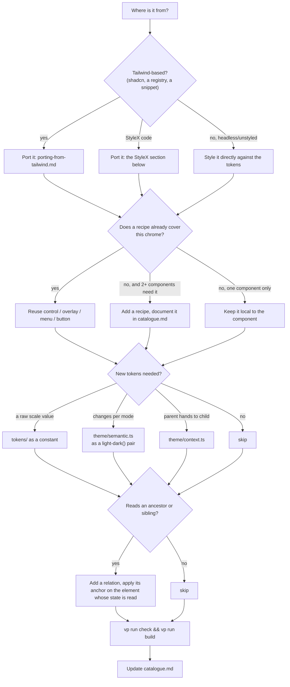
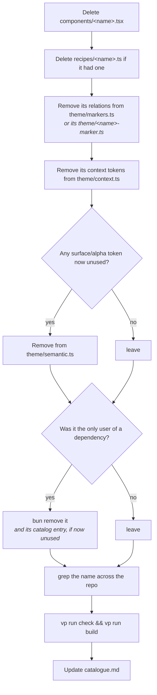
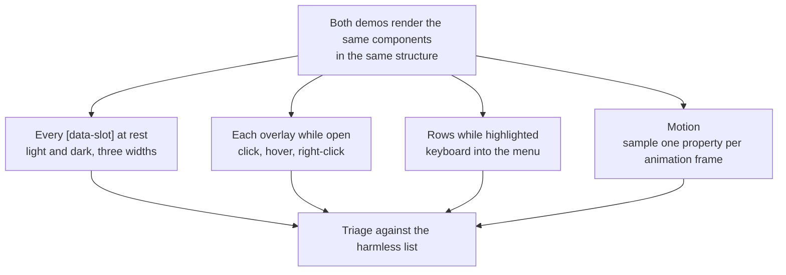
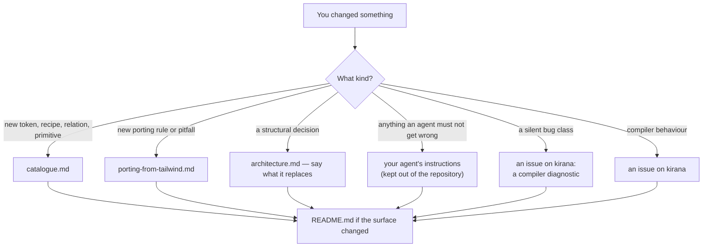

# Workflows

## Adding a component



Concretely, for a component that arrives as Tailwind:

1. **Read the classes before writing anything.** Sort them into self-state,
   ancestor, descendant and sibling. That sort decides the whole shape.
2. **Check the catalogue.** Most chrome already exists. A new popup is
   `overlayStyles` + `menuStyles`; a new field is `controlStyles.field`.
3. **Swap the dependencies.** `cn` → `sx={[…]}` on elements and
   `{...styleProps(…)}` on Base UI parts, `cva` → `recipe()`, `lucide-react` →
   `@hugeicons/core-free-icons` via the `Icon` primitive, `@/components/ui/x` → a
   relative import, `className` → `sx`.
4. **Read the compiler's diagnostics.** `vp run build` prints them, and
   `bunx kirana-style check ../../packages/ui/src src` from an app's folder (so it
   reads that app's `kirana.config.ts`) lists every one with its source line. Errors fail the build; warnings name
   real risks (`ambiguous-precedence`, `mixed-logical-physical`,
   `sx-on-external-component`). `unresolved-import` means an import did not
   resolve — usually dependencies are not installed — so every token behind it
   compiled as a runtime value.
5. **Verify against the source** if one exists, with the computed-style diff
   below.
6. **Give a registry component its page.** Port upstream's `<item>-demo` on every
   base it has (`registry/bases/<base>/examples`, listed in that base's
   `previews.ts`), and write `apps/site/content/docs/components/<item>.md`:
   upstream's page for that component, section for section (its preview, an
   `installation` embed, usage, composition, every example with its docs demo,
   the API reference), from its `base` and `aria` copies, with Kirana's own words
   only where Kirana differs (`sx` for `className`). Upstream's docs demos
   (`apps/v4/examples/<base>/`) port as a block's cards do (`kirana-style migrate
   tailwind`, "Adding a block"), wrapped in the preview's frame (`page.example`);
   each preview's code panel then comes from the builder (`/r/demos/<item>.json`),
   with no step of its own. The `installation` embed is
   both CLIs and the manual steps, with every file the item installs. That one
   file is the
   component's page for every framework and base it has: list them in its
   frontmatter, `variants: [react/base, react/aria, vue/ark]`, in the order
   `apps/site/src/lib/variants.ts` gives (the content generator fails when they
   differ from the frameworks the registry has markup for), and the generator
   writes a page for each, at `/docs/components/<framework>/<base>/<item>`. Say
   where they differ:
   - `<!-- ::start:only react/base,react/aria -->` … `<!-- ::end:only -->` for
     a passage only some variants have (shadcn/ui's CLI is React's, a note is
     one base's);
   - a `tabs` block whose headings are variant labels (`### Base UI`, `### Vue`,
     or several sharing code, `### Base UI, React Aria, Solid`) for the usage:
     each page keeps its own section;
   - an embed's `combinations="…"` for the variants it can show: a preview whose
     demo a framework lacks is left off that framework's page;
   - and for a variant that differs throughout, an override beside the source,
     `components/<item>/<framework>-<base>.md`, which is that page whole.

   Link a component by the URL its variants share, `/docs/components/<item>`:
   every link to it leads to the reader's framework, and the URL itself
   redirects to the default.

If the component needs a library that is not installed, install it — but check
first whether it is really needed. Versions shared by more than one workspace
live once, in the Bun catalog in the root `package.json`
(`"workspaces": { "catalog": { … } }`), and each workspace lists them as
`"catalog:"`. A library only one workspace uses stays a plain version in that
workspace's own `package.json`.

### Porting a component written for StyleX

Blocks, examples, the shell and all of `packages/ui` were ported from a StyleX
port of the same apps, with the passes that are now Kirana's own codemod. Run it
over directories or single files; it prints a diff and a report, and `--write`
applies it:

```bash
bunx kirana-style migrate stylex <dir>            # create → css, defineVars → defineTokens, markers → relation, …
bunx kirana-style migrate stylex <dir> --write
```

`bunx kirana-style migrate tailwind` does the same for Tailwind class strings.
Then build, read the diagnostics, and run the conformance comparison for every
app the code appears in; the table in
[Porting from StyleX: what the merge changes](#porting-from-stylex-what-the-merge-changes)
lists what the codemod cannot see. The script drops StyleX's `default: null` entries
rather than mapping them to `base: null` (which removes an earlier value). A
component that used a StyleX workaround — closed breakpoint ranges, a `null`
default beside a custom-property condition, props picked in JavaScript to dodge
the unlayered group — keeps working; simplify it only with a conformance run.

### Adding a block

A block is ported into `registry/bases/<base>/blocks/<name>/` for each React base (`page.tsx`, its
parts in `components/`), as `login-01` and `sidebar-07` are. Then, once:

1. its title, description and upstream's categories in `registry/blocks.ts`, which the builder
   writes into the registry's item and `/blocks` reads, so its category's page lists it and the
   category joins the blocks navigation with its first block;
2. its entry in `packages/builder/src/items.ts` (its files per combination), and in each base's
   `previews.ts`, which gives it its preview page, the frame `/blocks` shows;
3. `vp run registry`, `vp run build` (the preview page and the category page are prerendered),
   and `vp run conformance -- --pages <name> --styles all` against upstream's site.

A block of many cards (`preview`, `preview-02`) is ported with `kirana-style migrate tailwind`, from a
scratch folder whose `kirana.config.mjs` adds `@kirana-style/preset-scales/preset` and points
`utilities.scales.color` and `radius` at `registry/core/tokens.ts`'s `theme` and `radius`, and
`utilities.variants` at the eight `style-*` conditions. Its output then needs what Tailwind's
cascade does and Kirana's per-entry merge does not:

- a card's style on a registry component replaces that component's value in every style, so each
  property but the colours is `{ "*": null, base: … }` (upstream's per-style rules sit in
  `@layer base`, under every utility);
- under a card's `text-*`, a component keeps its own line height in the styles where it sets
  `leading-*` (Tailwind's `--tw-leading`) and takes the size's where its line height comes with its
  size: read it per style from upstream's `registry/styles/style-*.css`;
- `p-*`, `m-*` and `inset-*` are the shorthands, a gradient is a `backgroundImage`, `border` needs
  no `borderStyle` (the reset's is `solid`), and the composition variables (`compose[…]`) resolve
  to the values a hand port writes;
- an upstream custom property a component reads through a context (`--cell-size`) is the context's
  key (`calendarCtx.cellSize`), and Recharts becomes TanStack Charts by hand.

What the codemod should do itself is logged for Kirana.

### Adding a chart

A chart is ported from upstream's `registry/new-york-v4/charts/<name>.tsx` (the one place upstream
has its charts) into `registry/bases/<base>/charts/<name>.tsx` for each React base, on TanStack
Charts: a `defineChart` definition beside the card, as `chart-area-default` and the others are. A
config colour is a token (`theme.chart1`); Recharts' angles start at 3 o'clock and turn
counter-clockwise, TanStack Charts' at 12 and clockwise, so a pie or radial chart starts at
`Math.PI / 2` and ends at `Math.PI / 2 - Math.PI * 2`. Then, once:

1. its title, description (the file's own `description`) and type in `registry/charts.ts`, which
   the builder writes into the registry's item and `/charts/<type>` reads;
2. its entry in each base's `previews.ts`, the frame the charts page shows;
3. `vp run registry`, `vp run build`, and `vp run upstream -- accept` for its stamp.

## Removing a component



The checklist, in grep form:

```bash
NAME=drawer
grep -rn "$NAME" packages/ui/src apps/site/src  # imports, re-exports, demo usage
grep -rn "${NAME}Marker" packages/ui/src/theme/
grep -n "${NAME}Ctx\|${NAME}" packages/ui/src/theme/context.ts
```

Unused constants and tokens cost nothing in the stylesheet — Kirana emits only
what a compiled style references — but they are still a second name for nothing.
An anchor left applied with no reader is the `relation-unused` warning; a reader
left with no anchor is the `relation-without-anchor` error.

**What is exclusive and what is shared.** Safe to delete with the component:

- its own `recipes/<name>.ts`
- relations named after it (`drawerPopupMarker`)
- context tokens named after it (`drawerCtx`)

Not safe without checking — these are shared:

- anything in `tokens/` (the vocabulary, not per-component)
- `theme` and `alpha` tokens
- `surface` tokens — named by intent, not by component. Grep before removing
- `recipes/control`, `overlay`, `menu`, `button-group`, `recipe`
- everything in `primitives/`

## Verifying a port

Screenshots miss a pixel of line-height, a wrong easing curve, and a variant that
quietly dropped a state. Compare computed styles instead.

### The conformance harness

The harness lives in [kirana-lab](https://github.com/kirana-style/kirana-lab)
(`packages/harness/conformance`), beside the baselines it compares with: the
StyleX port (`baselines/stylex`) and the Tailwind original
(`baselines/tailwind`) of the apps in this repository. It compares every route
of the demo, blocks and examples, element by element, in Chrome through
Playwright. The full method, what to prepare and how to read a report are in its
README; from a kirana-lab checkout:

```bash
bun run conformance --app examples --serve           # web | blocks | examples
bun run conformance --app web --serve --states       # overlays, menus, hover, focus
```

kirana-lab's Kirana corpus started as a copy of this repository's apps. To check a
change made here, copy the changed files into the corpus first.

It walks every `[data-slot]` element, portals included, at 1400, 900 and 390px in
light and dark, and reads the property list below plus `::before` and `::after`.
The run passes when Kirana renders like the StyleX port, except where it renders
like the Tailwind original instead (the port was wrong there); against the
original, only differences the port does not share count. When the apps moved
out of the Kirana repository: 0 unexpected differences on 189 routes, with 82
corrections where Kirana matches the original and the StyleX port did not.

Colours are normalised by letting the browser convert them to one space: set
`background-color: color-mix(in srgb, <colour> 100%, transparent)` on a probe
element and read the computed value back. A canvas `fillStyle` does **not** work
in current Chrome: it keeps `lab()` and `oklch()` strings as written.

### What to compare

The page at rest is only half of it. Most of the bugs found in the ported
components only showed up in a state.



The harness covers pages at rest and, with `--states`, 20 interactive states on
any route that has their trigger: overlays open, highlighted rows, menus, hover,
focus and a toggled sidebar. Motion is still checked by hand (tracked in the
implementation tracker). Read more than box
and colour. A sweep that compared layout, spacing, colour and type at 1400px still
missed six visible bugs, each in a property it never read:

| Missed property                     | What it hid                                                        |
| ----------------------------------- | ------------------------------------------------------------------ |
| `text-wrap`                         | field descriptions balanced where the original wraps normally      |
| `text-decoration-line`              | links inside field, empty and item descriptions lost the underline |
| `border-style`                      | three Empties drew solid where the original is dashed              |
| `::after` position, on hover        | the sidebar rail's edge line, and the drawer bleed's side          |
| an open menu's offset and min-width | the menubar menu sat 4px off and 48px narrower                     |

Text-wrap differences also need a tight width to show.

Also compare bounding boxes: each card's position and size, and every slot's
position relative to its card. A computed-style diff only sees the properties you
list, and it missed an avatar sitting 4px low because `align-self` was not on the
list.

For motion, sample a property with `requestAnimationFrame` right after the
trigger and compare the sequences. Expect the port to start overlay motion one
frame later: Base UI needs one frame in `data-starting-style` before a transition
can run, while the original's keyframes start on mount.

When the original itself is wrong, fix the original.

### Against shadcn/ui's own site

The registry's preview pages are compared with the same pages on shadcn/ui's
site, a production build of its `apps/v4` at the manifest's commit (`next
build` once, then `next start` on port 4000, from a clone of shadcn/ui kept for
it), by the same harness in URL-pair mode: each route is loaded from both sites, with the
expected site's path rewritten. `scripts/conformance.ts` compares only the
pages a run names, on both React bases: `vp run conformance -- --pages
tabs-example,login-01`, in Nova and at rest unless `--styles lyra,sera` (`all`
for the eight) and `--states` ask for more. A page an earlier run compared is
not compared again unless the change concerns it. `vp run conformance:pr`
(`--changed`) keeps the pages whose own sources reach a file changed since
`origin/main`, and stops when more than eight do, so a run names the ones the
change concerns instead; `--all` is the whole matrix, for a change that truly
reaches every page. It needs the site's Worker on 8787, upstream's site on 4000
and a kirana-lab checkout beside this repository (`KIRANA_LAB` otherwise);
`--shard 1/3` splits the routes, `--list` prints them. Upstream's captures are kept between runs
(`node_modules/.cache/kirana-ui-conformance/upstream-<pin>`), so its server is
needed only for a page not captured yet. A difference not in
`conformance/expected-differences.json` fails it; each entry there says why it
is not a bug. One route by hand:

```bash
bun conformance/compare.ts --actual http://localhost:8787 --expected http://localhost:4000 \
  --label upstream --expected-path "/preview/react/=/preview/" \
  --group '[data-slot="example"]' \
  --paths "/preview/react/base/button-example?preset=b0" [--states]
```

- **Name the design by preset code.** Upstream's preview reads `?preset=` (`b0`
  by default) over any axis parameter, so `?style=lyra` still shows Nova there.
  Each style's code is upstream's own `encodePreset({ style })`: Nova `b0`, Vega
  `bIkeymG`, Lyra `buFywKm` (upstream rewrites it as `buFywLo`, with Lyra's
  radius), Maia `bbVJxYW`. The site reads the same codes.
- **Upstream's examples are ported with their layout**, in
  `components/example.tsx`'s frame. `--group` pairs elements within each titled
  example rather than across the page, so a section whose components do not exist
  yet is left out and reported once, by its title, instead of shifting every pair
  after it.
- **React Aria's `DialogTrigger` and `MenuTrigger` render no element**, so the
  harness's `dialog-open` and `dropdown-open` states find no trigger slot there:
  name it, `--trigger 'dialog-open=[data-slot="example-content"] button'`. A state
  neither page reaches is skipped without a word, so check that each one ran.

On the slice (`button-example`, `dialog-example`, `select-example`,
`dropdown-menu-example` and `login-01`, on Base UI and React Aria, in Nova and
Lyra, at rest and in every state), nothing differs beyond these, each reviewed:

| Difference                                               | Why                                                                                                                                                                                                                                                                                                                                                                                                                                                                                                        |
| -------------------------------------------------------- | ---------------------------------------------------------------------------------------------------------------------------------------------------------------------------------------------------------------------------------------------------------------------------------------------------------------------------------------------------------------------------------------------------------------------------------------------------------------------------------------------------------- |
| `font-family`                                            | Next.js's `next/font` names Inter `Inter, "Inter Fallback"` ahead of the shared `"Inter Variable"`; the same face, as every width shows                                                                                                                                                                                                                                                                                                                                                                    |
| `transition-property`                                    | `transition-all` is written as the properties that change                                                                                                                                                                                                                                                                                                                                                                                                                                                  |
| `span[data-slot="button-label"]`                         | Button trims its text to its capitals in a label element                                                                                                                                                                                                                                                                                                                                                                                                                                                   |
| The line height of FieldLabel and of Nova's small Button | upstream's site and the copy its CLI installs disagree: the site's stylesheet keeps a line height that `cn` drops from the installed classes. The registry follows the installed copy                                                                                                                                                                                                                                                                                                                      |
| `scale: 1` and `translate: 0px` against `none`           | a dialog or popup at rest after its transition, where upstream's keyframes leave none                                                                                                                                                                                                                                                                                                                                                                                                                      |
| `text-align: start` against `left`                       | the same in left-to-right text, and what upstream's right-to-left install writes                                                                                                                                                                                                                                                                                                                                                                                                                           |
| The select value's `text-overflow`                       | upstream's `line-clamp-1` is written as an ellipsis on one line: the same drawing, computed as `ellipsis` where line-clamp leaves `clip`                                                                                                                                                                                                                                                                                                                                                                   |
| A toast viewport                                         | upstream's preview page mounts its toaster around every item                                                                                                                                                                                                                                                                                                                                                                                                                                               |
| The heights of examples, and React Aria popups' `bottom` | an example stretches to its grid row and a React Aria popup is placed from the page's end, so both move where a section is left out; what is inside is compared one by one                                                                                                                                                                                                                                                                                                                                 |
| A closed select popup's `max-height`                     | Base UI mounts it ahead, 0×0: version 1.9 gives it the available height, upstream's 1.6 none                                                                                                                                                                                                                                                                                                                                                                                                               |
| The pages' left-out sections                             | each is named in the exceptions by its title (`Area Chart › `), with what it waits for                                                                                                                                                                                                                                                                                                                                                                                                                     |
| A chart's drawing                                        | upstream draws with Recharts, the registry with TanStack Charts: the harness compares the chart's box, and the drawing is checked apart (bar, tick and grid colours, the tooltip in every style). Two differences there are on purpose: the month labels are the muted foreground, where upstream's `[&_.recharts-cartesian-axis-tick_text]` no longer matches Recharts 3's tick classes and leaves them `#666`; and a tooltip's figures are Tailwind's `font-mono`, where upstream's site sets Geist Mono |
| A highlighted React Aria menu row's background           | upstream's React Aria menus always carry `cn-menu-translucent-aria`, which its menu-colour switch never removes, so their rows highlight translucent in the default colour. Ours follow the menu colour, as Base UI's do upstream                                                                                                                                                                                                                                                                          |
| sidebar-07's avatar                                      | the block's `/avatars/shadcn.jpg` is a picture upstream's site serves and the site does not, so the avatar shows its fallback                                                                                                                                                                                                                                                                                                                                                                              |
| The sidebar collapsed to icons                           | upstream's bug: its sub-list stays drawn, a 12px stub with its border under the first section, because the style file's `group-data-[collapsible=icon]:hidden` loses to the component's own `flex`. Ours hides it, as the rule means; the heights above it follow                                                                                                                                                                                                                                          |
| The header separator of sidebar-07 on React Aria         | upstream's bug: the page's `data-vertical:h-4 data-vertical:self-auto` never holds on React Aria, whose separator writes `aria-orientation`, so it stretches to the header's height there. Ours is 1rem tall on both bases, as on Base UI upstream                                                                                                                                                                                                                                                         |

The first run found a real bug: Button gave a lone `" "` child (`Default{" "}`
before an icon) a label of its own, an empty flex item one gap wide. Adjacent
strings are now one label, and white space alone stays bare text, which the flex
container drops. The select and dropdown examples found two more port slips: a
select trigger inside a vertical Field stayed as wide as its text, where
upstream's `*:w-full` fills the field (the trigger, and React Aria's root, take
`fillInField` now); and the shared menu separator ignored the pointer, which only
upstream's select separator does.

### Following upstream

`upstream/shadcn.json` records, for every item ported from shadcn/ui (its
components, the examples and the blocks), the upstream commit it was ported
from and the hash of every unit: each upstream file, and each `cn-*` hook's rule
in every style file the registry carries. It also says where each hook went,
read from the comment that names it in a style module (`// cn-field-set` above
`set: css(…)`), and which hooks were dropped and why.

```bash
vp run upstream -- scan [--ref main]     # upstream/report.md: what changed since
vp run upstream -- accept [<item>…]      # stamp items at a commit, once ported
```

The scan lists each changed unit, a changed class list as the utilities it adds
and removes with a draft of the added ones in Kirana's syntax (Kirana's own
Tailwind lowering, a suggestion never written into a source), the items not
stamped, the hooks with no place, and upstream's components and styles not
ported yet. `accept` refuses an item with a hook that has no place: name the hook
in a comment where its values live, or give it a reason under `dropped`. Both
read upstream through git: `--repo <path>` (or `UPSTREAM_REPO`) names a checkout,
and without one a blobless clone is kept in `node_modules/.cache/upstream`.

### Porting from StyleX: what the merge changes

The conformance run over blocks and examples found every class of difference
below; each is a StyleX habit that Kirana's per-entry merge turns into a bug.

| StyleX habit                                                                                         | Why it breaks                                                                                                              | Kirana form                                                                                                  |
| ---------------------------------------------------------------------------------------------------- | -------------------------------------------------------------------------------------------------------------------------- | ------------------------------------------------------------------------------------------------------------ |
| A caller writes a plain value to override a component (`alignSelf: "auto"`, `width: "auto"`)         | StyleX replaced the whole property; Kirana replaces only the base entry, and the component's conditional entries still win | write it under the component's condition, as the original did: `{ '[data-orientation="vertical"]': "auto" }` |
| A control drops its own chrome with plain values (`boxShadow: "none"`)                               | the Input's `aria-invalid` and grouped-item entries survive                                                                | `{ "*": null, base: "none" }` drops every entry                                                              |
| "1px except `:last-child`" for Tailwind's `not-last:`                                                | the `:last-child` entry beats a caller's plain value                                                                       | write the original condition: `{ ":not(:last-child)": "1px" }`                                               |
| A responsive custom property split across parent and child (narrow on the parent, wide on the child) | a component's own default beats what it inherits                                                                           | both values on the element that reads it: `{ base: a, [breakpoint.md]: b }`                                  |
| States restated beside an override ("an sx value replaces the whole property")                       | redundant, and the restated entries tie with the override                                                                  | write only the override                                                                                      |
| A wrapper spreads its props onto a Base UI part or an element (`<form {...props}>`)                  | `sx` rides inside the spread and never compiles                                                                            | take `sx` out and pass it on; the compiler reports it (`sx-on-external-component`)                           |
| `stylex.types.*` for an animatable custom property                                                   | —                                                                                                                          | a registered token: `{ value: "0px", syntax: "<length-percentage>" }`                                        |

### Keep the demos in step

`apps/site/src/components/demo.tsx` (the site's `/demo`) here and in kirana-lab's `baselines/stylex`
and `baselines/tailwind` are the same page: same cards, same data arrays, same
components in the same nesting. That is what makes a slot-by-slot diff meaningful. When you add a
component to one, add it to the others in the same shape.

Expect these to differ harmlessly:

| Difference                                                            | Why                                                                             |
| --------------------------------------------------------------------- | ------------------------------------------------------------------------------- |
| `border-*-color` where border width is `0`                            | Tailwind's reset set a global border colour; this project deliberately does not |
| `box-shadow` with extra `rgba(0,0,0,0) 0 0 0 0` layers                | Tailwind's empty `--tw-*` shadow slots                                          |
| `flex-start` vs `start`, `gap: normal` vs `0px`                       | Equivalent keywords                                                             |
| Sub-pixel `height` / `gridTemplateRows`                               | Line-height rounding                                                            |
| A `0 0 0 0` shadow layer in a real colour on inputs and switch thumbs | Tailwind's unused ring slot, still a colour but zero size                       |
| An extra `data-slot` on `InputGroupText`                              | The port names the slot; the original did not                                   |
| `filter: brightness(1) grayscale(1)` against `grayscale(1)`           | The port always writes the theme's brightness factor                            |
| Bounding boxes of a `Spinner`, opacity of a `Skeleton`                | They are animating; the frame decides                                           |
| Width of a visually hidden label inside a vertical Field              | Clipped either way; the port caps it at 1px                                     |
| `transition-property: all` against an enumerated list                 | See below: the port named the properties the original left to `all`             |

Anything else is a real difference.

### `transition-all`, and what the port did with it

Comparing transitions (added 2026-09-22) took the inherited count on the demo from 96 to 504, and
they are all one thing: shadcn writes `transition-all` on its interactive components, and the port
replaced it with the properties those components actually animate.

```
button   original  transition-property: all
         port      color, background-color, border-color, box-shadow, translate
badge    original  all
         port      color, background-color, border-color, box-shadow
switch   original  all
         port      background-color, border-color, box-shadow
```

Both ports agree, so nothing here is Kirana's doing, and the harness counts them as inherited rather
than as differences of ours. It is still a behaviour difference and worth knowing which side you
want: `all` animates every animatable property, including the layout ones, so a component whose
padding or size changes with a state animates that change in the original and snaps in the port.
The enumerated list is the safer default and the less faithful one. Restoring `all` is a one-line
change per component if fidelity is the goal; leaving it is a deliberate improvement, and this
paragraph is here so it stays deliberate.

For a quick look rather than a diff, open the page with `vp run dev`.

## Static checks

`vp run check` runs Oxfmt, Oxlint with the Kirana rules, and the TypeScript type
check (tsgolint) across the workspace, from the `fmt` and `lint` blocks of the
root `vite.config.ts`. The compiler is installed from npm with its native engine,
so nothing needs building first.

The design system's bug classes are compiler diagnostics now, not a script:

| StyleX-era check                                 | Kirana diagnostic                                              |
| ------------------------------------------------ | -------------------------------------------------------------- |
| markers read but never applied, or the reverse   | `relation-without-anchor` (error), `relation-unused` (warning) |
| a relationship query on the wrong element        | `relation-placement` (error), within one JSX tree              |
| breakpoints outranking variants beside them      | the ladder: state conditions beat at-rules                     |
| an unlayered custom-property default             | nothing to check: every rule is layered                        |
| `sx` in a file that never imports the compiler   | nothing to check: `sx` compiles in any module                  |
| `defineVars` defaults reading a library variable | `variable-default-scope` — catalogued, not implemented yet     |

The lint plugin (`@kirana-style/eslint-plugin`, loaded by Oxlint in `vp run check`)
catches the classes the compiler cannot, because they are about how source is
written rather than what it compiles to:

| Bug class                                                                | Rule                               |
| ------------------------------------------------------------------------ | ---------------------------------- |
| a plain override losing to a component's `[data-*]` entry (StyleX habit) | `kirana/override-keeps-conditions` |
| a forwarded `sx` that is not last, so callers cannot override            | `kirana/sx-last` (autofix)         |
| `className` given to a component that reads `sx`                         | `kirana/no-classname-on-sx`        |
| `className` or `style` beside `{...styleProps()}`                        | `kirana/no-conflicting-props`      |
| a styles-object key or recipe option nothing applies                     | `kirana/no-unused`                 |
| every compiler diagnostic, so lint alone fails on what the build would   | `kirana/diagnostics`               |

The rules read the compiler, which comes with its native engine from npm. A tool
run inside `packages/ui` reads `packages/ui/kirana.config.ts`, which exports the
same `uiConfig` the apps spread, so it sees the exclusive pairs too. For the same
answers while editing, install the Kirana extension (VS Code Marketplace or Open
VSX, `kirana-style.kirana`), which runs this project's own `kirana-style lsp`.

### Compiler warnings

`vp run dev` and `vp run build` print each warning once, as
`file:line:column`. Warnings never change the output; they point at styles whose
result depends on something the author did not state:

| Warning                  | Means                                                                                                                       | Do                                                                                                                                      |
| ------------------------ | --------------------------------------------------------------------------------------------------------------------------- | --------------------------------------------------------------------------------------------------------------------------------------- |
| `ambiguous-precedence`   | two entries for one property, with different values, tie on the ladder and can match together; text order decides           | nest the one that should win inside the other; when the library never sets both (`data-open` / `data-closed`), declare the pair (below) |
| `mixed-logical-physical` | a logical and a physical longhand of one side are both set and the result can mislead: same breadth, or a later write loses | use one family, or write the narrower one last (`padding`, then `paddingInlineEnd`)                                                     |
| `unsplittable-shorthand` | a shorthand whose value cannot be split per side stays whole                                                                | only a problem if a later style removes one side; write the longhands then                                                              |
| `unresolved-import`      | an import did not resolve, so everything behind it compiled as a runtime value                                              | `vp install`, or fix the specifier or tsconfig `paths`                                                                                  |

Pairs the compiler can prove never match together (`[data-size="sm"]` /
`[data-size="lg"]`, `X` / `:not(X)`, `:last-child` / `:nth-last-child(2)`),
pairs that set the same value, and pairs resolved by nesting do not warn.
Attributes a library never sets together are declared once in
`packages/ui/src/kirana.ts` (`conditions.exclusive`), which every app spreads
into its `kirana.config.ts`; add a group there when a component reads a new
pair. Check the Tailwind original before picking a winner: its compound variants
(`data-ending-style:data-swiping:`) say which state was meant to win, and twice
the tie-break had silently picked the other one. Any change made to silence a
warning still goes through the conformance run.

To hide or promote a warning project-wide, re-level it in the app's
`kirana.config.ts` (errors cannot be re-levelled):

```ts
export default defineConfig({
  ...uiConfig, // import { uiConfig } from "@workspace/ui/kirana.ts"
  layers: { before: ["reset", "base"] },
  diagnostics: { "ambiguous-precedence": "off" }, // "off" | "info" | "warning" | "error"
})
```

`kirana({ reportInfo: true })` in the Vite config also prints `info`
diagnostics. The same keys work as `kirana({ config: { diagnostics: … } })`.

When a new silent bug class turns up, it becomes a diagnostic in the compiler
with a fixture, never an ad-hoc script: open an issue on
[kirana](https://github.com/kirana-style/kirana) with a reproduction (the
diagnostic catalogue is in its `spec/10-compiler-architecture.md`).

Oxlint treats `no-shadow` and `prefer-for-of` as errors. Shadowing bites harder
here than usual: a local `theme` or `spacing` state hides the design token of the
same name for the rest of the function. Name the inner binding for what it holds
(`themeMode`, `child`, `option`, `rows`).

## Performance

Kirana's output is atomic and deduplicated, so CSS size plateaus as the codebase
grows. The things that actually cost bytes here:

| Lever                                   | Effect                                                                                                                                                                                                          |
| --------------------------------------- | --------------------------------------------------------------------------------------------------------------------------------------------------------------------------------------------------------------- |
| Constants over variable tokens          | Constants are inlined and emit nothing. A variable token emits one custom property when a compiled style references it                                                                                          |
| Lookup tables in `primitives/styles.ts` | Every entry is compiled into the stylesheet once its module is — a fixed, shared cost. Keep the vocabulary narrow                                                                                               |
| Shorthands                              | A single-component box shorthand is one rule (`padding: spacing[4]`); a multi-component one expands (`border: "1px solid …"` is 12 atoms). Prefer `borderWidth`/`borderStyle`/`borderColor` with one value each |
| Dynamic values                          | `css({ width: \`${n}%\` })` bridges through one custom property; a fixed set of values belongs in a lookup table                                                                                                |

[kirana-lab](https://github.com/kirana-style/kirana-lab) measures build time and
the client CSS and JavaScript sizes of these apps against the StyleX and Tailwind
baselines for every Kirana release, and publishes the results as releases of its
own. When the apps were measured in the Kirana repository: Kirana built the demo
in 1.6 s against StyleX's 3.4 s and Tailwind's 1.7 s; its CSS was 17.2 kB gzip
against StyleX's 17.6 kB, and its client JavaScript 7 kB gzip smaller.

**Budgets.** `vp run budgets` (`scripts/budgets.ts`, in `prepush` and CI) measures the built
site against `budgets.json`: each page's JavaScript and stylesheets, gzip at level 9, as its
prerendered HTML loads and preloads them (home, a docs page, `/create`, `/blocks`, `/charts`, `/colors`, a React preview page),
Kirana's compiled stylesheet for the site, the React and Vue previews' own, and the registry's files against the Worker's
static file limits. Each entry says why it has its budget; `measured` is the last build's value,
written with `bun scripts/budgets.ts --write`. A budget changes only in the pull request that
explains why. What keeps a page under its budget: code that only some readers need loads on
demand (the search dialog and cmdk on first open, the home page's chart card in its own chunk).

Runtime cost is the 1 kB private runtime merging class strings where something
is only known at render time — a prop's `sx`, a spread `className`, a bridged
value. A static `sx` with nothing else to merge compiles to a constant
`className`.

## Keeping this true



Nothing here is settled. If you find a better organisation, take it — and update
these documents in the same change so the next person inherits the better one.
